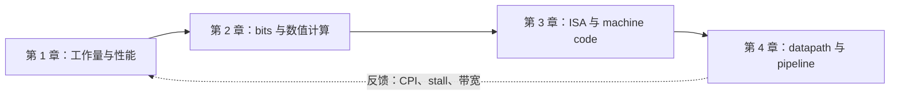

# Overview and Performance Evaluation

> [!abstract] 本章要解决的问题
> 为什么“频率更高、核心更多、制程更先进”都不必然意味着程序更快？分析时需要沿着“程序做了多少工作 → 每条指令花多少时间 → 哪些工作能够重叠 → 哪些部分仍然拖慢整体”逐层追踪。

> **本章学习结果：**读完后，你应该能用自己的话解释 latency 和 throughput 的区别，用 `CPU Time = IC × CPI × Clock_time` 比较两台机器，并用 Amdahl's Law 说明为什么并行加速会遇到上限。你不需要先记住所有硬件名词；先能回答“时间花在哪里”就够了。

> Course notes（以 English technical terms 为主，中文补充理解）
>
> 本章对应 `CA_1.pdf` 的 Chapter 1。主线是：计算机性能为什么能持续提升、现代计算机如何分层、并行计算为什么重要，以及怎样用公式公平地比较性能。

> **给零基础读者：**不需要先会电路设计。先理解“程序要做什么、硬件怎样执行、执行得多快”这三件事即可。读完后，你应能解释 computer system（计算机系统）的层次、区分 latency（延迟）和 throughput（吞吐量）、用 CPU time（CPU 执行时间）公式比较两台机器，并估算 parallelism（并行性）的上限。

### 本章先记住这条主线

```text
应用需求 -> 软件与 ISA -> processor / memory -> 电路与晶体管
    |                                           |
    +------ 性能由整个系统共同决定 <------------+
```

图中从需求到晶体管是逐层实现关系；评估性能时则要反过来追问：程序、处理器、存储和功耗分别造成什么影响。

### 本章的动机梯度

初学者先把问题想成一句话：**为什么“更快的芯片”不一定让程序更快？**

1. 程序的工作量、data movement、等待时间和并行程度可能不同；
2. 因此不能只看 transistor 数量或 clock rate；
3. 需要用 abstraction、parallelism、memory hierarchy 和 performance equation 分别定位瓶颈；
4. 最后再从 hardware、compiler、system 和 energy 角度判断哪种优化值得做。

这条梯度会在每一节重新落到具体问题上：制程为什么受 power 限制、parallelism 为什么受 serial fraction 限制、性能比较为什么必须同时看 `Instruction Count`、`CPI` 和 `Clock Rate`。

### 性能分析的四步方法

比较两台机器时，先检查下面四项，不要只看 GHz：

1. **工作量一样吗？**程序执行的 `Instruction Count` 是否相同？编译器、ISA 或算法可能让两台机器执行不同数量的 instruction。
2. **每条 instruction 一样贵吗？**平均 `CPI` 是否相同？cache miss、branch、浮点运算和流水线停顿都会改变它。
3. **一个 cycle 多久？**`Clock_time` 越短，单个 cycle 越快；但更高频率可能带来更深流水线、更高功耗和更多误预测代价。
4. **有没有等待没有算进去？**CPU time 不等于用户看到的 elapsed time；I/O、同步、通信和负载不均衡可能成为真正瓶颈。

因此，“频率越高越快”并不是可靠结论。性能是工作量、处理效率和等待共同作用的系统结果。

### 本章分层术语 roadmap

```text
Level 0  系统对象（第 1–2 节）
  computer system（计算机系统） -> application（应用程序） -> software（软件） -> hardware（硬件）
      |
Level 1  接口与实现（第 3–4 节）
  ISA（指令集架构） -> processor（处理器） -> microarchitecture（微架构） -> memory hierarchy（存储层次结构）
      |
Level 2  性能量（第 5–6 节）
  latency（延迟） -> throughput（吞吐量） -> instruction count（指令数） -> CPI（每指令周期数） -> clock rate（时钟频率）
  -> CPU time（CPU 执行时间） -> speedup（加速比）
      |
Level 3  性能上限与工程权衡（第 7 节以后）
  parallelism（并行性） -> serial fraction（串行部分比例） -> Amdahl's Law（阿姆达尔定律） -> power/energy（功耗/能量）
```

| 到达哪一层 | 学习检查 |
|---|---|
| Level 0 | 能说明程序工作如何落到硬件执行 |
| Level 1 | 能区分 ISA 的外部 contract 与 microarchitecture 的内部实现 |
| Level 2 | 能用 CPU time 公式比较两台机器 |
| Level 3 | 能解释增加并行单元为什么会遇到收益上限 |

### Reference glossary（查阅用，不是先修要求）

| Term | 它是什么 | 读到它时要关注什么 |
|---|---|---|
| `ISA（Instruction Set Architecture，指令集架构）` | 软件可以看到的 instruction interface | processor 能执行什么，以及软件如何调用它 |
| `Microarchitecture（微架构）` | 实现 ISA 的内部结构 | pipeline、cache、execution unit 如何配合 |
| `Latency（延迟）` | 一个任务从开始到完成的时间 | 单个请求是否响应得快 |
| `Throughput（吞吐量）` | 单位时间完成的任务数量 | 系统整体每秒能处理多少 |
| `Instruction Count (IC，指令数)` | 执行的 instruction 总数；本章不要和 `Integrated Circuit（集成电路）` 的 IC 混淆 | 程序和 compiler 让工作量变多还是变少 |
| `CPI (Cycles Per Instruction，每指令周期数)` | 平均一条 instruction 需要的 cycles | processor 执行每条指令的效率 |
| `Clock rate（时钟频率）` | 每秒产生多少 clock cycles | 只能作为 CPU time 的一个因素，不能单独代表性能 |
| `Speedup（加速比）` | 改进前时间除以改进后时间 | 新系统到底快了几倍 |
| `Amdahl's Law（阿姆达尔定律）` | 用不可并行部分估计加速上限 | 增加 processor 后还剩多少收益 |

## 1. Course roadmap

本课程的章节顺序：

1. `Overview and Performance Evaluation`
2. `Representation and Computation of Data`
3. `Instruction Set Architecture (ISA)`
4. `Processor Design`
5. `Pipeline Processor`
6. `Superscalar Processor`
7. `Memory System`
8. `Data-level Parallelism`
9. `Thread-level Parallelism`
10. `Graphics Processing Unit (GPU)`

### 四章教材怎样连起来

本次教材先把前四章串成一条完整路径：

```text
第 1 章：系统为什么快、怎样量性能
        ↓
第 2 章：数据怎样变成 bits、ALU/FPU 怎样计算
        ↓
第 3 章：软件用什么 ISA instruction 告诉硬件做事
        ↓
第 4 章：processor 怎样用 datapath、pipeline 和 speculation 执行 instruction
```

对应笔记：[[2 Representation and Computation of Data]]、[[3 Instruction Set Architecture]]、[[4 Design of Processor]]。遇到陌生术语时沿箭头回看前一章，不要一开始就强记第 4 章的所有硬件名词。

推荐教材：Patterson & Hennessy, *Computer Organization and Design: The Hardware/Software Interface, RISC-V edition*。

![[assets/1 Overview and Performance Evaluation/CA1-07.png]]

上图是课件给出的课程地图。它不是要求现在全部学会，而是帮助你知道本章之后会逐步进入 `ISA`、processor、pipeline、memory 和 GPU。

### 教材式学习路径与可视化入口

> [!note] 在 Obsidian 中打开交互页
> 先点本表的 HTML 链接。若 Obsidian 没有交给 HTML Reader，而是显示源码或跳到外部浏览器，请从文件列表打开 `assets/1 Overview and Performance Evaluation/interactive/` 下对应的 `.html` 文件。页面显示但滑块无效时，检查 HTML Reader 的 `Operating Mode`：`Balance Mode` 不运行脚本；互动需要允许 inline script 的模式。较宽松模式会降低安全隔离，只对信任的本地教学文件使用。系统浏览器可作为备用。

本章不要从历史人物和术语表开始死记。建议沿着一条问题链学习：先问“系统完成了什么工作”，再问“怎样公平地测量它”，最后问“增加硬件为什么仍有上限”。下面的图是全课程的入口；每个箭头都表示下一章需要上一章提供的前置概念。



如果 Mermaid 在当前主题中没有渲染，仍可按这条文字链阅读：**程序需要完成什么工作 → 数据如何表示 → 软件怎样描述操作 → 硬件如何重叠执行**。

| 你想观察的问题 | 本章入口 | 观察重点 | 结果的边界 |
|---|---|---|---|
| 增加 processor 为什么不一定带来等比例加速？ | [[assets/1 Overview and Performance Evaluation/interactive/amdahl-explorer.html|Amdahl 交互探索器]] | 拖动可并行比例与 processor 数量 | 理想模型，不含通信、同步和负载不均衡 |
| CPU time 的三个因素和并行开销怎样共同影响时间？ | [[assets/1 Overview and Performance Evaluation/interactive/performance-audit-explorer.html|Performance audit explorer]] | 调节 IC、CPI、clock rate、串行比例、处理器数量和通信开销 | 理想模型，不是产品 benchmark |
| 课件中的数字怎样追溯？ | 本章末的案例索引与截图 | 先读正文推导，再看原始页 | 截图是课件证据，不替代解释 |

### 从 0 开始：先补齐四个基本对象

如果你还没有系统学过 computer architecture（计算机体系结构），先把下面四个对象分开。后文所有性能问题，都是它们一起作用的结果：

| 对象 | 它是什么 | 一个最小例子 |
|---|---|---|
| Program（程序） | 按顺序写好的操作描述 | `z = x + y` |
| Software（软件） | 程序、库和操作系统等可被修改的部分 | compiler 把 `z = x + y` 翻译成 instructions |
| Hardware（硬件） | 真正搬运 bits、计算和保存状态的电路 | register、ALU、memory |
| Workload（工作负载） | 系统实际要完成的一批工作 | 运行一个模型、处理 1 万个请求 |

程序员写的是“做什么”，硬件执行的是一条条 instruction（指令）。compiler（编译器）把较抽象的程序翻译成 processor 能执行的 instruction；processor 再通过 register、ALU 和 memory 完成这些 instruction。这样，性能不是“芯片型号”单独决定的，而是由程序需要多少工作、instruction 怎样生成，以及硬件每条 instruction 做得多快共同决定。

还要先认识三个时间单位：`second (s)` 是实际经过的时间；`cycle` 是时钟的一次节拍；`clock rate` 是每秒多少 cycles，和 clock period 互为倒数。若 clock period 为 `1 ns`，则 1 秒约有 $10^9$ 个 cycles。

一个最小性能例子：若程序需要 `100` 条 instructions，每条平均 `2` 个 cycles，clock period 是 `1 ns`：

$$
CPU\ time = 100 \times 2 \times 1\text{ ns} = 200\text{ ns}
$$

逐步看就是：100 条指令 × 每条平均 2 拍 = 200 拍；每拍 1 ns，所以 CPU 实际计算时间是 200 ns。若另一台机器频率翻倍（周期变为 0.5 ns），但因架构差异每条指令平均要 3 拍，则时间是 $100\times3\times0.5=150\text{ ns}$，只快 $200/150\approx1.33$ 倍，而非 2 倍。这就是不能只比较 GHz 的原因。

后面第 5 节会把这个例子推广为 CPU time equation。现在先记住：**instruction 数量、每条 instruction 的 cycles、每个 cycle 的时间，三者缺一不可。**

---

## 2. History of computers

**设计动机：**为什么要从 transistor（晶体管）、IC（集成电路）、process technology（制程技术）和 packaging（封装）讲起？因为计算机性能不是凭空出现的，底层制造能力决定了芯片能放多少 logic（逻辑电路）、memory（存储器）和 interconnect（互连）；但 transistor 变多之后，power（功耗）、cooling（散热）、yield（良率）和 cost（成本）又会成为新的限制。理解这条因果链，才能看懂后面为什么从单核频率转向 multi-core（多核）、accelerator（加速器）和 chiplet（小芯片）。

**工程师视角：**process engineer（制程工程师）关心 transistor 能否稳定制造；chip architect（芯片架构师）关心新增面积能否转化为 useful compute（有效计算能力）；system engineer（系统工程师）关心 memory 和 cooling 是否跟得上；产品工程师还要考虑 yield、成本和供应链。没有“只追求 transistor count（晶体管数量）”这一条单一目标。

### 2.1 From transistor to the semiconductor industry

#### Transistor and integrated circuit

- `Transistor（晶体管）` 是一种可以控制电流的微小电子开关。CPU、memory 等复杂硬件，本质上都是大量 transistor 组合而成。
- `Integrated Circuit (IC，集成电路)` 把大量 transistor、wire 和其他元件制造在同一块 semiconductor（半导体）上。
- `Silicon Valley` 的名字来自制造 transistor 和 computer chip 常用的 silicon。

技术发展线索：

```text
Bell Labs -> Shockley Semiconductor Lab -> Fairchild Semiconductor
         -> Intel / AMD 以及后来的大量 semiconductor companies
```

- 1948 年，John Bardeen、William Shockley、Walter Brattain 在 `Bell Labs` 的研究带来了 transistor effect；三人因 semiconductor research 获得 1956 年 Nobel Prize in Physics。Bardeen 后来在 1972 年再次获奖。
- Shockley 招募的一批年轻 PhD 中，八人于 1957 年离开并成立 `Fairchild Semiconductor`，后来被称为 `Traitorous Eight`。
- Fairchild 产生了很多后来的 semiconductor companies。
- `Intel` 于 1968 年由 Robert Noyce 和 Gordon Moore 创立，名称来自 `Integrated Electronics`。
- `AMD` 于 1969 年由 Jerry Sanders 创立。

这里的重点不是背公司年份，而是理解产业如何形成：基础研究、人才流动、创业和 manufacturing capability 互相推动。

### 2.2 Moore's Law and advanced process technology

`Moore's Law（摩尔定律）` 首先是 Gordon Moore 的 empirical observation（经验观察），不是物理定律：

- 1965 版本：高密度 IC 中的 transistor count 约每年翻倍。
- 1975 版本：约每两年翻倍。

更多 transistor（晶体管）通常意味着可以放入更多 compute units（计算单元）、cache（高速缓存）或 control logic（控制逻辑），但不代表程序性能一定同比增长。还要考虑 power（功耗）、cooling（散热）、memory bandwidth（内存带宽）和 software parallelism（软件并行性）。

#### Process node（制程节点）

例如 `2 nm` 主要是一个 process generation 的名称，不应简单理解为每个 transistor 的实际 gate length 都正好是 2 nm。评价一个 process node 时要一起看：

- `PPA (Power、Performance、Area，功耗、性能、面积)`；
- `Yield`：一片 wafer 中能正常工作的 chip 比例；
- `EUV (Extreme Ultraviolet) lithography`：使用极短波长光刻出更细图形的制造技术；
- transistor structure、interconnect、cost。

课件中的例子：TSMC N2、Intel 18A、Samsung SF2 都使用了新一代 transistor / power-delivery 技术。TSMC 给出的 N2 与 N3E 对比说明，同一功耗下速度可以提高，或者同一速度下功耗可以降低。

#### FinFET to GAA

- `FinFET`：channel 像竖起来的 fin，gate 从多个面控制 channel。
- `GAA (Gate-All-Around)`：gate 从四周包住 nanosheet channel，channel control 更强，可以降低 leakage 和 operating voltage。
- `Stacked nanosheets`：垂直堆叠多个 nanosheet，在相同 footprint 中获得更多 channel width。sheet width 也是设计参数。

#### Backside power delivery

传统 chip 的 front side 同时承担 signal routing 和 power delivery。`Backside power delivery` 把 dedicated power network 放到 chip 背面：

- front side 主要走 signal interconnects；
- back side 提供 power network；
- power 和 signal 不再争抢同一部分 routing space；
- power-network resistance 降低，voltage drop 也会下降。

基本关系是：

$$
\Delta V = I R
$$

电流 `I` 经过电阻 `R` 会产生 voltage drop `ΔV`。Intel `PowerVia` 和 TSMC `Super Power Rail` 是课件中的代表性路线。

课件把这些技术放在“性能继续提升，但 power density 和 cooling 也越来越难”的背景下。先观察功耗与散热为什么成为系统级限制，再回到上面的 power-delivery 方案看它试图改善什么。

![[assets/1 Overview and Performance Evaluation/CA1-28.png]]

### 2.3 Integration innovation and the power challenge

单纯缩小 transistor 越来越困难，因此还要通过 integration 和 packaging 提升 system-level performance：

- `3D stacking`：把 logic / memory layer 垂直堆叠，缩短通信距离。
- `Wafer-scale processor`：尽量把整片 wafer 作为一个大型 computing device，减少 chip-to-chip communication。
- `Chiplet`：把一个大 chip 拆成多个小 die，再通过 advanced packaging 组合。

`Chiplet` 的优点：

1. 可以混用不同 process technology；
2. 小 die 通常更容易取得较高 yield；
3. 可以复用经过验证的 `IP (Intellectual Property)`；
4. 在 performance、cost 和 design flexibility 之间取得平衡。

但 chiplet 也会引入 interconnect、packaging、software coordination 和 cooling 问题。多个 die 放在一起并不等于免费加速；data center 中高端 GPU / superchip 的 overheating 就是例子。

#### Power wall and cooling

`Power wall` 指继续提高 single processor 的 frequency 会带来过高的 power 和 temperature。提高 frequency 往往还需要提高 voltage，而 dynamic power 对 voltage 很敏感。因此设计目标从“让一个 core 尽可能快”转向：

- multi-core；
- parallel computing；
- performance per Watt；
- liquid cooling。

课件中的 Microsoft data center 和 underwater data center 例子说明，cooling 已经是 computer architecture 的一部分。

### 2.4 Chinese processors and open practice

#### Loongson

课件回顾了 `Loongson` 的发展：

- 1998：香山科学会议第一次讨论自主研发国产 CPU；
- 2001：龙芯课题组成立；
- 2002：Loongson-1 问世；
- 2008：Loongson 中科正式成立。

`CPU (Central Processing Unit)` 是执行 general-purpose instructions、运行 operating system 和普通 application 的核心部件。`自主 CPU` 的重点是掌握关键 instruction、processor design 和 implementation 能力。

#### One Student One Chip

`一生一芯` 是开源 processor learning project，路线包括：

1. 从 digital logic 和 Verilog 入门；
2. 逐步实现 RISC-V processor；
3. 让 program 和 operating system 在自己的 CPU 上运行；
4. 实现 pipeline、Cache，并做 performance evaluation；
5. 通过 simulation、verification、debugging 和 open-source collaboration 训练工程能力。

对初学者来说，真正理解 CPU 不只是记住结构图，而是把 ISA、hardware、compiler 和 software 串起来，让程序实际跑起来。

### 2.5 Parallel computing: science and databases

#### Scientific computing

从 1970s 开始，parallel computing 主要服务于 scientific computing 和 supercomputer：天气预报、石油勘探、生命科学、工业设计等。

- `C.mmp` 是早期的 MIMD multiprocessor system。
- `Sunway TaihuLight` 使用大量 SW26010 processor，应用于 scientific simulation、weather forecasting、drug discovery 等。
- `Fugaku` 是日本 RIKEN 的 supercomputer，课件展示了其 peak 与实际 measured performance。

`FLOPS (Floating-point Operations Per Second)` 表示每秒完成的 floating-point operation 数量。`PetaFLOPS` 约等于每秒 `10^15` 次 floating-point operations。

`Peak performance` 是理想情况下的上限，真实 application 通常达不到。`HPCG (High Performance Conjugate Gradients)` 通过 sparse matrix-vector multiplication、vector update、global dot product 和 Gauss-Seidel smoother 等操作，测试更接近很多 scientific workload 的 performance。HPCG 的 peak utilization 较低，说明 theoretical peak 不等于 real application speed。

#### Database

从 1990s 开始，database server 成为 parallel computing 的另一类重要 workload。数据库需要同时处理多个 user request、query、disk operation 和 network operation，因此适合使用 multiple processors。

### 2.6 AI era: specialized computing and infrastructure

约从 2015 年开始，neural network training / inference 成为推动 parallel hardware 的重要 workload：

- `GPU (Graphics Processing Unit)`：拥有大量适合 data-parallel computation 的 arithmetic units。
- `TPU (Tensor Processing Unit)`：Google 为 tensor / matrix operation 设计的 accelerator，常采用 `systolic array`。
- `NPU (Neural Processing Unit)`：面向 neural network 的 specialized accelerator。
- `HBM (High Bandwidth Memory)`：靠近 accelerator、以高带宽提供 tensor data 的 memory；
- `AI cluster`：多个 GPU / accelerator 通过 high-speed interconnect 组成的计算集群。

`Training` 是调整 model parameters；`Inference` 是使用训练好的 model 产生 output。training 常关注 total throughput，推理通常还要关注 single-request latency。

课件中的 NVIDIA DGX、Tesla Dojo、Cloud TPU、Huawei Ascend 和 T-Head PPU 说明，一个 AI platform 不只有 compute chip，还需要：

```text
parallel processor + memory / HBM + interconnect + software stack
```

software stack 包括 compiler、runtime、accelerated library 和 developer tools。没有合适的 software，hardware peak performance 也很难转化为 application performance。

AI 时代的限制还包括：model size 增长、training scale 增长、data-center electricity demand 和 cooling capacity。

### 2.7 Single-processor performance to parallelism

在 1980s 和 1990s，single-processor performance 主要通过以下方式提升：

- wider data path：4-bit -> 8-bit -> 16-bit -> 32-bit -> 64-bit；
- better pipelining：降低 average `CPI`；
- `Instruction-Level Parallelism (ILP)`：寻找可以重叠执行的 independent instructions；
- `Superscalar`：一个 cycle issue multiple instructions；
- higher clock rate：从 MHz 进入 GHz。

约 2004 年以后，frequency scaling 受到 power wall 限制。programmer 的视角从“等下一台更快的机器”转向“写 parallel software”。CPU design 也从只追求 chip 内最大 performance，转向同时关心 performance per area、performance per Watt、core count、power 和 cooling。

---

## 3. Overview of a computer system

**设计动机：**小白常把 application（应用程序）、CPU（中央处理器）、OS（操作系统）和电路混成一个“电脑”。分层是为了处理复杂度：每一层只暴露下一层需要的 interface（接口），隐藏暂时不需要的细节。代价是 performance（性能）问题可能跨层传播，所以 architecture engineer（架构工程师）必须能沿着 hierarchy（层次结构）往上、往下追原因。

### 3.1 Hierarchy of computer system

现代 computer 很复杂，需要按 layer 理解：

```text
Application
    ↓
Compiler
    ↓
Operating System
    ↓
ISA
    ↓
Microarchitecture / Organization
    ↓
Digital circuit / transistor
```

- `Application（应用程序）`：使用 high-level language（高级语言）编写的程序。
- `Compiler（编译器）`：把 source code（源代码）翻译成 machine code（机器码）。
- `Operating System（操作系统，OS）`：管理 hardware resource（硬件资源），并向 application 提供 process（进程）、file（文件）、memory、I/O 等服务。
- `Instruction Set Architecture（指令集架构，ISA）`：software（软件）和 hardware（硬件）之间的 interface，规定 processor 能执行哪些 instructions。
- `Microarchitecture（微架构）`：实现 ISA 的内部组织，例如 pipeline（流水线）、cache（高速缓存）、execution unit（执行单元）和 control logic。

同一个 function 可以放在 software 或 hardware 中实现：software 更 flexible、hardware 更 efficient，但 hardware 修改和验证的成本更高。

### 3.2 What is computer architecture?

早期常把 computer architecture（计算机体系结构）主要理解成 `ISA design`，需要确定 register organization（寄存器组织）、memory access（存储器访问）、addressing mode（寻址方式）、operands（操作数）、supported operations（支持的操作）和 instruction encoding（指令编码）。

现在的定义更广：在 cost、power、availability、reliability 等 constraints 下，针对目标 workload 最大化 system performance。它包括 ISA、computer organization / microarchitecture 和 hardware implementation。

### 3.3 Computer architecture vs. computer organization

| Concept | 关注点 | 初学者理解 |
|---|---|---|
| `Computer Architecture` | 对外可见的 structure、behavior、performance goal | “机器提供什么能力，软件如何使用” |
| `Computer Organization` | registers、ALU、control、datapath、timing | “这些能力在内部怎样实现” |

例如 `x86`、`ARM`（Arm architecture）和 `MIPS`（这里指一种 ISA）是 ISA / architecture 层面的例子；register-transfer level、combinational logic 和 control signal 是 organization / implementation 层面的例子。注意，性能报告中的 `MIPS` 也可能表示 Million Instructions Per Second；读到它时要看上下文。

两者边界正在变模糊，原因是 hardware/software co-design 越来越重要：application 的增长推动 hardware 演进，而新的 multi-core / accelerator 又推动 software 采用 parallel programming。

### 3.4 Five great ideas in computer architecture

#### 1. Abstraction

复杂系统必须使用 abstraction（抽象）。Application programmer（应用程序员）不需要知道 transistor 如何切换，只需通过 language（编程语言）、library（程序库）、OS 和 ISA 使用机器。

好的 abstraction 隐藏不必要的细节，同时保留下一层真正需要的 interface。

#### 2. Moore's Law

增加 transistor count 是提升 capability 的重要方式，但今天不能只看 transistor 数量，还要同时看 power、cost、cooling、memory 和 software。

#### 3. Locality and memory hierarchy

程序有两个重要的 locality（局部性）：

- `Temporal locality（时间局部性）`：刚访问过的数据很可能很快再次访问；
- `Spatial locality（空间局部性）`：访问某个地址后，附近地址也可能被访问。

因此计算机使用 memory hierarchy（存储层次结构）：

```text
Registers -> Cache -> DRAM -> SSD / HDD
fast, small                         slow, large
```

CPU 比 DRAM 快很多，cache 利用 locality 保存近期或附近的数据，用来缓解 CPU-memory speed gap。

#### 4. Dependability via redundancy

`Redundancy（冗余）` 是增加额外 information（信息）或备用 component（部件），使一个小 failure（故障）不会导致整个 system failure（系统失效）。

`ECC RAM (Error-Correcting Code RAM)` 会使用额外的 bits / chips 检测并纠正部分 memory error。可靠性要求高的 server 通常更重视 ECC。

#### 5. Parallelism

Parallelism（并行性）可以出现在不同层级：request（请求）、thread（线程）、instruction（指令）、data（数据）甚至 gate level（逻辑门级）。后面的 processor、memory 和 GPU 章节会分别展开。

---

## 4. Parallel computing

**设计动机：**当继续提高单个 core（处理器核心）的 frequency（频率）会触碰 power wall（功耗墙）时，设计者需要让更多计算单元同时工作。但“增加 processor（处理器）”并不会自动带来等比例加速，因为 serial code（串行代码）、communication（通信）、synchronization（同步）和 load imbalance（负载不均衡）仍然存在。并行计算这一章就是在回答：哪里可以并行、并行的代价是什么、理论上限在哪里。

**工程师视角：**algorithm engineer 先找 independent work；hardware engineer 设计 execution unit 和 interconnect；runtime engineer 处理 scheduling 和 synchronization；performance engineer 用 speedup 和 profiling 判断并行是否值得。

### 交互探索：Amdahl's Law 的并行上限

问题：如果程序只有一部分能并行，processor 越多是否永远越快？打开下面的本地交互页，拖动 `可并行比例` 和 `processor 数量`，观察 speedup 如何逐渐受串行部分限制。

[[assets/1 Overview and Performance Evaluation/interactive/amdahl-explorer.html|打开 Amdahl's Law 交互探索器]]

静态结论：交互页把课件公式变成可观察的输入、输出关系，但不替代公式本身。它还明确标注了没有计入 communication、synchronization 和 load imbalance 开销。

### 4.1 Definition

`Parallel computer（并行计算机）` 是一组能够 communication（通信）并协作的 processing elements（处理单元），共同更快地解决一个大问题。

现代 CPU 和 GPU 基本都包含 parallel structure。并行不一定意味着“有很多 CPU”：一个 core 内同时推进多个 instructions，或者一条 instruction 同时处理多个 data，也属于 parallelism。

### 4.2 Levels and types of parallelism

- `Instruction-Level Parallelism（指令级并行，ILP）`：同一 instruction stream（指令流）中，independent instructions（相互独立的指令）可以重叠或同时执行。相关技术：pipelining（流水线）、out-of-order execution（乱序执行）、speculative execution（推测执行）、branch prediction（分支预测）。
- `Data-Level Parallelism (DLP)`：同一个 operation 同时作用于多份 data。例子：SIMD、vector processor、array processor、systolic array。
- `Task / Thread-Level Parallelism (TLP)`：不同 task 或 thread 同时执行。
- `Request-Level Parallelism`：server 同时处理多个独立 request。

课件把 parallelism 分成 instruction、data 和 task 三个常用层次。初学时可以分别记成：“同一程序里的多条指令”“同一操作处理多份数据”“多个独立任务同时做”。

![[assets/1 Overview and Performance Evaluation/CA1-70.png]]

### 4.3 Flynn's taxonomy

Flynn's taxonomy 按 instruction stream 和 data stream 的数量分类：

| Type | Full name | Meaning | Typical example |
|---|---|---|---|
| `SISD` | Single Instruction, Single Data | 一条 instruction 处理一个 data，基本是 sequential execution | older computer、microcontroller |
| `SIMD` | Single Instruction, Multiple Data | 一条 instruction 同时处理多个 data | vector processor、部分 GPU |
| `MISD` | Multiple Instruction, Single Data | 多条 instructions 处理同一 data stream | 少见，fault-tolerant system |
| `MIMD` | Multiple Instruction, Multiple Data | 不同 processor 可以执行不同 instructions、处理不同 data | modern multi-core CPU、server |

现代 GPU 常用 `SIMT (Single Instruction, Multiple Threads)` 描述：许多 threads 执行相似 instructions，但每个 thread 有自己的 data。

### 4.4 Why parallel computers?

Parallelism 的目标包括：

- 降低 execution time；
- 提高 task throughput；
- 用多个简单 unit 替代一个极高频、极复杂的 unit；
- 在相同性能下减少 power；
- 提高 scalability。

代价是 synchronization、communication、load imbalance 和 resource contention。

### 4.5 Amdahl's Law

> [!example] 例题拆解：4 个 processor 为什么不是 4 倍加速？
> 假设原程序耗时 100 秒，其中 80 秒可以并行，20 秒必须串行。4 个 processor 只能把 80 秒理想地分成 4 份，变成 20 秒；新的总时间是 `20 + 20 = 40` 秒，所以 speedup 是 `100 / 40 = 2.5`。串行的 20 秒完全没有被 processor 数量改变，这正是加速受限的原因。

`Amdahl's Law（阿姆达尔定律）`描述 fixed workload（固定工作负载）在部分资源得到改进时，整体 speedup（加速比）的理论上限：

$$
Speedup = \frac{1}{(1-p)+\frac{p}{s}}
$$

- `p`：能够从改进中受益的 execution fraction（执行时间比例）；
- `s`：这部分被加速的倍数；
- `1-p`：无法加速的 serial fraction（串行部分比例）。

并行计算中的常用形式：

$$
Speedup = \frac{1}{(1-P)+\frac{P}{N}}
$$

- `P`：program（程序）中可以并行化的比例；
- `N`：processor 数量。

如果 `P=0.9`，即使 processor 无限多，speedup 最大也只有 `1/(1-0.9)=10`。剩下的 10% serial code 是 bottleneck。

读公式时可以把原总时间假设为 1：不可并行部分仍占 $1-P$；可并行部分平均分给 $N$ 个处理器，变成 $P/N$；两者相加就是新时间。比如 $P=0.8,N=4$，新时间 $0.2+0.8/4=0.4$，所以加速比 $1/0.4=2.5$。注意“4 个处理器”并不推出“4 倍加速”，因为串行的 20% 完全没变。

**一步一步算例（教学拆解）：**假设程序原来耗时 100 秒，其中 80% 可并行，20% 必须串行；使用 4 个 processor 后，并行部分理想地缩短为原来的四分之一：

$$
T_{new}=100\times(1-0.8)+100\times\frac{0.8}{4}=20+20=40\text{ s}
$$

所以 speedup 为 $100/40=2.5$ 倍，而不是 4 倍。即使 processor 无限多，仍需 20 秒，理论最大 speedup 是 $100/20=5$ 倍。这个例子用于解释公式；关键限制来自无法并行的那部分。

实际 speedup 通常更低，因为还存在 synchronization overhead、load imbalance、shared-resource contention 和 communication overhead。

### 4.6 Speedup curve

$$
Speedup = \frac{T_{old}}{T_{new}}
$$

常见情况：

- `Linear speedup`：processor 数增加几倍，performance 也约增加几倍；
- `Sublinear speedup`：communication / synchronization 使增速低于 processor 数；
- `Superlinear speedup`：有时来自 cache / memory effect 或不公平比较，不能直接认为 algorithm 本身超过理论。

---

## 5. Performance evaluation

**设计动机：**如果只说“机器 A 比机器 B 快”，结论很容易被 clock rate（时钟频率）、compiler（编译器）、memory wait（存储器等待）或 workload（工作负载）误导。性能评估需要把 latency（延迟，即一个任务完成多久）和 throughput（吞吐量，即单位时间完成多少任务）分开，再把时间拆成 `Instruction Count`（指令数）、`CPI` 和 clock period（时钟周期长度），才能知道瓶颈在哪。

**工程师视角：**architect 看 CPI、pipeline 和 cache；compiler engineer 看 instruction count 和 code generation；system engineer 看 I/O、memory 和 contention；用户/产品侧则更关心真实 workload 的 latency、throughput 和 energy，而不是单一峰值指标。

### 5.1 Latency and throughput

- `Execution time / Latency（执行时间/延迟）`：完成一个特定 task（任务）需要的时间。适合描述单次 response（响应）、memory access（存储器访问）、disk access（磁盘访问）。
- `Throughput（吞吐量）`：单位时间完成的 operation / task 数量。适合描述 database（数据库）、data center（数据中心）、multimedia pipeline（多媒体流水线）。

用三个请求理解差别：若单个请求要 10 秒，且系统一次只能处理一个，请求延迟是 10 秒，长期吞吐量约为每秒 0.1 个；若流水线仍需 10 秒才交付第一个请求，但之后每 2 秒交付一个，单个请求的延迟仍约 10 秒，稳定吞吐量却提高到每秒 0.5 个。流水线主要改善“持续处理多少件”，不保证“第一件更早完成”。

常见指标：

- `FPS (Frames Per Second)`：每秒处理多少帧；
- `BPS (Bits Per Second)`：每秒传输多少 bits，常用于 bandwidth；
- `TOPS/W`：每 Watt 每秒完成多少 trillion operations。

可以类比：一件快递从下单到送达的时间是 latency；快递站每小时处理的包裹数是 throughput。

### 5.2 Performance and speedup

通常定义：

$$
Performance = \frac{1}{Latency}
$$

因此：

$$
Speedup = \frac{Performance_{new}}{Performance_{old}}
= \frac{Latency_{old}}{Latency_{new}}
$$

如果 system X 运行一个 program 需要 10 s，system Y 需要 15 s：

$$
Speedup_{X/Y}=\frac{15}{10}=1.5
$$

所以 X 比 Y 快 1.5 倍，也可以说性能提升 50%。

![[assets/1 Overview and Performance Evaluation/CA1-83.png]]

### 5.3 Execution time vs. CPU time

- `Execution time / elapsed time`：从 program 开始到结束经过的真实时间，包括等待 input、disk、network 和其他 process 的时间。
- `CPU time（CPU 执行时间）`：CPU 真正为这个 program 执行 instructions 所花的时间。

在 multitasking OS 中，program 等待 I/O 时 CPU 可以运行其他 program。因此比较 processor 执行同一个 program 的能力时，`CPU time` 通常比 elapsed time 更合适；评价用户实际体验时，则必须同时考虑 I/O 和 waiting time。

### 5.4 CPU time equation

> [!example] 先把公式理解为一份“时间账本”
> `IC` 是指令总数，`CPI` 是平均每条指令消耗的周期数，`Clock_time` 是一个周期持续的时间。三者相乘得到 CPU time。只看 clock rate，相当于只看节拍快慢，却忽略了工作总量和每项工作所需的周期数。

如果 program 只有一种 instruction type：

$$
CPU\ Time = IC \times CPI \times Clock\_time
$$

- `IC (Instruction Count，指令数)`：执行的 instruction 数量；
- `CPI (Cycles Per Instruction，每指令周期数)`：平均每条 instruction 需要的 clock cycle 数；
- `Clock_time（时钟周期长度）`：一个 clock cycle 的持续时间；
- `Clock Rate（时钟频率）= 1 / Clock_time`。

也可以写为：

$$
CPU\ Time = \frac{IC \times CPI}{Clock\ Rate}
$$

如果有多种 instruction type：

$$
CPU\ Time = \left(\sum_{i=1}^{n} IC_i \times CPI_i\right) \times Clock\_time
$$

不同 instruction 的 CPI 可能不同，例如 integer instruction、floating-point instruction 和 memory access instruction。

### 5.5 Three factors and trade-offs

CPU time 的三个 factors 相互影响，不能孤立优化：

1. 减少 `IC`：compiler optimization、constant folding、constant propagation、more complex ISA instruction；
2. 减少 `CPI`：pipelining、out-of-order execution、branch prediction、instruction scheduling；
3. 减少 `Clock_time`：smaller transistor、更快的 circuit、更高的 clock rate。

一个 factor 变好，可能让另一个 factor 变差。例如 complex instruction 可能减少 IC，但会增加 decode complexity。Processor design 本质上是 trade-off。

| Target | Techniques | Main contributors |
|---|---|---|
| Reduce `IC` | compiler optimization、stronger instruction | compiler、ISA |
| Reduce `CPI` | pipeline、out-of-order、branch prediction | microarchitecture、compiler、ISA |
| Reduce `Clock_time` | faster technology、simple decode path | process technology、ISA、microarchitecture |

### 5.6 Worked example

M1 和 M2 使用相同 ISA：

- M1：`Clock Rate = 1.5 GHz`，`CPI = 2`；
- M2：`Clock Rate = 1.2 GHz`，`CPI = 1`。

同一个 program 的 IC 相同：

$$
\frac{Time_{M1}}{Time_{M2}}
=\frac{IC\times2/1.5}{IC\times1/1.2}
=1.6
$$

M1 的运行时间是 M2 的 1.6 倍，所以 M2 更快。这个例子说明：higher clock rate 不一定意味着 higher performance，必须同时比较 IC、CPI 和 Clock Rate。

![[assets/1 Overview and Performance Evaluation/CA1-88.png]]

---

## 6. Chapter summary

### 6.1 Development storyline

```text
Transistor -> IC -> Moore's Law -> multi-core / parallelism
           -> specialized accelerator -> hardware/software co-design
```

早期主要靠 transistor scaling 和 clock-frequency scaling 提升 single-processor performance；power wall 出现后，系统转向 multi-core、GPU、TPU/NPU、Chiplet、3D stacking，以及更强的 memory / interconnect / cooling infrastructure。

### 6.2 需要记住的 distinctions

- `ISA` 是 software 可见的 interface，不是 CPU 的全部；同一 ISA 可以有多种 microarchitecture。
- `Clock rate` 不是 performance 本身；要结合 `IC`、`CPI` 和 `Clock_time`。
- `Latency` 与 `Throughput` 不同：前者看一个 task 多久完成，后者看单位时间完成多少 task。
- Processor 越多不一定越快；`Amdahl's Law` 说明 serial fraction 限制最大 speedup。
- `2 nm` 是 process-generation name；评价时要看 PPA、yield、cost 和实际 workload。
- Peak `FLOPS` 不等于 application performance；memory、communication、algorithm 和 software 都会限制结果。
- CPU、GPU 和 specialized accelerator 是互补关系：CPU 偏 general-purpose control，GPU / accelerator 偏规则的大规模 data parallel workload。

### 6.3 Suggested study order

1. 先掌握 `Application -> Compiler -> OS -> ISA -> Microarchitecture -> Circuit` 这条 hierarchy；
2. 用 `CPU Time = IC × CPI × Clock_time` 比较不同 processor；
3. 理解 locality 和 cache，再学习 pipeline；
4. 用 SISD / SIMD / MIMD 区分不同 parallel model；
5. 用 Amdahl's Law 判断 parallel design 的上限；
6. 最后把 processor、memory、interconnect、power 和 cooling 放到完整 system 中思考。

---

## 7. Glossary

| Term | 简单解释 |
|---|---|
| `transistor` | 控制电流的微小电子开关 |
| `Integrated Circuit (IC)` | 在同一块 semiconductor 上集成大量 transistor 的 circuit；性能公式中的 `IC` 则是 `Instruction Count`，需结合上下文区分 |
| `CPU` | 执行 general-purpose instruction、运行 OS 的处理器 |
| `GPU` | 擅长大规模 data-parallel computation 的处理器 |
| `accelerator` | 针对特定 workload 优化的处理器 |
| `ISA` | software 与 hardware 之间的 instruction interface |
| `microarchitecture` | 实现 ISA 的内部 organization |
| `register` | CPU 内部很小且很快的 storage |
| `ALU` | 执行 arithmetic / logic operation 的单元 |
| `cache` | 利用 locality 缓解 CPU-DRAM speed gap 的快速小容量 memory |
| `DRAM` | 常说的 main memory |
| `latency` | 一个 task 完成需要多久 |
| `throughput` | 单位时间完成多少 task |
| `Instruction Count (IC)` | 执行的 instruction 总数；不要与 `Integrated Circuit` 混淆 |
| `CPI` | Cycles Per Instruction，平均每条 instruction 的 cycle 数 |
| `clock rate` | 每秒的 clock cycle 数 |
| `ILP` | 同时推进多条 independent instruction |
| `SIMD` | 一条 instruction 处理多个 data |
| `MIMD` | 多个 processor 执行不同 instruction、处理不同 data |
| `speedup` | old execution time / new execution time |
| `yield` | 制造出来的 chip 中合格 chip 的比例 |
| `PPA` | Power、Performance、Area |
| `ECC` | 检测并纠正部分 memory error 的编码 |
| `Chiplet` | 用多个小 die 组合成一个 system |
| `power wall` | 继续提高 frequency 会受到 power / cooling 限制 |
| `EUV lithography` | Extreme Ultraviolet 光刻，用更短波长制造更细的芯片图形 |
| `HBM` | High Bandwidth Memory，面向高带宽数据供给的 memory |
| `HPCG` | High Performance Conjugate Gradients，用较真实的 memory access/communication pattern 衡量 HPC 系统 |
| `FLOPS` | Floating-point Operations Per Second，每秒完成的浮点运算数 |
| `MIPS` | 可能是 MIPS ISA，也可能是 Million Instructions Per Second；必须按上下文区分 |

---

## 8. Review questions

1. 为什么 power wall 出现后，计算机设计从提高 frequency 转向 parallelism？
2. `ISA` 和 `microarchitecture` 的区别是什么？
3. 为什么 clock rate 更高的 processor 仍然可能更慢？
4. `Amdahl's Law` 如何限制 parallel speedup？
5. `latency` 和 `throughput` 有什么区别？分别举一个适合的例子。
6. 为什么 AI accelerator 需要 memory 和 interconnect，而不只是更多 compute unit？
7. 在 M1/M2 例子中，M2 的 clock rate 更低，为什么仍然更快？

### 自测参考答案

1. 继续提高 frequency 会带来更高 power 与散热压力；并行化让多个计算单元分担工作，但要求程序和任务适合并行。
2. ISA 规定软件可见的指令与行为；microarchitecture 是处理器内部实现这些行为的组织方式。
3. 一台机器的每条指令可能需要更多 cycles，或程序需执行更多 instructions；clock rate 只是 CPU time 的一个因素。
4. 串行部分不能靠增加 processor 消除，因此它决定固定工作负载的 speedup 上限。
5. Latency 是一个任务完成所需时间；throughput 是单位时间完成的任务数。
6. 数据搬运、存储容量和通信速度可能限制加速器喂入数据的速度，所以算力不是唯一瓶颈。
7. M2 的 CPI 更低（1 对 2），抵消了其较低的 clock rate；讲义算得 M1 用时是 M2 的 1.6 倍。

## 9. Expert appendix：从公式到真实系统

前面的 `CPU Time` 和 `Amdahl's Law` 是必要的第一层模型，但它们还没有回答一个工程问题：**为什么两台都写着同样的 peak performance，真实程序却差很多？**原因通常在工作负载、数据搬运、并行效率、编译器和测量方法。

### 9.1 三种不同的问题，不要用一个指标回答

| 你想知道什么 | 应观察的量 | 常见误区 |
|---|---|---|
| 一个请求多久完成 | latency / response time | 只看平均值，忽略 p95/p99 尾延迟 |
| 一段时间能完成多少工作 | throughput | 用单个请求 latency 推断并发能力 |
| 做完任务消耗多少资源 | energy-to-solution、cost-to-solution | 只看 peak FLOPS/TOPS，不看利用率和搬运 |

例如，数据库服务可能需要低 latency；批量训练更关心 throughput；移动设备还要关心每个任务的 energy 和 thermal limit。**同一硬件没有脱离 workload 的“绝对最快”。**

### 9.2 Amdahl's Law 与 Gustafson's Law 的互补

课件中的 Amdahl's Law 固定问题规模：串行部分随着 processor 增加仍然存在，所以适合回答“同一个任务最多能加速多少”。

**Background（外部扩展）：**当 processor 增加时，人们有时会同时处理更大的问题规模。Gustafson's Law 用 scaled problem 的视角描述理想 speedup：

$$
S_N = N - (1-P)(N-1)
$$

这里 $N$ 是 processor 数量，$P$ 是并行部分在并行执行时间中的比例。它不是推翻 Amdahl，而是换了问题：Amdahl 问固定任务，Gustafson 问“资源增加后能否解决更大的任务”。真实系统仍会受到通信、内存和负载不均衡限制。

### 9.3 Roofline：把“计算快不快”连接到“数据来不来得及”

**Learner-visible problem：**如果一颗 accelerator 每秒能做很多乘加，但数据从 memory 来得很慢，计算单元就会空等。只看 peak FLOPS 会漏掉这个瓶颈。

`Operational intensity（计算强度）`表示每搬运 1 byte 数据做多少次 operation，常用单位是 FLOP/Byte。Roofline 的上界模型是：

$$
Performance \le \min(P_{peak},\; Bandwidth \times Operational\ Intensity)
$$

- $P_{peak}$：硬件理论计算峰值；
- `Bandwidth`：memory 每秒能提供的 bytes；
- `Operational Intensity`：每 byte 数据对应的 operations。

**教学例子：**若 $P_{peak}=1000$ GFLOP/s、memory bandwidth 为 200 GB/s：

- 计算强度为 2 FLOP/Byte 时，带宽上限是 $200\times2=400$ GFLOP/s，属于 memory-bound；
- 计算强度为 10 FLOP/Byte 时，带宽上限是 2000 GFLOP/s，最终受 1000 GFLOP/s 的 compute peak 限制，属于 compute-bound。

这解释了为什么 tile、cache、local buffer、coalesced access 和 data reuse 会影响 AI workload 的真实性能：它们提高有效计算强度或减少无效搬运。该模型是理想上界，不会自动证明程序一定能达到上界。

<svg xmlns="http://www.w3.org/2000/svg" viewBox="0 0 760 290" role="img" aria-label="Roofline 教学图：低计算强度时性能受带宽斜线限制，高计算强度时受计算峰值水平线限制" style="width:100%;height:auto;background:#f8fafc;border-radius:12px">
  <g font-family="sans-serif" fill="#0f172a"><text x="380" y="278" text-anchor="middle" font-size="15">Operational intensity（FLOP/Byte）</text><text x="18" y="150" text-anchor="middle" font-size="15" transform="rotate(-90 18 150)">Performance</text><text x="100" y="55" font-size="14" fill="#0369a1">Bandwidth-bound</text><text x="515" y="55" font-size="14" fill="#b45309">Compute-bound</text><text x="530" y="90" font-size="13" fill="#475569">P_peak</text></g>
  <path d="M70 240 L365 70 L690 70" fill="none" stroke="#2563eb" stroke-width="4"/>
  <path d="M70 240V35M70 240H700" fill="none" stroke="#475569" stroke-width="2"/>
  <path d="M365 70V240" stroke="#94a3b8" stroke-dasharray="6 5"/><circle cx="365" cy="70" r="6" fill="#dc2626"/><text x="365" y="262" text-anchor="middle" font-family="sans-serif" font-size="13" fill="#475569">ridge point</text>
</svg>

图中左侧斜线表示“多搬一点数据，才能多做一些计算”；到达 `ridge point` 后，继续提高计算强度也不会超过硬件峰值。这个图是教学模型，具体 roofline 还要用目标硬件的带宽、峰值和实际 kernel 测量。

### 9.4 Performance、power 与 energy 的关系

`Power` 是单位时间消耗的能量，`Energy` 是完成一个任务实际消耗的总量：

$$
Energy = Power \times Time
$$

因此降低执行时间不一定降低能量：更高频率可能提高 power；更低频率可能延长 time。对 data center，常看 performance/W；对移动设备，还要看峰值温度、电池和持续性能。**Professional perspective：**硬件设计者优化 PPA，系统工程师优化真实 workload 的 energy-to-solution，不能只用一个峰值数字代表全部目标。

### 9.5 一次可靠 benchmark 至少要说明什么

1. workload 与输入规模：测的是哪个程序、哪个数据集、哪个精度；
2. 编译器、优化选项和线程数：否则 IC、CPI 和并行度不可复现；
3. cold/warm cache、初始化和 I/O 是否计入；
4. 重复运行的平均值、离散程度和尾延迟，而不是只报一次最好成绩；
5. 结果是 latency、throughput、energy 还是 cost，单位和基准系统是什么。

**External context（在线拓展）：**SPEC CPU 提供可复现的 benchmark 体系；NVIDIA 的 CUDA Best Practices Guide 以 memory bandwidth、coalesced access 和 data transfer 解释 GPU 性能为何偏离峰值；Roofline 模型的经典论文由 Berkeley 团队提出。它们帮助你把课件公式连接到真实测量，但不替代课程中的 CPU time 公式。

### 9.6 从一次运行到可信的性能结论

看到一次运行时间，不等于已经知道某台机器更快。一次测量可能被 background task、thermal throttling（温度导致的降频）、cache 初始状态、输入规模或计时范围影响。比较前先固定同一程序、同一输入、同一正确性要求，再重复测量并说明统计量和环境。

**最小例子（教学数字）：**程序 A 跑 10.0 ms，程序 B 跑 9.5 ms。如果自然波动约 1 ms，这个差距不足以支持“B 一定更快”。多次重复后，若 B 的分布稳定低于 A，证据才更强。

实际比较可按以下顺序进行：

1. 验证做的是同一件事：输入、输出正确性、精度和停止条件相同；
2. 定义计时边界：是否包含启动、数据传输、编译、初始化和 I/O；
3. 控制环境并重复运行：记录机器、系统、compiler、优化选项、线程数和重复次数；
4. 报告有意义的统计量：median 可表示典型延迟，同时应说明 spread；服务场景还要看 p95/p99；
5. 检查工作量与瓶颈：instructions、cycles、cache events 可帮助解释原因，但硬件计数器受权限、multiplexing 和具体处理器影响；
6. 报告完整配置与规则，避免只挑有利数字。

Linux perf stat 可观测 cycles、instructions 等事件，并支持重复运行；它是诊断工具，不会自动控制 workload，也不能单独证明因果关系。IPC 等于 instructions 除以 cycles，但 IPC 上升不保证 wall-clock time 下降：程序可能执行更多 instructions，也可能被 I/O 或通信限制。

**容易混淆：**benchmark score 是特定测试和规则下的结果，不是所有应用的通用速度；microbenchmark 能隔离某个机制，却未必代表真实应用；hardware counter 是证据，不是“为什么变快”的单独证明。

**可视化观察：**打开 [[assets/1 Overview and Performance Evaluation/interactive/performance-audit-explorer.html|Performance audit explorer]]，先改变 IC、CPI 和 clock rate，再改变串行比例、processor 数量与通信开销。它把本节的公式和 Amdahl 的限制放在同一个理想化视图中；不要把柱子的数值当成真实芯片 benchmark。

### 9.7 在线拓展

- Amdahl 的固定规模与 Gustafson 的 scaled problem：<https://doi.org/10.1109/12.8707>（Gustafson, 1988；访问日期：2026-10-21）。
- Roofline 模型：<https://doi.org/10.1145/1498765.1498785>（Williams, Waterman, Patterson, 2009；访问日期：2026-10-21）。
- GPU memory/data transfer 优化：<https://docs.nvidia.com/cuda/cuda-c-best-practices-guide/index.html>（NVIDIA，官方指南；访问日期：2026-10-21）。
- 可复现实验 benchmark：<https://www.spec.org/cpu/>（SPEC，官方站点；访问日期：2026-10-21）。
- Linux perf stat 计数器与重复运行选项：<https://man7.org/linux/man-pages/man1/perf-stat.1.html>（Linux man-pages project；访问日期：2026-10-22）。
- SPEC CPU 2017 benchmark、metric 与运行规则说明：<https://www.spec.org/cpu2017/Docs/overview.html>（Standard Performance Evaluation Corporation；访问日期：2026-10-22）。

## 10. Source and verification note

### 主要课件案例与截图索引

下表记录本章真正承担教学作用的课件案例。阅读顺序是“先读正文的输入、变换和结论，再看截图中的原始布局”；截图不是装饰，也不是对正文推理的替代。

| Case ID | 来源页 | 课件案例 | 正文落点 | 截图（状态/可读性） |
|---|---:|---|---|---|
| CA1-01 | 7 | 课程地图与计算机系统层次 | Course roadmap | `CA1-07.png`（课件原图；正常宽度可读） |
| CA1-02 | 28 | 制程、PPA 与 power delivery | History of computers | `CA1-28.png`（课件原图；正常宽度可读） |
| CA1-03 | 70 | instruction/data/task parallelism | Parallel computing | `CA1-70.png`（课件原图；正文已嵌入） |
| CA1-04 | 83 | latency、throughput 与 speedup | Performance evaluation | `CA1-83.png`（课件原图；正常宽度可读） |
| CA1-05 | 88 | M1/M2 的 CPU time 比较 | CPU time equation | `CA1-88.png`（课件原图；正常宽度可读） |

截图路径：`assets/1 Overview and Performance Evaluation/CA1-07.png`、`CA1-28.png`、`CA1-70.png`、`CA1-83.png`、`CA1-88.png`。HPCG、ECC、Amdahl、Roofline 等概念已在正文中用文字和公式解释；它们没有另外截取装饰性页面，因为关键数值和因果关系已经在正文中完整呈现。

- 主要来源：`/Users/dongyangchen/Desktop/lecture note/CA/CA_1.pdf`，Chapter 1 - Overview and Performance Evaluation，共 92 页。
- 已保留课件的主要案例：advanced process/PPA、HPCG 与 peak utilization、ECC reliability、Amdahl's Law、linear/sublinear/superlinear speedup、latency/throughput、M1/M2 CPU time ratio。
- 本轮按通用 skill 增加了局部动机梯度和 hardware/compiler/system/performance 视角；这些解释用于连接课件概念，未替代课件案例。
- 图片均使用 `assets/1 Overview and Performance Evaluation/` 下的相对 Obsidian 链接，当前链接已验证存在。
