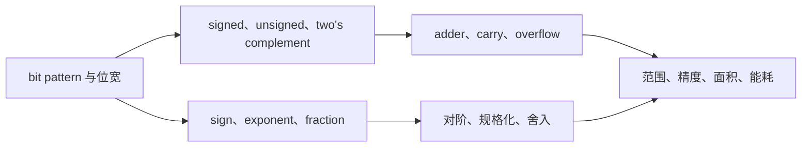

# Representation and Computation of Data

> [!abstract] 本章要解决的问题
> 一组有限的 0 和 1，怎样被解释成数，又怎样被电路可靠地运算？理解任何 bit pattern 时，都要先确认位宽和解释规则，再判断它表示的数值。

> **本章学习结果：**你应该能区分 bit pattern 与它的数值解释，手算 8-bit 补码，解释 carry 和 overflow 为什么不是一回事，并能沿着 sign、exponent、fraction 三个字段说明一个 binary32 数值怎样被编码。

> Course notes（中文解释，保留 English technical terms）
>
> 本章承接 [[1 Overview and Performance Evaluation]]：上一章介绍了 computer（计算机）的层次结构和 ISA（指令集架构）；这一章往下看，研究数据怎样变成 bit（位），以及 CPU（中央处理器）怎样用数字电路做整数加减。
>
> **课件范围说明：**CA_2 讲解计算机基本结构、整数表示、类型转换和整数加法器；CA_3 继续讲 floating-point（浮点数）表示与运算。下面把两份讲义合并成一条学习路径，并用 IC（集成电路）数据通路的视角解释“这些 bits 如何被电路处理”。

> **给零基础读者：**本章只需要认识 0/1、加法和“固定格子数有限”这几个想法。学完后，你应能把一个 bit pattern 按 signed/unsigned 解读、手算补码加减、区分 carry 与 overflow，并说出浮点加法为何需要对阶和舍入。

### 从 0 开始：bits 如何表示一个数？

计算机不会直接保存“数字 13”这个概念，而是保存一组 bits（位）。要读懂这组 bits，必须知道每一位的权重、总共有多少位，以及采用什么解释规则。

以 4-bit binary（二进制）`1011` 为例，从右到左的权重是 $2^0,2^1,2^2,2^3$：

$$
1011_2 = 1\times2^3 + 0\times2^2 + 1\times2^1 + 1\times2^0 = 8+0+2+1=11
$$

同一组 bits 也可以按 hexadecimal（十六进制）书写。每 4 bits 对应一个 hex digit（十六进制数字），因此 `1011` 就是 `0xB`，`1111 1010` 就是 `0xFA`。十六进制不是另一种数据，只是让长串 binary 更容易阅读。

还要区分 address（地址）和 value（值）：`Memory[1016] = 42` 中，`1016` 是地址，`42` 是数据；把地址误当成数据，会导致后面的 load/store 和指针例子全部读错。

位宽也不可省略：4-bit 有 $2^4=16$ 种编码，8-bit 有 $2^8=256$ 种编码。位宽越大，可表达的编码越多，但 register、adder、memory traffic 和 energy 也可能增加。后面的 signed/unsigned、补码和浮点数，都是在回答“这些有限编码怎样分配给不同数值”。

### 本章的动机梯度

先把本章想成一个工程问题：**硬件只有有限数量的 bits 和有限面积，怎样把现实世界的整数、连续数和运算结果编码得足够有用？**
 **本质就是在有限的芯片面积和bits之间做tradeoff**
- 如果不规定 bit pattern 的解释，`1111 1111` 既可能是 255，也可能是 -1，软件和硬件会产生不同结论；
- 如果为每种运算设计完全不同的电路，面积、验证和功耗会迅速增加；
- 如果用浮点表示连续量，范围、精度、舍入和异常必须同时处理；
- 因此本章从 encoding 走到 datapath，再走到 precision/energy trade-off。

后文每节会从一个局部问题展开，并从 hardware、compiler/software、verification 和 performance/energy 角度说明同一个选择为什么有用、又付出了什么代价。

### 读取 bit pattern 的通用方法

`1111 1111` 脱离上下文时没有唯一数值：

1. 如果按 unsigned 解释，它是 $255$；
2. 如果按 8-bit two's complement 解释，它是 $-1$；
3. 如果它是浮点格式的一部分，还要按 sign、exponent、fraction 的位置重新解释；
4. 如果它是 instruction 的一部分，它可能是 opcode、register 编号或 immediate。

因此，读取数据应按以下顺序进行：**确定 representation（表示）→ 解释 semantics（含义）→ 追踪 computation（运算结果）。**存储的 bits、软件类型和数学数值是彼此相关但不同的对象。

> 位宽决定可用编码数量：4-bit 有 $2^4=16$ 种编码，8-bit 有 $2^8=256$ 种编码。当数学结果超出可表示范围时，系统必须按规定处理截断、溢出或改变表示；overflow、subnormal 和 rounding 都与这些边界有关。

### 本章分层术语 roadmap

```text
Level 0  bit 与编码对象（第 1–2 节）
  bit（位）/byte（字节） -> binary（二进制） -> signed（有符号）/unsigned（无符号） -> MSB（最高有效位）/LSB（最低有效位）
      |
Level 1  整数 datapath（第 3–6 节）
  two's complement（二进制补码） -> carry（进位） -> overflow（溢出） -> adder（加法器）/ALU（算术逻辑单元）
      |
Level 2  浮点对象（第 7–9 节）
  sign（符号位） -> exponent（指数） -> significand（有效数） -> bias（偏置值）
  -> normal（规格化数）/subnormal（非规格化数） -> NaN（非数）/infinity（无穷大）
      |
Level 3  数值实现与代价（第 10 节以后）
  normalize（规格化） -> round（舍入） -> precision（精度） -> dynamic range（动态范围）
  -> FPU（浮点运算单元） -> GRS（保护位、舍入位、粘滞位） -> reduced-precision format（低精度格式）
```

| 到达哪一层 | 学习检查 |
|---|---|
| Level 0 | 能用同一组 bits 区分 signed 与 unsigned 的解释 |
| Level 1 | 能手算补码加减并判断 carry 与 overflow |
| Level 2 | 能指出浮点格式中范围和精度分别由什么控制 |
| Level 3 | 能从 datapath、舍入和能耗角度比较表示方式 |

### Reference glossary（查阅用，不是先修要求）

| Term                                                                 | 它是什么                                                          | 读到它时要关注什么                             |
| -------------------------------------------------------------------- | ------------------------------------------------------------- | ------------------------------------- |
| `bit（位）/byte（字节）`                                                    | 0 或 1 的最小单位 / 通常由 8 bits 组成                                   | 位宽决定能表示多少种编码                          |
| `signed（有符号）/unsigned（无符号）`                                          | 对同一组 bits 的两种数值解释                                             | 先确认解释规则，再读结果                          |
| `two's complement（二进制补码）`                                            | signed integer 的常用编码                                          | 负数如何编码，以及减法如何变成加法                     |
| `MSB (Most Significant Bit，最高有效位)/LSB (Least Significant Bit，最低有效位)` | 最高/最低有效位                                                      | MSB 常决定 sign，LSB 对应最低位权和移位方向          |
| `carry（进位）`                                                          | 向更高位传出的进位                                                     | 常用于观察 unsigned 运算的范围问题                |
| `overflow（溢出）`                                                       | 数学结果超出 signed 位宽                                              | 不能和 carry 混为一谈                        |
| `sign（符号位）/exponent（指数）/significand（有效数）`                            | 浮点数的符号、指数、有效数部分；IEEE encoding 中 fraction 保存 significand 的小数部分 | 分别影响正负、范围和精度                          |
| `bias（偏置值）`                                                          | 浮点 exponent 的偏置编码                                             | 让 exponent 字段可以用 unsigned bits 表达正负指数 |
| `normal（规格化数）/subnormal（非规格化数）`                                      | 带隐含 leading 1 的普通数 / 接近 0、取消隐含 1 的数                           | 浮点数如何覆盖正常范围与 gradual underflow        |
| `NaN（Not a Number，非数）/infinity（无穷大）`                                 | 无效运算结果 / 超出有限范围的特殊值                                           | FPU 必须分类、传播并处理这些状态                    |
| `normalize（规格化）/round（舍入）`                                           | 重新写成标准形式 / 舍入到有限位数                                            | 浮点运算为什么会损失精度                          |
| `fixed-point（定点数）`                                                   | 小数点位置固定的编码方式                                                  | 量程和精度如何分配，为什么浮点需要移动指数                 |
| `precision（精度）`                                                      | 某个数量级附近可区分的细致程度                                               | 位数增加是否真的改善数值结果                        |
| `dynamic range（动态范围）`                                                | 从最小可表示量到最大可表示量的跨度                                             | 指数位数如何影响可表示范围                         |
| `leading-one detector`                                               | 找到结果最高有效 1 的电路                                                | 整数转浮点时如何生成 exponent 和 fraction        |
| `convergence`                                                        | 迭代算法逐步接近目标结果的性质                                               | 低精度 rounding 是否影响模型/算法能否稳定收敛          |
| `RCA (Ripple-Carry Adder，纹波进位加法器)`                                   | 多个 full adder 串接的加法器                                          | 面积和结构简单，但 carry 逐位传播会限制 latency       |
| `FPU (Floating-Point Unit，浮点运算单元)`                                   | 执行浮点运算的硬件单元                                                   | 执行对阶、significand 运算、规格化、舍入和异常处理       |
| `GRS (guard/round/sticky，保护位/舍入位/粘滞位)`                               | 三个额外保留位                                                       | 帮助硬件决定如何进行浮点舍入                        |
| `MXFP8`                                                              | 以共享 scaling factor 配合 FP8 元素的 reduced-precision format        | 减少 storage/data movement，但引入缩放和误差     |

### 教材式学习路径与可视化入口

> [!note] 在 Obsidian 中打开交互页
> 先点本表的 HTML 链接。若 Obsidian 没有交给 HTML Reader，而是显示源码或跳到外部浏览器，请从文件列表打开 `assets/2 Representation and Computation of Data/interactive/` 下对应的 `.html` 文件。页面显示但按钮无效时，检查 HTML Reader 的 `Operating Mode`：`Balance Mode` 不运行脚本；互动需要允许 inline script 的模式。较宽松模式会降低安全隔离，只对信任的本地教学文件使用。系统浏览器可作为备用。

本章每次看到一串 bits，都按同一个顺序追问：**它有多少位 → 采用什么解释 → 经过什么运算 → 结果是否仍在范围内**。这样可以避免把“编码”“数值”和“电路结果”混成同一个概念。



如果 Mermaid 没有渲染，文字版仍然成立：**先固定位宽，再选择解释规则；整数依赖补码和加法器，浮点依赖指数对齐和舍入；最后回到精度与硬件代价。**

| 学习问题 | 本章入口 | 先观察什么 | 静态 fallback |
|---|---|---|---|
| 同一组 bits 为什么能代表不同数？ | [[assets/2 Representation and Computation of Data/interactive/bit-pattern-explorer.html|bit pattern 交互探索器]] | 翻转最高位，比较 unsigned 与 signed | 8-bit 范围表与补码公式 |
| 一个十进制数怎样进入 binary32？ | [[assets/2 Representation and Computation of Data/interactive/float-format-explorer.html|IEEE 754 交互探索器]] | 输入 `5.5`、`0.1`、`-0`，比较字段 | `-5.5` 完整编码推导与 IEEE 分类表 |

## 1. 从程序语句到硬件操作

**设计动机：**程序里的 `+`、`-` 和变量名对硬件并不是直接可执行的对象；硬件需要固定格式的 bits（位）、control signals（控制信号）和 datapath（数据通路）。Von Neumann/Harvard architecture（冯·诺依曼/哈佛架构）的层次把“指令在哪里、数据在哪里、谁负责执行”分开，后面的整数和浮点章节再解释这些 bits 如何进入 ALU/FPU。

**工程师视角：**architecture engineer（架构工程师）关心 interface（接口）是否清晰；hardware engineer（硬件工程师）关心 instruction/data path（指令/数据通路）是否能并行访问；compiler/OS engineer（编译器/操作系统工程师）关心程序如何被装载、保护和执行。这里的分层不是装饰，而是控制复杂度的办法。

程序员（programmer）写下 `z = x - y`，但计算机并不直接“理解”减号。它先把指令和数据表示为 bit pattern（位模式），再由 processor（处理器）中的 control logic（控制逻辑）和运算电路执行。理解本章可以沿着这条线走：

```text
程序中的整数 -> 固定位数的 bit pattern -> 加法器中的 0/1 运算 -> 解释结果并检查标志
```

这里的 bit pattern 是一串 0 和 1；它本身不带“这是正数”“这是地址”等标签。要知道它代表什么，必须结合数据类型与解释规则。

### 1.1 Von Neumann architecture

`Von Neumann architecture（冯·诺依曼架构，也叫 Princeton architecture）`把指令（告诉机器做什么）和数据（机器要处理的对象）都存放在 memory（存储器）中。基本组成包括：

- `Processing unit（处理单元）`：执行运算，内部有 `ALU (Arithmetic Logic Unit，算术逻辑单元)` 和 registers（寄存器，处理器内的高速小存储）。
- `Control unit（控制单元）`：决定当前取哪条指令、如何解释并控制执行；`Program Counter (PC，程序计数器)` 记录下一条要取的指令位置，`Instruction Register (IR，指令寄存器)` 暂存当前指令。
- `Memory`：保存程序指令和数据。
- `Input/Output (I/O)`：和外部设备交换信息。

![[assets/2 Representation and Computation of Data/CA2-05.png]]

`Harvard architecture（哈佛架构）`把指令存储/访问路径与数据存储/访问路径分开；传统 Von Neumann 结构共享它们。分开访问可减少指令和数据争用同一路径的情况。现代处理器常是混合设计：主存整体常呈现 Von Neumann 式统一地址空间，而 L1 instruction cache（一级指令缓存）与 L1 data cache（一级数据缓存）常分开，体现 Harvard 式访问。不要把它们理解成只能二选一的整机标签。

![[assets/2 Representation and Computation of Data/CA2-07.png]]

## 2. 整数与 bit：先明确表示宽度

**设计动机：**现实中的数值可以很大，但 register（寄存器）只有固定宽度；如果不先确定位数，就无法判断编码数量、范围和溢出。`signed（有符号）`/`unsigned（无符号）` 不是两套物理 bits，而是同一 bits 的两种解释规则。

**工程师视角：**hardware 设计者需要固定宽度以控制 datapath 面积和 timing；compiler/ABI 需要明确类型转换和扩展规则；verification 工程师要覆盖边界值，尤其是 sign bit、最大值和最小值。

### 交互探索：同一组 bits 的两种解释

问题：`1111 1111` 到底是 255 还是 -1？打开交互页，点击任意 bit 翻转，观察同一组存储 bits 在 `unsigned` 与 `two's complement signed` 解释下如何变化。

[[assets/2 Representation and Computation of Data/interactive/bit-pattern-explorer.html|打开 bit pattern 交互探索器]]

静态结论：bits 本身没有“正数/负数”标签；解释规则不同，读出的数值就不同。交互页固定为 8 bits，便于把位权变化直接看出来。

### 2.1 Bit、byte 与整数范围

`bit` 是最小的信息单位，只能取 0 或 1；`byte` 通常是 8 bits。若一个整数使用固定的 $n$ 个 bits，一共只有 $2^n$ 种不同编码，因此它能表达的数值范围必然有限。

一个容易混淆的地方：C/C++ 类型实际占多少 bits 与平台、编译器和 ABI 有关。课件列出某些环境中的 `short` 16 位、`int` 32 位、`long` 64 位；这是具体实现，不应当作所有机器的保证。以下二进制例子会明确说使用几位。

| 类型示例 | 位数 | 无符号范围 | 二进制补码有符号范围 |
|---|---:|---:|---:|
| 8-bit | 8 | $0$ 到 $2^8-1=255$ | $-2^7$ 到 $2^7-1$，即 $-128$ 到 $127$ |
| 16-bit | 16 | $0$ 到 $65535$ | $-32768$ 到 $32767$ |
| 32-bit | 32 | $0$ 到 $2^{32}-1$ | $-2^{31}$ 到 $2^{31}-1$ |

有符号的 $n$-bit two's complement 范围为

$$
-2^{n-1} \le x \le 2^{n-1}-1
$$

最左边一位常被称为 `MSB`（Most Significant Bit，最高有效位）；在 two's complement 中它承担负权重。最右边一位是 `LSB`（Least Significant Bit，最低有效位），代表最低位权 $2^0$。

### 2.2 Signed 与 unsigned 是不同的解释

同一组 bits 可以按 unsigned 或 signed 规则解释。例如 8-bit `1111 1111`：按 unsigned 是 255；按 two's complement 是 $-1$。硬件保存的位没有改变，改变的是程序和指令采用的解释规则。

`unsigned` 适合保证非负的量，例如计数、位掩码；signed 整数适合包含正负的量。无符号 $n$-bit 数值按普通二进制位权相加：

$$
U = \sum_{i=0}^{n-1} b_i 2^i
$$

例如 8-bit `1111 1010` 的 unsigned 值是 $128+64+32+16+8+2=250$。

## 3. 负整数如何编码：从原码到 two's complement

**设计动机：**原码和反码直观，却会产生两个零，并让加减法需要额外的符号判断电路。two's complement（二进制补码）选择把负数放入同一个模 $2^n$ 的编码环，使加法器可以复用来完成减法；代价是最小负数没有对应的正数，且 overflow（溢出）必须单独检测。

**工程师视角：**ALU 设计者喜欢统一的加法 datapath；compiler 依赖一致的比较、扩展和溢出行为；verification 工程师重点检查 `0`、最小负数、最大正数和位宽转换等 corner cases。

### 3.1 原码与反码为什么不够

`True form / sign-magnitude`（原码）把最高位当作符号：0 表示正，1 表示负，其余 bits 表示绝对值。以 8-bit 的 $+62$ 和 $-62$ 为例：

- $+62$：`0011 1110`
- $-62$：`1011 1110`

这样直观，但加减需要额外区分符号和大小；而且会出现 `+0` 与 `-0` 两个零。

`One's complement`（反码）中正数保持不变，负数把正数的每一位取反。8-bit 下 $+62$ 是 `0011 1110`，$-62$ 的反码是 `1100 0001`。反码同样有正零和负零，且加法规则不够方便。

![[assets/2 Representation and Computation of Data/CA2-16.png]]

### 3.2 Two's complement：负数 = 取反再加一

> [!example] 补码解决了什么问题？
> 如果正数和负数使用两套完全不同的加法规则，ALU 会很复杂。two's complement 将负数编码为模 $2^n$ 意义下的补数，使加法器仍可执行普通二进制加法。4-bit 中，`-3` 是 `1101`；`0101 + 1101 = 1 0010`，丢弃位宽外的进位后留下 `0010`，也就是 2。
>
> **Carry 不等于 overflow。**Carry 是最高位向外传出的进位，常用于观察 unsigned 范围；overflow 表示 signed 数学结果超出位宽，需要结合操作数和结果的符号判断。

`Two's complement`（二进制补码，简称补码）是现代通用处理器表示 signed integer 的常见方式。固定 $n$ 位时：

1. 非负数照普通二进制写，左侧补 0。
2. 要得到负数 $-x$ 的编码：先写出 $x$ 的 $n$ 位编码，逐位取反，再加 1。

8-bit 示例：$+62=$ `0011 1110`。逐位取反为 `1100 0001`，再加 1 得 `1100 0010`，所以 $-62$ 的 8-bit two's complement 是 `1100 0010`。

![[assets/2 Representation and Computation of Data/CA2-18.png]]

补码的重要性在于它让减法变成加法。直觉上可用钟表理解：在 12 小时制钟面上，从 11 点倒拨 3 格到 8 点，等价于顺拨 9 格，因为 $11+9=20$，而 $20$ 与 $8$ 在模 12 意义下落在同一位置。

一般地，$n$ 位只保留低 $n$ 位，运算相当于模 $2^n$。四位例子中，$5-3$ 可改写为 $5+(16-3)$：

$$
5-3 \equiv 5+(16-3) = 5+13 = 18 \equiv 2 \pmod{16}
$$

四位下 $-3$ 的编码就是 $16-3=13=$ `1101`。因此：

```text
  0101   (5)
+ 1101   (-3 的 4-bit 补码)
------
1 0010
```

丢弃超出四位的最左进位，留下 `0010`，即 2。这里模运算是对编码做环绕，不是说整数 18 与 2 在通常数学意义下相等；只是在模 16 下同余。

![[assets/2 Representation and Computation of Data/CA2-19.png]]

### 3.3 怎样读补码、怎样扩展位数

将 $n$-bit pattern $b_{n-1}\dots b_1b_0$ 解释为补码时，最高位权重为 $-2^{n-1}$，其余位权重仍为正：

$$
S = -b_{n-1}2^{n-1} + \sum_{i=0}^{n-2} b_i2^i
$$

例如 4-bit `1101`：$-8+4+1=-3$。补码负数也可用“最高位是 1，所以数值为负”快速判断，但计算具体值时要按上式或“取反加一”求幅度。

把较短整数放进较宽容器时，需要 `extension`（扩展）：

- `Zero extension`（零扩展）：unsigned 数左侧补 0，数值保持不变。16-bit `1111 1111 1111 1010` 扩为 32-bit：`0000 0000 0000 0000 1111 1111 1111 1010`，仍然是 65530。
- `Sign extension`（符号扩展）：signed two's complement 重复最高位。比如 8-bit `1111 1010` 表示 $-6$，扩成 16-bit 为 `1111 1111 1111 1010`，仍表示 $-6$。

不能把 signed 值当 unsigned 来零扩展：8-bit `1111 1010` 如果表示 $-6$，零扩展到 16 位会变成正数 250，而不是 $-6$。

![[assets/2 Representation and Computation of Data/CA2-22.png]]

![[assets/2 Representation and Computation of Data/CA2-23.png]]

#### 先做一个类型转换题：为什么答案是 `0x0000FFFA`

课件给出的 `unsigned short x = 65530` 使用 16 bits 存储，即 `0xFFFA`。把它赋给 32-bit `int y` 时，`x` 仍然是 unsigned，所以执行 **zero extension**：左侧补 16 个 0，得到 `0x0000FFFA`。如果把同样的 bit pattern 当作 signed 16-bit 数，它会表示 $-6$，那才需要 sign extension。做题的第一步永远是确认“原来的类型”，不能只看十六进制外观。

![[assets/2 Representation and Computation of Data/CA2-22.png]]

### 3.4 混合类型运算与比较

在表达式中混用整数类型，编译器通常会先按语言规则把操作数转换为共同类型，再进行运算。课件给出的常见规则包括：`bool`、`char`、`short` 运算前通常提升为 `int`；`int` 与 `unsigned` 混算时常转成 `unsigned`；`int` 与 `float` 混算时转成 `float`。具体细节要以所用语言标准和类型宽度为准。

注意：把负的 signed 数转为 unsigned，不会报错说“负数不能表示”，而是按模 $2^n$ 映射成一个非负值。因此混合 signed/unsigned 比较可能与直觉不一致。RISC-V 提供不同比较指令：`slt` 按 signed 小于比较，`sltu` 按 unsigned 小于比较。编译器必须根据变量类型选对指令。

可以把混合类型表达式理解为“先统一规则，再运算”：

<svg xmlns="http://www.w3.org/2000/svg" viewBox="0 0 760 118" role="img" aria-label="混合类型运算先转换到共同类型，再执行运算和解释结果的流程图" style="width:100%;height:auto;background:#f8fafc;border-radius:12px">
  <defs><marker id="arrow-type" markerWidth="8" markerHeight="8" refX="7" refY="4" orient="auto"><path d="M0,0 L8,4 L0,8 Z" fill="#475569"/></marker></defs>
  <g fill="#e0f2fe" stroke="#0369a1" stroke-width="2">
    <rect x="16" y="34" width="158" height="50" rx="12"/><rect x="211" y="34" width="160" height="50" rx="12"/>
    <rect x="408" y="34" width="150" height="50" rx="12"/><rect x="595" y="34" width="149" height="50" rx="12"/>
  </g>
  <g fill="#0f172a" font-family="sans-serif" font-size="16" text-anchor="middle">
    <text x="95" y="55">不同类型的</text><text x="95" y="75">操作数</text>
    <text x="291" y="55">按规则转换成</text><text x="291" y="75">共同类型</text>
    <text x="483" y="64">执行运算</text>
    <text x="669" y="55">按 signed /</text><text x="669" y="75">unsigned 解读</text>
  </g>
  <g stroke="#475569" stroke-width="2.5" marker-end="url(#arrow-type)"><path d="M174 59 H204"/><path d="M371 59 H401"/><path d="M558 59 H588"/></g>
</svg>

例如 `int` 与 `unsigned int` 比较时，若 `int` 被转换为 `unsigned int`，最后一步使用的是 unsigned interpretation；这也是为什么写混合 signed/unsigned 表达式时必须同时检查类型宽度和符号。

![[assets/2 Representation and Computation of Data/CA2-25.png]]

课件中的 RISC-V 对比指令正好体现这个规则：`slt` 按 signed interpretation 比较，`sltu` 按 unsigned interpretation 比较。同一组 bits 若最高位为 1，signed 结果可能是负数，unsigned 结果却是很大的正数；指令名称告诉硬件该用哪把“尺子”。

### 3.5 浮点数：用有限 bits 近似实数

CA_3 把 floating-point number（浮点数）从“表示法”推进到真正的硬件运算。对 IC 设计来说，浮点数不是一根线上的普通整数：32 位被拆成 sign（符号位）、exponent（指数）和 fraction（小数部分）三个字段，FPU 必须先拆字段，再用不同的移位器、加法器和舍入逻辑处理它们。

整数用固定的位权 $2^0,2^1,\dots$ 表示；实数范围更大、还需要表示小数，因此计算机通常使用 `floating-point`（浮点数）。它类似科学计数法：

$$
x = (-1)^s \times m \times 2^e
$$

- $s$ 是 sign bit（符号位）；
- $m$ 是 significand / mantissa（有效数或尾数），负责精度；
- $e$ 是 exponent（指数），负责范围。

浮点数的“小数点”可以随着指数移动，所以叫 floating-point。它不是把所有实数精确存下，而是在范围与精度之间做折中。

#### 十进制数如何转换成二进制（理解浮点数的第一步）

在学习 binary32 之前，先把十进制数转换成二进制。浮点数不是把十进制数字直接塞进 32 个 bit，而是先完成这个转换，再把二进制写成科学计数法的形式。

**1. 整数部分：反复除以 2**

每次用当前整数除以 2，记录余数（0 或 1），再把商继续除以 2。商变成 0 后，把余数从下往上读。例如：13 除以 2 的余数依次为 1、0、1、1，所以从下往上读得到 13₁₀ = 1101₂。

![[assets/2 Representation and Computation of Data/CA3-15.png]]

**2. 小数部分：反复乘以 2**

每次把当前小数乘以 2，记录结果的整数部分（0 或 1），再保留小数部分继续乘 2。讲义例子给出 0.6875₁₀ = 0.1011₂；每次得到的整数部分从上往下读。

![[assets/2 Representation and Computation of Data/CA3-16.png]]

**3. 合并并规格化**

整数和小数分别转换后直接拼接：13.6875₁₀ = 1101.1011₂。然后规格化：1101.1011₂ = 1.1011011₂ × 2³。对 binary32 来说，sign = 0，fraction 保存 1. 后面的 1011011…，exponent field 保存真实指数加 bias：3 + 127 = 130 = 10000010₂。

所以转换链条是“十进制 → 二进制 → 规格化 → 拆成 sign / exponent / fraction”。如果有效位太多，硬件还要用 GRS bits 做 rounding，因此某些十进制小数在 binary32 中只能近似表示。

**完整算一遍课件中的 $-5.5$（binary32）：**先取符号，负数令 $s=1$。再转绝对值：$5.5_{10}=101.1_2$，因为 $5=101_2$ 且 $0.5=0.1_2$。规格化为 $1.011_2\times2^2$，所以真实指数 $e=2$，存储指数 $E=e+127=129=10000001_2$。规格化数开头的 `1.` 是隐含位，不存入 fraction；fraction 写 `01100000000000000000000`。于是字段为 `1 | 10000001 | 01100000000000000000000`，完整 32-bit pattern 是 `11000000101100000000000000000000`，十六进制 `0xC0B00000`。反算检查：$(-1)^1\times1.011_2\times2^2=-5.5$。每一步都能逆向核对，避免只背字段。

#### IEEE 754 的基本布局

> [!example] 浮点数怎样扩大可表示范围？
> 先把数写成二进制科学计数法，例如 $5.5 = 1.011_2 \times 2^2$。binary32 用 sign 表示正负，用 exponent 表示数量级，用 fraction 保存有效数的小数部分。指数扩大了可表示范围，但 fraction 位数有限，因此 `0.1` 通常只能近似保存，编码时需要舍入。

最常见的 binary32（通常称 `float`）和 binary64（通常称 `double`）布局如下。CA_3 的重点是 binary32：

| 格式 | 总 bits | sign | exponent | fraction | 常见有效精度 |
|---|---:|---:|---:|---:|---:|
| binary32 / `float` | 32 | 1 | 8 | 23 | 约 7 位十进制有效数字 |
| binary64 / `double` | 64 | 1 | 11 | 52 | 约 15--16 位十进制有效数字 |

![[assets/2 Representation and Computation of Data/CA3-03.png]]

读图时把它想成“指数控制量程、fraction 控制刻度”：指数越大，能表示的数量级越大；fraction 位越多，同一数量级内的间隔越小、精度越高。

对正常数（normal number），fraction 前面有一个隐含的 leading 1：

$$
x = (-1)^s \times (1.fraction)_{2} \times 2^{E-bias}
$$

其中 $E$ 是存储的 exponent field，`bias` 是指数偏置：binary32 的 bias 是 127，binary64 的 bias 是 1023。使用 bias 后，指数部分也能以无符号形式存储，硬件比较和排序更方便。

CA_3 给出的 binary32 例子是：

```text
S = 1, E = 10000001₂ = 129, F = 011000...
```

因此实际指数为 $129-127=2$，有效数为 $1.011_2=1.375$，结果是 $-1.375\times2^2=-5.5$。

![[assets/2 Representation and Computation of Data/CA3-14.png]]

举一个缩小版的理解例子：若某格式存储的数为

```text
sign = 0, significand = 1.101₂, actual exponent = 2
```

那么它表示

$$
(1.101)_2 \times 2^2 = (110.1)_2 = 6.5
$$

真实的 binary32/binary64 还要按照字段宽度和 bias 编码；这个例子只用来理解“有效数 × 2 的指数次方”的结构。

#### Normal、subnormal 与特殊值

当 exponent field 不全为 0 或 1 时，是 normal number，使用隐含的 leading 1；当 exponent 全为 0 且 fraction 非 0 时，是 subnormal，隐含位变成 0，并固定使用最小指数。subnormal 的作用是让数值接近 0 时逐渐变小（gradual underflow），而不是突然跳到 0。

![[assets/2 Representation and Computation of Data/CA3-05.png]]

特殊编码需要在硬件中单独检测：

- `E=0,F=0`：$+0$ 或 $-0$；
- `E=all 1,F=0`：$+\infty$ 或 $-\infty$；
- `E=all 1,F\ne0`：`NaN`。

这就是为什么 FPU 里除了主运算器，还要有分类、比较和异常处理逻辑。

#### 为什么 `0.1 + 0.2` 可能不等于 `0.3`

十进制 $0.1$ 在二进制中是一个无限循环小数，不能被有限 fraction bits 完全表示。存入 `float` 或 `double` 时，硬件会选择最接近的可表示值；运算过程中还可能再次进行 rounding（舍入）。因此程序里常见：

```text
0.1 + 0.2  !=  0.3    # 某些语言/格式下的近似示意
```

比较浮点数时，通常要检查误差是否小于容许值，而不是直接使用 exact equality：

$$
|a-b| < \varepsilon
$$

这里的 $\varepsilon$（tolerance）应根据数据的尺度和算法误差选择；不能盲目固定成一个适用于所有问题的常数。

#### 特殊编码

IEEE 754 用特殊的 exponent/fraction 组合表示一些普通科学计数法无法方便处理的状态：

- `+0` 与 `-0`：数值上都等于 0，但符号位可能不同；
- `+∞`、`-∞`（infinity）：例如非零数除以 0 的结果可能进入无穷大；
- `NaN`（Not a Number）：例如 $0/0$ 或无效运算的结果；NaN 与任何数（包括另一个 NaN）的相等比较通常都为 false；
- `subnormal`（非规格化数）：在非常接近 0 的区域牺牲一部分有效精度，使结果逐渐下溢，而不是突然变成 0。

![[assets/2 Representation and Computation of Data/CA3-18.png]]

读 IEEE 754 的分类表时，可以按这个顺序检查：先看 exponent 是否全 0 或全 1，再看 fraction 是否为 0。这样比先把 32 个 bits 当普通整数计算更可靠，因为 `0`、`subnormal`、`infinity` 和 `NaN` 使用了不同的解释规则。

课件还给出一个寄存器比较题：`f1 = 0xCC900000`、`f2 = 0xB0C00000`。两者 sign bit 都是 1，因此同为负数；`f1` 的 exponent 更大，绝对值数量级更大，所以 $x<y$，且符号相同。遇到这类题，先比较 sign，再按 exponent 和 fraction 判断绝对值，最后把负号纳入结论。

![[assets/2 Representation and Computation of Data/CA3-25.png]]

可以把浮点运算的过程记成：

```text
real-number calculation
          |
          v
encode: sign + exponent + fraction
          |
          v
hardware operation with finite precision
          |
          v
rounding / overflow / underflow / NaN check
```

#### 浮点数与整数的区别

| 对比项 | Integer | Floating-point |
|---|---|---|
| 表示对象 | 离散整数 | 有限精度的实数近似 |
| 主要限制 | 固定位宽的范围 | 范围与精度都有限，且精度随数量级变化 |
| 运算风险 | signed overflow、unsigned carry | rounding error、overflow、underflow、NaN |
| 典型用途 | 计数、地址、位运算 | 科学计算、图形、测量值 |

因此，`float` 的“范围更大”不代表它比 32-bit integer 在所有方面都更精确：它能表示很大的数量级，但在同一数量级附近的相邻可表示数之间可能有间隔。涉及金额、计数或地址时通常优先使用整数；涉及测量和连续量时才考虑浮点，并明确接受近似误差。

## 4. 加法器：从一位逻辑到多位运算

**设计动机：**处理器不能只会抽象地“做加法”，必须把每一位的 sum（和位）和 carry（进位）变成真实逻辑门。half adder（半加器）/full adder（全加器）提供可复用的 bit-level building block（位级构件），RCA 用规则结构扩展到 n bits；代价是 carry 逐位传播，位宽越大 latency（延迟）越明显。

**工程师视角：**circuit designer 在 timing、area 和 power 间取舍；architecture designer 决定是否值得换更快但更大的 carry-lookahead 等结构；verification 工程师要验证所有输入组合和 carry 链路。

### 4.1 Half adder 与 full adder

`Adder`（加法器）是组合逻辑电路，输入若干 bit，输出和与进位。`XOR`（异或）在两个输入不同时输出 1；`AND`（与）只有两个输入都为 1 才输出 1。

`Half adder`（半加器）输入两个 bit $A,B$，不接收来自前一位的进位：

$$
Sum = A \oplus B, \qquad Carry = A \land B
$$

| $A$ | $B$ | $Sum$ | $Carry$ |
|---:|---:|---:|---:|
| 0 | 0 | 0 | 0 |
| 0 | 1 | 1 | 0 |
| 1 | 0 | 1 | 0 |
| 1 | 1 | 0 | 1 |

两个最低位相加时可能已有来自更低位的 carry，因此多位加法需要 `Full adder`（全加器）：输入 $A_i, B_i, C_i$，其中 $C_i$ 是前一位传来的进位；输出和 $S_i$ 和下一位进位 $C_{i+1}$。

$$
S_i = A_i \oplus B_i \oplus C_i
$$

$$
C_{i+1} = (A_iB_i) \lor (A_iC_i) \lor (B_iC_i)
$$

进位可理解为：三个输入中至少两个为 1 时，当前位产生进位。

![[assets/2 Representation and Computation of Data/CA2-29.png]]

### 4.2 Ripple-carry adder

把多个 full adder 串起来，就形成 `Ripple-Carry Adder (RCA)`（纹波进位加法器）。每一位等前一位算出 carry 后才能确定本位结果，因此 carry 从 LSB 一路传到 MSB，像波纹一样传播。它结构简单，但位数越多，最坏情况下等待时间越长。

![[assets/2 Representation and Computation of Data/CA2-30.png]]

课件最后还比较了不同 adder 的 **latency** 与 **area**：RCA 的面积小、结构规则，但 carry 必须逐级传播，位宽增加时延迟会变长；更快的 carry-lookahead 等结构会增加逻辑面积和布线。这里体现一个重要的 IC 设计原则：没有“绝对最快又最省面积”的加法器，设计要在 timing、area 和 power 之间取舍。

![[assets/2 Representation and Computation of Data/CA2-41.png]]

## 5. 同一个加法器完成加法与减法

**设计动机：**如果加法和减法使用两套完整电路，面积和验证成本都会增加。利用 two's complement，硬件只需在 $B$ 前加 XOR、把初始 carry 设为模式位，就能共享 adder；代价是控制路径要正确区分 add/sub，也不能把 signed overflow 和 unsigned carry 混为一谈。

补码允许把减法改为“加上相反数”：

$$
A-B = A + (-B)
$$

对固定宽度的 $B$，$-B$ 可由逐位取反再加一得到。RCA 可在每个 $B_i$ 前加 XOR 门，并把模式位 $M$ 接到最低位初始进位 $C_0$：

- 加法模式 $M=0$：$B_i \oplus 0=B_i$ 且 $C_0=0$，计算 $A+B$。
- 减法模式 $M=1$：$B_i \oplus 1=\overline{B_i}$ 且 $C_0=1$，计算 $A+\overline{B}+1=A-B$。

这就是共享的 adder/subtractor datapath（加减法数据通路）：加减法不需要两套完整加法电路。RISC-V 的 `add` 和 `sub` 是不同指令，但硬件能复用相似的运算电路；课件指出 ISA 不需要另设 `addu/subu` 指令来区分加法结果的 signedness，关键差别是如何解释结果以及如何处理 overflow。

<svg xmlns="http://www.w3.org/2000/svg" viewBox="0 0 760 190" role="img" aria-label="统一的补码加法与减法数据通路">
  <rect x="0" y="0" width="760" height="190" fill="#f5f8fa"/>
  <g font-family="Arial, sans-serif" font-size="15" text-anchor="middle">
    <rect x="24" y="66" width="112" height="54" rx="4" fill="#dceef2" stroke="#246b73"/><text x="80" y="98" fill="#173f46">A bits</text>
    <rect x="24" y="132" width="112" height="42" rx="4" fill="#fff0d8" stroke="#a65f00"/><text x="80" y="159" fill="#653b00">B bits</text>
    <rect x="190" y="132" width="116" height="42" rx="4" fill="#fff0d8" stroke="#a65f00"/><text x="248" y="159" fill="#653b00">XOR with M</text>
    <rect x="360" y="66" width="150" height="74" rx="4" fill="#e6e9f5" stroke="#4b5784"/><text x="435" y="97" fill="#303954">n-bit adder</text><text x="435" y="119" fill="#303954">Cin = M</text>
    <rect x="580" y="76" width="150" height="54" rx="4" fill="#e0f1e2" stroke="#397444"/><text x="655" y="108" fill="#244b2a">Result bits</text>
    <path d="M136 93 H360" fill="none" stroke="#334155" stroke-width="2"/><path d="M306 153 H330 V120 H360" fill="none" stroke="#334155" stroke-width="2"/><path d="M510 103 H580" fill="none" stroke="#334155" stroke-width="2"/>
    <path d="M435 30 V57" fill="none" stroke="#a65f00" stroke-width="2"/><text x="435" y="22" fill="#653b00">Mode M: 0 add / 1 subtract</text>
    <path d="M248 126 V110 H344" fill="none" stroke="#a65f00" stroke-width="2" stroke-dasharray="5 4"/><text x="246" y="105" fill="#653b00">same M selects carry-in</text>
  </g>
  <g fill="#334155"><path d="M360 89 l-8 -5 v10z"/><path d="M360 120 l-8 -5 v10z"/><path d="M580 103 l-8 -5 v10z"/></g>
</svg>

读图：$M$ 同时决定是否反转 $B$ 的各位，以及最低位是否加上初始进位 1；所以同一组加法器既可算 $A+B$，也可算 $A-B$。

![[assets/2 Representation and Computation of Data/CA2-32.png]]

## 6. Overflow 与 carry：不要混为一谈

**设计动机：**固定宽度运算会把超出范围的高位丢掉，单看结果 bits 可能无法知道数学结果是否可信。硬件因此产生 flags，让软件区分 signed overflow、unsigned carry、zero 和 sign；代价是 flags 的含义必须和 ISA、比较指令及编译器约定一致。

### 6.1 Signed overflow 的含义

`Overflow`（溢出）指真实数学结果超出当前 signed 位宽可表示的范围。它不是“出现了进位”的同义词。$n$ 位 two's complement 的范围为 $[-2^{n-1}, 2^{n-1}-1]$；四位范围为 $[-8,7]$。

- $-5+(-3)=-8$，在四位范围内。位运算有最高位向外的 carry，但**没有** signed overflow。
- $5+3=8$，超出四位最大值 7。低四位变成 `1000`，若按补码读取是 $-8$，所以发生 signed overflow。

因此只看最终向外的 carry（`Cout`）不能判断 signed overflow。

![[assets/2 Representation and Computation of Data/CA2-34.png]]

加法的符号规则也很实用：两个同号数相加，若结果符号与它们不同，则有 signed overflow；两个异号数相加不会产生 signed overflow。等价硬件判定是最高位的 carry-in 与 carry-out 不同：

$$
V = C_{n-1} \oplus C_n
$$

$C_{n-1}$ 是进入 sign bit 的 carry，$C_n$ 是从 sign bit 出去的 carry。`XOR` 两者，不相同则 $V=1$。另一种等价视角是看结果符号是否与输入符号相反，但课件给出用 carry 检查的电路实现。

![[assets/2 Representation and Computation of Data/CA2-37.png]]

### 6.2 Flag bits

运算电路可以一边给出结果，一边输出状态位（flags），让后续指令判断结果特征：

| Flag | 名称 | 含义 |
|---|---|---|
| `ZF` | Zero Flag | 结果是否为 0 |
| `SF` | Sign Flag | 结果最高位；补码中常可用来判断结果正负，但必须结合是否 overflow |
| `OF` | Overflow Flag | signed 运算结果是否超出表示范围 |
| `CF` | Carry Flag | unsigned 加法的进位等信息；减法中的具体借位约定依 ISA 而异 |

`OF` 与 `CF` 回答不同的问题：有符号数看结果是否越界；无符号数看进位/借位是否显示其范围之外的值。不能仅凭一个标志替代另一个。

![[assets/2 Representation and Computation of Data/CA2-38.png]]

### 6.3 八位算例：计算 $4x-y$

课件练习给定八位补码 $x=23_{16}$、$y=3C_{16}$。下标 16 表示十六进制；十六进制每位对应 4 bits。先转换并分步计算：

1. $x=0x23=$ `0010 0011`，即十进制 35。
2. 左移两位相当于乘 4（本例没有丢失有效位）：$4x=$ `1000 1100`，其八位补码解释为 $-116$。
3. $y=0x3C=$ `0011 1100`，即十进制 60；取负：取反 `1100 0011` 再加 1，得到 $-y=$ `1100 0100`（即 $-60$）。
4. 相加的真实数学值是 $-116+(-60)=-176$，不在八位补码范围 $[-128,127]$ 内，因此 $OF=1$。
5. 硬件留下低八位：`0101 0000`，即 `0x50`。这是发生溢出后的 bit pattern；不能把它当成真实答案 $-176$ 的正确八位表示。

课件计算所得机器数为 `50H`，溢出标志 `OF=1`。要分清：**机器结果是截断后的低位编码，数学结果是否可表示由 OF 指出。**

![[assets/2 Representation and Computation of Data/CA2-40.png]]

## 7. 浮点加法：先对齐指数，再做定点加法

**设计动机：**连续量的范围可能很大，单纯用 `fixed-point`（定点数，小数点位置固定的编码）会在范围和精度之间很快失衡。浮点通过 sign（符号位）、exponent（指数）和 significand（有效数）把范围与局部精度分开，但加法不能直接把编码相加，必须先对阶、运算、规格化、舍入并检查异常。

**工程师视角：**FPU 设计者关注可变位移器、宽 ALU、normalize/round 的 timing；数值算法工程师关心误差传播和结合律失效；性能/energy 工程师关心更高精度是否值得增加的面积、带宽和功耗。

浮点加法的核心不是直接把 32 位编码相加，而是把两个数先写成

$$
(-1)^{s_1}M_1 2^{E_1}+(-1)^{s_2}M_2 2^{E_2}
$$

然后让两个有效数的指数相同。以 $E_1>E_2$ 为例，先令 $\Delta E=E_1-E_2$，把较小指数的 $M_2$ 右移 $\Delta E$ 位，再执行有效数加减。

### 7.1 五个硬件步骤

1. **对阶 (align exponents)**：指数减法器算出 $\Delta E$；可变位移器右移较小的 significand。右移出去的位意味着精度可能损失。
2. **尾数加减**：使用类似整数的定点加法器；符号不同则实际执行减法。
3. **规格化 (normalize)**：若结果为 `10.x`，右移一位且指数加 1；若结果为 `0.00...1x`，左移并减少指数，直到变成 `1.x`。
4. **舍入 (round)**：只保留 fraction 能容纳的位数；必要时再加 1，并再次检查是否需要规格化。
5. **检查 exponent 溢出/下溢**：上溢通常输出 $\pm\infty$；下溢进入 subnormal 或 0。

![[assets/2 Representation and Computation of Data/CA3-27.png]]

### 7.2 数值例子：为什么“小数要向大指数对齐”

讲义例子：

$$
A=2.6125\times10^1=1.1010001000_2\times2^4
$$

$$
B=4.150390625\times10^{-1}=1.1010100100_2\times2^{-2}
$$

指数差为 $6$，所以把 $B$ 的有效数右移 6 位：

```text
  1.1010001000 × 2^4
+ 0.0000011010101 × 2^4
  -----------------
  1.1010100010101 × 2^4
```

舍入后得到 $1.1010100011\times2^4=26.546875$。**IC 直觉：**右移器负责对齐，big ALU 负责加法，规格化逻辑负责根据前导位移动结果，最后 rounding unit 决定被丢弃的低位如何影响最终编码。

![[assets/2 Representation and Computation of Data/CA3-35.png]]
![[assets/2 Representation and Computation of Data/CA3-36.png]]

### 7.3 GRS 位：硬件如何做“就近舍入”

对阶时被移出去的位不能全部立刻丢弃。IEEE 754 常额外保留三位：`guard`、`round`、`sticky`（GRS）。`sticky` 一旦有任意更低位为 1，就一直保持 1。它们帮助判断被丢弃部分是否超过半个最低有效位，从而实现 `round to nearest, ties to even`。

![[assets/2 Representation and Computation of Data/CA3-32.png]]

这解释了一个重要事实：浮点加法的误差不是偶然的软件 bug，而是数据通路中有限位宽、右移和舍入共同产生的结果。

### 7.4 浮点加法器的 IC 数据通路

![[assets/2 Representation and Computation of Data/CA3-37.png]]

读图顺序是：小 ALU 比较两个 exponent 并产生差值；多路选择器选出大指数和对应的两个 significand；移位器右移较小的 significand；大 ALU 做加减；normalize 单元移动结果并修正 exponent；rounding 单元生成最终 fraction。相比整数 RCA，这条路径更长，控制也更复杂。

## 8. 浮点乘法与运算顺序

**设计动机：**乘法和加法的硬件路径不同，且有限精度会让普通数学中的结合律失效。理解这一点，是避免把“换一个计算顺序”误认为纯粹的编译器重排问题的基础。

浮点乘法的结构比加法简单一些：

1. 指数相加（实际要扣除 bias）；
2. significand 相乘；
3. 规格化；
4. 舍入；
5. 检查溢出；
6. 符号位为 $s_1\oplus s_2$。

乘法器仍需要宽位宽的 fraction multiplier、normalize、round 和异常检测逻辑。

### 8.1 浮点运算不满足普通代数律

有限精度会让结合律失效。讲义中：$x=-1.5\times10^{38}$、$y=1.5\times10^{38}$、$z=1.0$。

$$
(x+y)+z=0+1=1
$$

但

$$
x+(y+z)=x+y=0
$$

因为在 $y+z$ 中，$1.0$ 相对 $1.5\times10^{38}$ 太小，对阶右移后被舍掉了。

![[assets/2 Representation and Computation of Data/CA3-41.png]]

因此不要用 `==` 判断浮点数是否相等；工程上通常使用相对/绝对误差阈值。对架构而言，这也意味着编译器或硬件改变加法顺序，可能改变最终数值。

![[assets/2 Representation and Computation of Data/CA3-39.png]]
![[assets/2 Representation and Computation of Data/CA3-40.png]]

## 9. 精度、能耗与 IC 设计取舍

**设计动机：**更高 `precision`（同一数量级内能区分多细）通常意味着更多 bits、更宽的 multiplier、更多 SRAM 和更高 data-movement cost；更低 precision 则可能损失 accuracy 或 `dynamic range`（可表示的最小量到最大量的跨度）。AI chip 选择 FP16、BF16、FP8、MXFP 等格式，是在 accuracy、bandwidth、energy、area 和 throughput 之间做系统级取舍。

**工程师视角：**模型/算法工程师看 accuracy 和 `convergence`（迭代结果是否逐步接近目标）是否受影响；数值硬件工程师看 rounding、overflow、scaling 和异常；memory/system 工程师看每个 tensor element 的 bytes 和搬运量；产品工程师看真实 workload 的 cost/performance，而不是只看理论 TOPS。

CA_3 还把表示法连接到实际芯片设计：fraction 位数越多，精度越高，但乘法器、寄存器、总线和 SRAM/Cache 的面积与能耗也增加；指数位数越多，量程越大。AI 加速器因此常使用 FP16、BF16、FP8 或 MXFP 等 reduced-precision 格式。

![[assets/2 Representation and Computation of Data/CA3-11.png]]

以讲义的 MXFP8 为例，32 个数共享一个 8-bit scaling factor，每个元素只存 8 bits，总共约 33 bytes，而 FP32 需要 128 bytes。这样能减少存储和 data movement（通常比计算本身更耗能），代价是舍入误差和额外的缩放逻辑。**从 IC 角度：**选择数据格式本质上是在面积、带宽、功耗、吞吐率和数值精度之间做 trade-off。

### 9.1 Integer 与 floating-point 之间的转换

类型转换不是“换一个标签”，而是重新编码 bit pattern：

- `float/double -> int`：通常保留整数部分、向 0 截断；超出 `int` 范围或遇到 NaN 时，C 标准不保证结果。
- `int -> double`：只要 integer 的有效位不超过 double 的 fraction 精度，通常可以精确转换。
- `int -> float`：32-bit `float` 只有约 24 个有效二进制位（含隐含的 leading 1），位数更多的整数需要 rounding。

CA_3 的例子是 $-2147483647$：32-bit two's complement 可以精确保存为 `0x80000001`；binary32 需要舍入，正确的 IEEE 754 编码是 `0xCF000000`，它代表的是附近的可表示值，而不是把每个十进制单位都精确保存下来。

**IC 直觉：**整数转浮点要先用 `leading-one detector`（寻找最高有效 1 的电路）确定数量级，再生成 exponent/fraction；如果有效位太多，就交给 rounding unit。因而“同样是 32 bits”不代表 integer 与 float 有相同的精度。

![[assets/2 Representation and Computation of Data/CA3-43.png]]

#### MXFP8：为什么少存 bits，代价却不只是“精度变低”

CA_3 的 `MXFP8 (Microscaling Floating Point)` 把 32 个 FP8 数分成一组，共用一个 8-bit scaling factor；每个元素本身只存 8 bits。课件例子中若共享因子 $S=8$，原数 $12$ 存成 $q=1.5$，恢复时计算 $S\times q=12$；$24.3$ 除以 8 后约为 $3.0375$，FP8 近似存成 $3$，恢复为 $24$。因此 32 个数由 FP32 的 128 bytes 降到约 33 bytes，但要付出 rounding error 和缩放/还原逻辑的代价。

![[assets/2 Representation and Computation of Data/CA3-11.png]]

对 AI chip 来说，减少 data movement 往往比减少一次简单加法更能省能耗；所以 reduced precision 是 **memory bandwidth、energy、area、throughput 与 accuracy** 的共同取舍，而不是单纯追求“位数越少越好”。

## 10. 本章脉络与自检

```text
位宽决定可用编码数量
    -> signed / unsigned 规则解释位模式
    -> two's complement 让负数和减法适配二进制加法
    -> half/full adder 组合成多位电路
    -> flags 告诉程序结果是否为零、负值或溢出
```

对于浮点部分，再接上：

```text
sign/exponent/fraction
    -> 对阶 -> significand 加/乘 -> 规格化 -> 舍入 -> 异常检查
```

学习本章时，可以反复沿着两条硬件主线回看：整数的“补码 -> adder -> flags”，以及浮点的“字段拆分 -> 对阶 -> significand 运算 -> 规格化/舍入 -> 异常检查”。

---

**和前一讲的连接：**前一讲提到 ISA 是软件与硬件之间的 interface。本章展示这种连接的具体例子：RISC-V 用 `add/sub` 指令表达操作，而补码和加法器是硬件实现整数运算的一种基础方式；位宽限制及 overflow 则影响程序如何正确解释结果。

### 自测：先自己回答，再看答案

1. 8-bit 的 `1111 1111` 按 unsigned 和 two's complement 分别是多少？
2. 8-bit 补码怎样得到 $-6$？把它扩展到 16 bits 时为什么不能补 0？
3. 两个正数相加得到负的补码结果，可能说明什么？这是否与 carry-out 是同一件事？
4. 浮点数相加时，为什么要把较小 exponent 对齐到较大 exponent？
5. GRS bits 的作用是什么？

**参考答案：**

1. unsigned 是 255；two's complement 是 $-1$。
2. $+6$ 写成 `0000 0110`，取反加一得到 `1111 1010`。扩展时重复符号位 1，得到 `1111 1111 1111 1010`，仍是 $-6$；补 0 会改变它的数值解释。
3. 可能发生 signed overflow，因为正数的数学和超出该位宽可表示的最大值。Carry-out 是最高位之外的进位，主要与 unsigned 运算相关；两者不能混为一谈。
4. 指数相同时才能提取共同的 $2^E$，只对有效数做加减。右移较小数的 significand 会损失低位精度，因此还需舍入。
5. Guard、Round、Sticky 位保留被移出位的信息，帮助硬件判断如何舍入，而不是简单丢弃所有低位。

## 11. Expert appendix：浮点数的标准边界

课件已经展示 `normal`、`subnormal`、`infinity`、`NaN`、舍入和结合律失效。要达到工程上可用的理解，还要把它们看成一个**标准规定的行为集合**，而不是若干零散的特殊例子。

### 11.1 IEEE 754 的四个观察层次

| 层次 | 你要问的问题 | 典型风险 |
|---|---|---|
| 编码 | sign/exponent/fraction 怎样组成 bit pattern？ | 把 fraction 当成完整尾数，忘记 hidden leading 1 |
| 数值 | 这个 pattern 表示哪个有限数或特殊值？ | 忽略 bias、subnormal 的不同规则 |
| 运算 | 加减乘除后如何规格化和舍入？ | 认为每一步都等于无限精度实数 |
| 比较/异常 | `NaN`、`-0`、infinity 怎样参与判断？ | 用 `==` 处理所有数，或忽略异常传播 |

### 11.2 Rounding mode：最后几位不是随便丢掉

**Background（外部扩展）：**IEEE 754 定义了舍入方向。最常见的是 `roundTiesToEven`（就近、正中间取偶数），它在大量运算中减少系统性偏差；其他方向包括 toward zero、toward positive infinity 和 toward negative infinity。硬件执行 rounding 时需要保留 GRS 信息，正文的 GRS 小节正是在解释这个接口如何落到电路。

设真实结果为 $x$，可表示结果为 $operatorname{round}(x)$。工程上常观察绝对误差 $|x-operatorname{round}(x)|$，也会在 $x\ne0$ 时观察相对误差：

$$
relative\ error = \frac{|x-\operatorname{round}(x)|}{|x|}
$$

相对误差不能替代所有判断：接近 0 时它会放大，比较两个数时还要考虑 `ulp`（相邻可表示数之间的间隔）和问题本身的容许误差。

### 11.3 `NaN` 与 `-0` 为什么会让“直觉比较”失效

- `+0` 和 `-0` 数值比较通常相等，但除法的符号可能不同：$1/(+0)=+\infty$，$1/(-0)=-\infty$；
- `NaN` 表示没有有效数值结果，通常连 `NaN == NaN` 都不成立；因此检测 NaN 不能依赖普通相等比较；
- infinity 可以参与部分运算，但 $infty-\infty$、$0\times\infty$ 等会产生 NaN；
- 浮点 bit pattern 的直接 unsigned 比较不能无条件替代数值比较，必须先处理 sign、zero 和 NaN。

这也是为什么 FPU 需要 classification、comparison 和 exception handling，而不是只放一个整数加法器。

### 11.4 Integer overflow 与浮点 overflow 不是同一件事

**External context（语言规则）：**硬件的固定宽度加法可以产生 wrap-around bits；但在 C/C++ 中，signed integer overflow 不能简单当作“自动环绕”的语言语义，编译器可能据此进行优化。unsigned integer 的模运算语义与 signed integer 不同。阅读程序时必须分开问：

1. 硬件 datapath 产生了什么 bit pattern？
2. ISA 的 flag/exception 如何描述它？
3. 编程语言是否保证这种结果可以被程序继续使用？

这三个层次混在一起，就会把“机器做得到”误认为“程序语义允许”。

### 11.5 误差怎样传播？为什么 FMA 有时更准？

每个浮点运算都可能舍入。误差不一定停留在产生它的那一步；后续运算可能放大、抵消或暴露它。Catastrophic cancellation（灾难性消去）指两个很接近、且各自已有舍入误差的数相减：共同的高位抵消后，剩下的低位可能主要由误差构成。

**经典教学例子（Goldberg 的有限精度示例）：**计算判别式 $b^2-4ac$，取 $a=1.22$、$b=3.34$、$c=2.28$，精确结果是 $0.0292$。若有限精度中两项分别舍入为 $11.2$ 和 $11.1$，最后相减得到 $0.1$；计算值约为精确值的 $3.4$ 倍，绝对误差是 $0.0708$。关键不是“减法一定不准”，而是前面乘法产生的误差在相近数相减时变得显眼。

FMA（Fused Multiply-Add，融合乘加）计算 $a\times b+c$，把乘积与加数作为一次融合运算，按目标格式完成一次最终舍入。分开的 multiply 再 add 通常有两次舍入；FMA 可减少一次中间舍入，因此常更接近精确实数结果。但它可能和逐步舍入代码产生不同末位；结果不同本身不代表错误。要求可复现时，应记录编译器是否进行 contraction（融合）。

| 计算方式 | 主要舍入点 | 可能影响 |
|---|---|---|
| 先舍入 a×b，再舍入 product+c | 通常两次 | 中间乘积误差继续传播 |
| FMA：舍入 a×b+c | 一次最终舍入 | 减少中间舍入，但末位可能不同 |

**边界：**FMA 减少的是特定中间舍入，不会自动修复不稳定算法、输入误差或 cancellation；更高精度也不保证病态问题变得稳定。

### 11.6 交互探索：直接观察 binary32 字段

在前面的 bit pattern 交互之外，下面的工具把一个十进制输入实际编码成 browser 的 binary32，并显示 sign、exponent、fraction 与十六进制结果。输入 `5.5`、`0.1`、`-0`、`Infinity`，重点观察哪些值能精确表达、哪些值需要近似或特殊编码。

[[assets/2 Representation and Computation of Data/interactive/float-format-explorer.html|打开 IEEE 754 binary32 交互探索器]]

这是一个**本地教学观察器**，不是完整 IEEE 754 仿真器；正文仍是理解 subnormal、rounding mode 和异常语义的依据。

### 11.7 在线拓展

- IEEE 754 标准入口：<https://standards.ieee.org/ieee/754/6210/>（IEEE Standards Association；访问日期：2026-10-19）。
- RISC-V F extension 的浮点指令与舍入模式：<https://docs.riscv.org/reference/isa/v20240411/unpriv/f-st-ext.html>（RISC-V International，官方 ISA 规范；访问日期：2026-10-19）。
- C 运算与 integer overflow 参考：<https://en.cppreference.com/w/c/language/operator_arithmetic.html>（cppreference，作为语言层背景参考；访问日期：2026-10-19）。
- David Goldberg, “What Every Computer Scientist Should Know About Floating-Point Arithmetic,” ACM Computing Surveys 23(1), 1991。在线版本讨论 rounding error、cancellation、FMA/exactly rounded operations 与 IEEE exceptional values：<https://docs.oracle.com/cd/E19957-01/806-3568/ncg_goldberg.html>（Oracle 文档库转载；访问日期：2026-10-22）。

## 12. Source and verification note

### 主要课件案例与截图索引

| Case ID | 来源页 | 课件案例 | 正文落点 | 截图（状态/可读性） |
|---|---:|---|---|---|
| CA2-01 | 5、7 | Von Neumann / Harvard 结构 | 从程序语句到硬件操作 | `CA2-05.png`、`CA2-07.png`（课件原图；正常宽度可读） |
| CA2-02 | 16、18、19 | `+62` 与 `-62` 的补码、4-bit `5-3` | Two's complement | `CA2-16.png`、`CA2-18.png`、`CA2-19.png`（正文已嵌入） |
| CA2-03 | 22、23、25 | zero/sign extension 与 `0xFFFA` | 类型转换 | `CA2-22.png`、`CA2-23.png`、`CA2-25.png`（正文已嵌入） |
| CA2-04 | 29、30、41 | full adder、RCA 与延迟/面积取舍 | 加法器 | `CA2-29.png`、`CA2-30.png`、`CA2-41.png`（课件原图；正常宽度可读） |
| CA2-05 | 34、37、40 | 八位 `4x-y` 与 `OF=1` | Overflow | `CA2-34.png`、`CA2-37.png`、`CA2-40.png`（正文已嵌入） |
| CA3-01 | 3、14--16 | 十进制转二进制、binary32 字段 | 浮点表示 | `CA3-03.png`、`CA3-14.png`、`CA3-15.png`、`CA3-16.png`（课件原图；正常宽度可读） |
| CA3-02 | 5、18、25 | normal/subnormal/infinity/NaN 与比较 | IEEE 754 分类 | `CA3-05.png`、`CA3-18.png`、`CA3-25.png`（正文已嵌入） |
| CA3-03 | 27、32、35--37 | 对阶、GRS 舍入与浮点加法器 | 浮点加法 | `CA3-27.png`、`CA3-32.png`、`CA3-35.png`、`CA3-36.png`、`CA3-37.png`（课件原图；正常宽度可读） |
| CA3-04 | 11、39--41、43 | 结合律失效、整数转浮点、MXFP8 | 精度与能耗取舍 | `CA3-39.png`、`CA3-40.png`、`CA3-41.png`、`CA3-43.png`、`CA3-11.png`（正文已嵌入） |

每一项都在正文中先解释输入、变换、输出和限制，再放对应课件截图；截图文件统一位于 `assets/2 Representation and Computation of Data/`。

- 主要来源：`/Users/dongyangchen/Desktop/lecture note/CA/CA_2.pdf` 与 `CA_3.pdf`，主题为 Representation and Computation of Data，共 42 + 46 页。
- 已保留课件的主要案例：原码/反码/补码、4-bit/8-bit overflow、`4x-y` 八位算例、IEEE 754 normal/subnormal/infinity/NaN、`0.1+0.2`、浮点寄存器比较、GRS rounding、浮点加法数值例子、结合律失效、`-2147483647` 的 integer/float 转换和 MXFP8。
- 本轮按通用 skill 增加了局部动机梯度、专业术语地图和 hardware/compiler/verification/performance 视角；额外解释均服务于课件机制，并保持与课件数值案例一致。
- 图片均使用 `assets/2 Representation and Computation of Data/` 下的相对 Obsidian 链接，当前链接已验证存在；公式分隔符已检查平衡。
