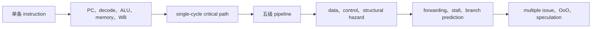

# Design of Processor

> [!abstract] 本章要解决的问题：处理器如何执行并加速 instruction
> 处理器的工作可以从一条 `ld x5, 16(x2)` 开始追踪：它怎样经过 PC、register file、ALU 和 memory；随后让多条 instruction 同时进入这些阶段，观察 pipeline 为什么会出现 hazard；最后理解 forwarding、stall、branch prediction、OoO 和 GPU/SERDES 怎样把等待时间变少。

> **你真正要学会的不是背五级名称，而是四个判断：**当前 instruction 是什么？它需要的数据何时产生？结果何时可以被下一条 instruction 使用？为了提高 throughput，硬件增加了什么代价？只要这四个问题能答出来，复杂的 processor 图就不会再只是“看起来很大”。

> 本章依据 CA_5.pdf（Chapter 4 - Design of Processor）整理，并承接 [[1 Overview and Performance Evaluation]]、[[2 Representation and Computation of Data]]、[[3 Instruction Set Architecture]]。目标不是背结构图，而是从一条 RISC-V 指令出发，追踪数据和控制信号怎样穿过处理器，再理解如何让多条指令安全地重叠执行。
>
> **给零基础读者：**你只需先知道 bit（位）、register（寄存器）、memory（存储器）和 RISC-V instruction（RISC-V 指令）大致是什么。每个新概念都会先用直觉解释，再给术语和硬件机制。学完后，你应能读懂简化 CPU 的 datapath（数据通路），解释 pipeline（流水线）的吞吐量收益与 hazard（冒险），并看懂现代处理器用多发射、动态调度和 speculation（推测执行）换性能时付出的代价。

### 教材式学习路径与可视化入口

> [!note] 在 Obsidian 中打开交互页
> 先点本表的 HTML 链接。若 Obsidian 没有交给 HTML Reader，而是显示源码或跳到外部浏览器，请从文件列表打开 `assets/4 Design of Processor/interactive/` 下对应的 `.html` 文件。pipeline 页点“下一 cycle”逐拍观察；其他页用滑块、按钮或下拉框改变一个因素。页面显示但控件无效时，检查 HTML Reader 的 `Operating Mode`：`Balance Mode` 不运行脚本；互动需要允许 inline script 的模式。较宽松模式会降低安全隔离，只对信任的本地教学文件使用。系统浏览器可作为备用。

本章不要一上来背 CPU 方框图。先跟踪一条 `ld`，再把同一条路径放进流水线；只有当“数据什么时候产生、什么时候可用”清楚以后，forwarding、branch prediction 和乱序执行才有意义。

### 处理器优化的基本原则：正确性先于并行性

处理器当然想让更多 instruction 同时工作，但它不能为了“看起来很快”而改变程序结果。于是每个性能机制都要同时回答两件事：

- **它怎样让硬件少等？**例如 pipeline 重叠不同 instruction，forwarding 直接传递已产生的结果，branch prediction 提前猜下一条 PC。
- **它怎样保证结果仍然正确？**例如 hazard detection 会 stall，错误分支会 flush，乱序执行最后仍要按程序顺序提交。

本章所有机制都可以放进这条判断链：**发现等待 → 找到可重叠的工作 → 允许提前执行 → 检查依赖和状态 → 必要时等待或恢复。**这比孤立记忆 `stall`、`flush`、`ROB` 更牢固。



如果 Mermaid 没有渲染，文字版仍然成立：**先看一条指令如何完成，再看多条指令如何重叠，最后看硬件如何处理重叠带来的冲突。**

| 学习问题 | 本章入口 | 观察重点 | 静态 fallback |
|---|---|---|---|
| 一条 `ld` 的地址和数据怎样流动？ | `ld x5, 16(x2)` 五阶段示例 | 地址计算与数据读回是两件事 | datapath SVG 与五步清单 |
| 依赖为什么造成停顿？ | [[assets/4 Design of Processor/interactive/pipeline-explorer.html|pipeline 交互探索器]] | cycle 4 的 `ID · stall` 与 `IF · hold` | 本章逐拍表与 hazard SVG |
| 分支预测怎样逐渐改变判断？ | [[assets/4 Design of Processor/interactive/branch-predictor-explorer.html|2-bit predictor 交互探索器]] | weak/strong 状态迁移 | 四状态说明和误预测代价 |

## 1. 学习目标与概念路线

本章学习完成后，你应能：

1. 用 `PC（程序计数器）→ fetch（取指）→ decode/read（译码/读寄存器）→ execute（执行）→ memory（访存）→ write-back（写回）` 描述一条指令的完整旅程。
2. 从一组指令推导 datapath（数据通路）需要哪些硬件，并解释主要 control signals（控制信号）的用途。
3. 比较 single-cycle processor（单周期处理器）和 pipelined processor（流水线处理器），区分 latency（延迟）、throughput（吞吐量）、CPI（每指令周期数）与 IPC（每周期指令数）。
4. 识别 structural/data/control hazard（结构/数据/控制冒险），说明 forwarding（旁路转发）、stall（暂停）、flush（清空）和 branch prediction（分支预测）分别解决什么问题。
5. 解释 multiple issue（多发射）、out-of-order execution（乱序执行）、register renaming（寄存器重命名）、ROB（重排序缓冲区）和 speculation（推测执行）的基本关系。
6. 从 AI chip designer 视角判断一个性能优化会把成本转移到哪里：面积、功耗、验证、软件调度或数据带宽。

### 分层术语路线图

| 学习位置 | 在这里逐步认识的术语 | 学完这一层能做什么 |
|---|---|---|
| 2–4 节：一条指令怎么执行 | `PC（程序计数器）`、`datapath（数据通路）`、`control（控制逻辑）`、`MUX（多路选择器）`、`single-cycle（单周期）`、`critical path（关键路径）` | 追踪指令的数据流和控制流 |
| 5–6 节：如何重叠执行 | `pipeline（流水线）`、`stage（阶段）`、`pipeline register（流水线寄存器）`、`throughput（吞吐量）`、`latency（延迟）` | 读懂五级 pipeline 与时间图 |
| 7–9 节：重叠为何会出错 | `hazard（冒险）`、`RAW (Read After Write，先写后读依赖)`、`forwarding（旁路转发）`、`stall/bubble（暂停/气泡）`、`flush（清空）`、`branch prediction（分支预测）` | 判断什么时候可旁路，什么时候必须等待或恢复 |
| 10–11 节：提升指令级并行 | `ILP (Instruction-Level Parallelism，指令级并行)`、`multiple issue（多发射）`、`OoO (out-of-order，乱序)`、`register renaming（寄存器重命名）`、`ROB (Reorder Buffer，重排序缓冲区)`、`speculation（推测执行）` | 看懂复杂处理器的性能来源与能耗成本 |

**前置知识连接：**第 1 章的 CPU time 公式告诉我们性能由 instruction count、CPI 和 clock period 共同决定；第 2 章解释 ALU/FPU 操作的 bit-level 实现；第 3 章说明 ISA 规定软件可见的行为。本章从 ISA 落到 microarchitecture：同一条 ISA 指令可以由不同内部结构完成。

## 2. 从一条指令开始：处理器究竟做什么？

### Digital Logic Basics：先掌握逻辑门和状态保存

看 CPU 方框图前，先建立一个底层认识：digital circuit（数字电路）用有限种离散状态表示信息。最常见的是 binary（二进制）的 `0` 和 `1`。在真实芯片里，它们对应不同的电压范围；画图时把它们抽象成 0/1，方便推理。一个 bit（位）只保存一个二进制数，许多 bits 合在一起可以表示指令、数字、地址或控制状态。**同一串 bits 表示什么，取决于电路或指令采用的解释规则。**

logic gate（逻辑门）是数字电路的基本运算单元。它读取一个或多个 0/1 输入，再按固定规则产生 0/1 输出。下面四种门足以帮助理解本章常见的运算和选择：

| 门 | 规则 | 直觉 | 例子 |
|---|---|---|---|
| NOT（非） | 把输入反过来 | 开变关，关变开 | `NOT 0 = 1` |
| AND（与） | 所有输入都是 1，输出才是 1 | 条件必须同时满足 | `1 AND 1 = 1`；`1 AND 0 = 0` |
| OR（或） | 至少一个输入是 1，输出就是 1 | 满足任一条件即可 | `1 OR 0 = 1`；`0 OR 0 = 0` |
| XOR（异或） | 两个输入不同时输出 1 | 检查“是否不同” | `0 XOR 1 = 1`；`1 XOR 1 = 0` |

把输入可能出现的每种组合和对应输出都列出来，叫 truth table（真值表）。`NOT` 只有一个输入；下面列出两个输入门 `AND`、`OR`、`XOR` 的完整真值表：

| A | B | AND | OR | XOR |
|---:|---:|---:|---:|---:|
| 0 | 0 | 0 | 0 | 0 |
| 0 | 1 | 0 | 1 | 1 |
| 1 | 0 | 0 | 1 | 1 |
| 1 | 1 | 1 | 1 | 0 |

<svg xmlns="http://www.w3.org/2000/svg" viewBox="0 0 940 220" role="img" aria-label="逻辑门组成组合逻辑计算新值，寄存器在时钟边沿保存新状态并作为下一步输入" style="width:100%;height:auto;background:#ffffff">
  <defs>
    <marker id="logic-base-arrow" markerWidth="10" markerHeight="10" refX="8" refY="5" orient="auto"><path d="M0 0L10 5L0 10Z" fill="#167a68"/></marker>
  </defs>
  <g font-family="sans-serif" text-anchor="middle">
    <g stroke-width="2">
      <rect x="24" y="65" width="150" height="82" rx="5" fill="#e9f2fb" stroke="#3478a8"/>
      <rect x="240" y="45" width="225" height="122" rx="5" fill="#fff3df" stroke="#bc6b18"/>
      <rect x="535" y="65" width="145" height="82" rx="5" fill="#e5f3ef" stroke="#167a68"/>
      <rect x="750" y="65" width="165" height="82" rx="5" fill="#f2edf8" stroke="#75618a"/>
    </g>
    <g fill="#172b4d" font-size="16" font-weight="700">
      <text x="99" y="96">Input bits</text><text x="99" y="121" font-size="13" font-weight="400">例如 A、B、0/1</text>
      <text x="352" y="81">Combinational logic</text><text x="352" y="106" font-size="13" font-weight="400">逻辑门 / ALU / MUX</text><text x="352" y="137" font-size="13" font-weight="400">按当前输入算出结果</text>
      <text x="607" y="96">New result</text><text x="607" y="121" font-size="13" font-weight="400">新的 bit pattern</text>
      <text x="832" y="96">Register</text><text x="832" y="121" font-size="13" font-weight="400">在时钟边沿保存</text>
    </g>
    <g fill="none" stroke="#167a68" stroke-width="2.8" marker-end="url(#logic-base-arrow)">
      <path d="M174 106H230"/><path d="M465 106H525"/><path d="M680 106H740"/>
      <path d="M832 148V190H99V157"/>
    </g>
    <text x="470" y="211" fill="#116b58" font-size="13">保存后的状态成为下一步计算可读取的输入</text>
    <text x="715" y="54" fill="#475467" font-size="12">clock edge（时钟边沿）</text>
  </g>
</svg>

ALU 中的加法器会组合 XOR、AND 等逻辑来计算 sum 和 carry。控制逻辑也会用这些门组合条件，例如“当前是 load 指令 **并且** 需要写回”时才打开相应的控制信号。单个逻辑门只能处理少量 bits；把许多门按规则连起来，才能处理完整的 32-bit 或 64-bit 值。

另一个重要区别是组合逻辑和时序逻辑：

- Combinational logic（组合逻辑）的输出只由**当前输入**决定。比如输入两个数的 adder、在多个输入中选一个的 MUX，都属于组合逻辑；输入变了，经过电路延迟后输出也会变。
- Sequential logic（时序逻辑）的输出还取决于**之前保存的状态**。Register（寄存器）就是一组能保存 bits 的电路；它通常在 clock（时钟）的指定边沿更新，随后继续保存该值，直到下一次允许更新。

可以用“计算”和“记忆”来区分：组合逻辑负责算出新值，时序逻辑负责记住哪些值已经成为处理器状态。CPU 每个 clock cycle（时钟周期）会在寄存器间推进状态；但并不意味着每条 instruction 恰好一个 cycle 完成，后面的 single-cycle 和 pipeline 会分别说明不同设计怎样安排这些工作。

MUX（multiplexer，多路选择器）把这个区别连接到 CPU 数据流：它本身不做复杂计算，而是根据 select（选择）信号，从多个输入中挑一个送到输出。例如 ALU 的第二个输入可以选 register 中的值，也可以选 instruction 里的 immediate。**数据输入决定“可选什么”，select 控制信号决定“这次选哪个”。**因此后面看到 datapath 上的 MUX 时，可以把它理解成由控制逻辑操纵的电子岔路口。

#### Clock、state 与 instruction 的关系

`clock（时钟）` 是一个重复的节拍信号，用来约定状态何时更新。一个简化的 CPU 可以理解成：

```text
当前 state（PC、register 等）
        ↓ 一个 clock cycle 内由组合逻辑计算
候选的新 state
        ↓ clock edge（时钟边沿）
寄存器保存新 state，进入下一 cycle
```

因此执行一条 instruction 时，CPU 不是把整条文字一次性“理解完”，而是在一个或多个 cycle 中，让 PC、control signals、datapath 和 registers 协同完成状态转换。`single-cycle processor` 把主要工作安排进一个较长 cycle；`pipeline` 则把工作分成 stage，让不同 instruction 在同一时刻占用不同 stage。这个区别会直接影响 latency、throughput 和 hazard。

### CPU overview：先看整颗处理器的地图

`CPU（Central Processing Unit，中央处理器）` 的工作可以概括成一个循环：**取一条指令，弄清它要做什么，取得所需数据，执行操作，保存结果，再决定下一条取哪条指令。**CPU 不只是 `ALU（Arithmetic Logic Unit，算术逻辑单元）`；ALU 只负责其中的计算，完整执行还需要保存状态的部件、控制逻辑、数据通路，以及和 memory（存储器）的连接。

可以先把简化 CPU 想成三类部件：

| 部件 | 包含什么 | 负责什么 | 初学者可以怎样理解 |
|---|---|---|---|
| 状态存储 | `PC（Program Counter，程序计数器）`、register file（寄存器堆） | 记住程序执行到哪里，以及计算正在使用的少量数据 | 桌面上的书签和便笺 |
| Datapath（数据通路） | ALU、adder（加法器）、MUX（多路选择器）、连线 | 让数据经过选择、运算和传递，最后到达目的地 | 桌面上实际处理文件的工作台和通道 |
| Control（控制逻辑） | decoder（译码器）、control signals（控制信号） | 读懂当前 instruction，并控制 datapath 该选哪一路、做哪种操作、是否读写 | 根据任务单指挥工作台 |

instruction memory（指令存储器）保存要执行的程序；data memory（数据存储器）保存程序处理的数据。教学用简化图常把它们画在 CPU 外部。register（寄存器）则在 CPU 内部，数量少但离运算单元近。实际处理器会用 cache（高速缓存）等结构优化访问，这里先抓住“指令从哪里来、数据在哪里、结果写回哪里”这三个问题。

<svg xmlns="http://www.w3.org/2000/svg" viewBox="0 0 1120 455" role="img" aria-label="CPU 总览图：指令从指令存储器进入译码控制，寄存器和立即数进入 ALU，结果可写回寄存器或访问数据存储器" style="width:100%;height:auto;background:#ffffff">
  <defs>
    <marker id="overview-arrow-data" markerWidth="10" markerHeight="10" refX="8" refY="5" orient="auto"><path d="M0 0L10 5L0 10Z" fill="#167a68"/></marker>
    <marker id="overview-arrow-control" markerWidth="10" markerHeight="10" refX="8" refY="5" orient="auto"><path d="M0 0L10 5L0 10Z" fill="#bc6b18"/></marker>
    <marker id="overview-arrow-pc" markerWidth="10" markerHeight="10" refX="8" refY="5" orient="auto"><path d="M0 0L10 5L0 10Z" fill="#475467"/></marker>
  </defs>
  <rect x="218" y="35" width="680" height="390" rx="7" fill="#f8fafc" stroke="#475467" stroke-width="2.5"/>
  <text x="245" y="65" fill="#172b4d" font-family="sans-serif" font-size="18" font-weight="700">CPU core（处理器核心）</text>
  <g font-family="sans-serif" text-anchor="middle">
    <g stroke-width="2">
      <rect x="25" y="112" width="165" height="76" rx="5" fill="#e9f2fb" stroke="#3478a8"/>
      <rect x="250" y="100" width="125" height="70" rx="5" fill="#e9f2fb" stroke="#3478a8"/>
      <rect x="430" y="92" width="175" height="88" rx="5" fill="#fff3df" stroke="#bc6b18"/>
      <rect x="435" y="235" width="190" height="94" rx="5" fill="#e5f3ef" stroke="#167a68"/>
      <rect x="675" y="230" width="145" height="78" rx="5" fill="#e5f3ef" stroke="#167a68"/>
      <rect x="925" y="230" width="170" height="78" rx="5" fill="#e9f2fb" stroke="#3478a8"/>
      <rect x="675" y="345" width="145" height="55" rx="5" fill="#f2edf8" stroke="#75618a"/>
      <rect x="250" y="255" width="125" height="60" rx="5" fill="#f2edf8" stroke="#75618a"/>
    </g>
    <g fill="#172b4d" font-size="15" font-weight="700">
      <text x="107" y="143">Instruction memory</text><text x="107" y="166" font-size="13" font-weight="400">指令存储器</text>
      <text x="312" y="130">PC</text><text x="312" y="151" font-size="13" font-weight="400">当前指令地址</text>
      <text x="517" y="127">Decoder + control</text><text x="517" y="151" font-size="13" font-weight="400">译码与控制信号</text>
      <text x="530" y="273">Register file</text><text x="530" y="298" font-size="13" font-weight="400">寄存器堆：提供/保存数据</text>
      <text x="747" y="263">ALU</text><text x="747" y="285" font-size="13" font-weight="400">运算或算地址</text>
      <text x="1010" y="263">Data memory</text><text x="1010" y="285" font-size="13" font-weight="400">数据存储器</text>
      <text x="747" y="369">Write-back select</text><text x="747" y="389" font-size="12" font-weight="400">选择写回来源</text>
      <text x="312" y="280">Immediate</text><text x="312" y="300" font-size="12" font-weight="400">指令中的常数/偏移</text>
    </g>
    <g fill="none" stroke="#167a68" stroke-width="2.8" marker-end="url(#overview-arrow-data)">
      <path d="M250 125H210V80H15V150H25"/><path d="M190 165H205V195H415V136H420"/><path d="M517 180V222"/>
      <path d="M625 272H665"/><path d="M375 285H405V202H650V269H665"/>
      <path d="M820 267H915"/><path d="M747 308V335"/><path d="M925 300H890V372H830"/>
      <path d="M675 372H645V329H635"/>
    </g>
    <g fill="none" stroke="#bc6b18" stroke-width="2.3" stroke-dasharray="7 5" marker-end="url(#overview-arrow-control)">
      <path d="M517 180V210H620V231"/><path d="M590 175H870V220H925"/><path d="M430 155H390V238H312V253"/>
    </g>
    <g fill="none" stroke="#475467" stroke-width="2.3" marker-end="url(#overview-arrow-pc)">
      <path d="M430 115H405V78H245V135H250"/>
    </g>
    <g fill="#475467" font-size="12">
      <text x="29" y="101">PC 提供地址</text><text x="312" y="215">指令字段送入译码</text>
      <text x="640" y="258">读出的操作数</text><text x="875" y="254">load / store</text>
      <text x="835" y="354">load 数据</text><text x="676" y="418">ALU 结果或 load 数据</text>
      <text x="318" y="74">顺序地址或 branch target 更新 PC</text>
    </g>
  </g>
  <g font-family="sans-serif" font-size="13">
    <path d="M30 377H82" stroke="#167a68" stroke-width="3" marker-end="url(#overview-arrow-data)"/><text x="92" y="382" fill="#344054">数据流</text>
    <path d="M30 407H82" stroke="#bc6b18" stroke-width="2.5" stroke-dasharray="7 5" marker-end="url(#overview-arrow-control)"/><text x="92" y="412" fill="#344054">控制信号</text>
  </g>
</svg>

同一颗 CPU 会根据 instruction 走不同的数据路径。比如 `add x5, x6, x7` 从 register file 读出 `x6`、`x7`，ALU 相加后把结果写入 `x5`；它不需要访问 data memory。`ld x5, 16(x2)` 则先读取 `x2` 和偏移 `16`，ALU 算出地址，再从 data memory 读出数据并写回 `x5`。`sd x5, 16(x2)` 也要算地址，但它把 `x5` 的值写入 data memory，不把结果写回 register。理解这三条路径，就能看懂控制逻辑为什么要为不同指令选择不同输入和写入位置。

| 指令类别 | ALU 在做什么 | 是否访问 data memory | 最终结果去哪里 |
|---|---|---|---|
| 运算，如 `add` | 对寄存器中的值做运算 | 否 | 写回目的 register |
| Load（读取），如 `ld` | 计算 effective address（有效地址）`base + offset` | 读 | memory 读出的值写回 register |
| Store（存储），如 `sd` | 计算 effective address `base + offset` | 写 | register 中的数据写入 memory |

这张总览图先回答“部件各自做什么”；后面的 2.1–2.7 节会沿着一条指令，逐步解释 PC、instruction、load、branch、寄存器读取、ALU、访存、写回和 control signals。再往后，pipeline 会让多条指令同时处于这些不同阶段。

### Instruction Basics：一条 instruction 到底是什么？

instruction（指令）不是“程序”本身，而是 CPU 可以执行的一条最小操作描述。把它想成一张给硬件的任务单，它至少回答三件事：

1. **读什么？** source operand（源操作数）来自哪个 register、哪个 immediate，或者哪个 memory address；
2. **做什么？** operation（操作）是加法、比较、地址计算、读取 memory 还是写入 memory；
3. **结果放哪里？** destination（目的地）是某个 register、memory，或者更新 PC。

例如：

```asm
add x5, x6, x7       # x5 = x6 + x7
ld  x5, 16(x2)       # x5 = Memory[x2 + 16]
sd  x5, 16(x2)       # Memory[x2 + 16] = x5
beq x5, x6, label    # 若 x5 == x6，则跳到 label
```

这四条 instruction 的共同结构是“读输入 → 做操作 → 写结果/改变 PC”，但它们使用的硬件路径不同：`add` 只需要 register file 和 ALU；`ld` 需要 ALU 算地址、data memory 读数据和 register write-back；`sd` 需要 ALU 算地址并写 data memory；`beq` 需要比较两个 registers，并决定 PC 取 `PC + 4` 还是 branch target。

在 machine code（机器码）中，instruction 会被编码成固定宽度的 bits。decoder 不会读取 `add` 这个文字，而是读取 opcode（操作码）、register fields（寄存器字段）、immediate/offset fields（立即数/偏移字段）等 bit fields。可以用下面这个抽象模型读任何 instruction：

```text
instruction bits
      ↓ decoder
operation + source registers + immediate/offset + destination register
      ↓ control signals
datapath 选择正确的数据路径并执行
```

注意 operand 和 address 不一样：`x2` 是 register 编号，`x2` 中保存的值才可能是一个 memory address；`16` 是 instruction 中编码的 offset，不是要读取的数据本身。只有 ALU 把它们相加得到 effective address（有效地址）后，data memory 才知道去哪里读或写。

### 2.1 用 PC 找到指令

程序由排好顺序的 instructions（指令）组成。`Program Counter（程序计数器，PC）` 是保存当前指令地址的状态寄存器。处理器用 PC 向 instruction memory（指令存储器）发出地址，memory（存储器）返回该位置的 instruction。RISC-V 基本指令通常是 32 bits（位），因此普通顺序执行时下一条地址为 `PC + 4`；branch（条件分支）或 jump（跳转）会选择不同地址。

**直觉：**PC 像书签，instruction memory 像按页码存放的书。取到当前页后，书签通常移到下一页；遇到跳转指令时，书签改到目标页。

### 2.2 Load instruction：从 memory 读一个值写回 register

`load instruction（加载指令）` 的方向是 **memory → register**。本节用 RISC-V 的 `ld` 说明完整过程：

```asm
ld x5, 16(x2)
```

它不是“把数字 16 放进 x5”，而是按照下面的规则执行：

$$
x5 \leftarrow Memory[x2 + 16]
$$

这里 `x2` 是 base register（基址寄存器），`16` 是 signed offset（有符号偏移量），`x5` 是 destination register（目的寄存器）。假设：

```text
x2 = 1000                 # base address
offset = 16               # instruction 中的 immediate
Memory[1016] = 42         # address 1016 处存着数据 42
```

那么有效地址是：

$$
effective\ address = 1000 + 16 = 1016
$$

最后才从 `Memory[1016]` 读出 `42`，写入 `x5`。所以一定要区分：**1016 是地址，42 是地址里的数据。**

#### `ld` 的五个阶段

拿 `ld x5, 16(x2)` 作完整例子。假定 `x2` 保存地址 `1000`，memory 地址 `1016` 存放数值 `42`：

1. **IF (Instruction Fetch，取指)：**PC 指向这条 `ld`，instruction memory 返回指令，同时计算顺序候选地址 `PC + 4`。
2. **ID (Instruction Decode，指令译码)：**decoder（译码器）识别这是 load；register file（寄存器堆）读出 `x2 = 1000`，immediate generator（立即数生成器）将偏移 `16` 扩展到机器字宽。
3. **EX (Execute，执行)：**ALU 做地址加法：`1000 + 16 = 1016`。这里 ALU 不是在做模型乘法，而是在计算 effective address（有效地址）。
4. **MEM (Memory，访存)：**data memory（数据存储器）用地址 `1016` 读出 `42`。
5. **WB (Write Back，写回)：**把 `42` 写回目的寄存器 `x5`。

<svg xmlns="http://www.w3.org/2000/svg" viewBox="0 0 1080 260" role="img" aria-label="ld 指令从基址寄存器和偏移计算有效地址，再从数据存储器读取数据并写回目的寄存器" style="width:100%;height:auto;background:#ffffff">
  <defs>
    <marker id="ld-flow-arrow" markerWidth="10" markerHeight="10" refX="8" refY="5" orient="auto"><path d="M0 0L10 5L0 10Z" fill="#167a68"/></marker>
    <marker id="ld-control-arrow" markerWidth="10" markerHeight="10" refX="8" refY="5" orient="auto"><path d="M0 0L10 5L0 10Z" fill="#bc6b18"/></marker>
  </defs>
  <g font-family="sans-serif" text-anchor="middle">
    <g stroke-width="2">
      <rect x="25" y="75" width="150" height="70" rx="5" fill="#f2edf8" stroke="#75618a"/>
      <rect x="215" y="75" width="150" height="70" rx="5" fill="#f2edf8" stroke="#75618a"/>
      <rect x="405" y="60" width="190" height="100" rx="5" fill="#fff3df" stroke="#bc6b18"/>
      <rect x="650" y="75" width="170" height="70" rx="5" fill="#e9f2fb" stroke="#3478a8"/>
      <rect x="875" y="75" width="175" height="70" rx="5" fill="#e5f3ef" stroke="#167a68"/>
    </g>
    <g fill="#172b4d" font-size="16" font-weight="700">
      <text x="100" y="104">x2 = 1000</text><text x="100" y="127" font-size="13" font-weight="400">base register</text>
      <text x="290" y="104">offset = 16</text><text x="290" y="127" font-size="13" font-weight="400">sign-extended immediate</text>
      <text x="500" y="94">ALU</text><text x="500" y="118" font-size="14" font-weight="400">1000 + 16 = 1016</text><text x="500" y="141" font-size="13" font-weight="400">effective address</text>
      <text x="735" y="104">Data memory</text><text x="735" y="127" font-size="13" font-weight="400">Memory[1016] = 42</text>
      <text x="962" y="104">x5 = 42</text><text x="962" y="127" font-size="13" font-weight="400">write-back</text>
    </g>
    <g fill="none" stroke="#167a68" stroke-width="2.8" marker-end="url(#ld-flow-arrow)">
      <path d="M175 110H395"/><path d="M365 110H395"/><path d="M595 110H640"/><path d="M820 110H865"/>
    </g>
    <path d="M500 35V55" fill="none" stroke="#bc6b18" stroke-width="2.3" stroke-dasharray="7 5" marker-end="url(#ld-control-arrow)"/>
    <text x="500" y="26" fill="#8a4d12" font-size="13">ALUSrc = immediate；MemRead = 1；RegWrite = 1</text>
  </g>
</svg>

#### `ld` 与 `sd` 的根本区别

`ld` 和 `sd` 都需要 ALU 计算 `base + offset`，区别在于 data memory 的箭头方向：

| instruction | 数据方向 | memory 动作 | 是否写回 register |
|---|---|---|---|
| `ld x5, 16(x2)` | memory → `x5` | 读出 8 bytes | 是 |
| `sd x5, 16(x2)` | `x5` → memory | 写入 8 bytes | 否 |

这里的 `ld` 是 RV64 的 load doubleword，读取一个 64-bit（8-byte）数据；`lw` 读取 32-bit word，`lb` 读取 8-bit byte。较窄的数据写入 64-bit register 时，还要按 signed/unsigned 规则做 sign extension（符号扩展）或 zero extension（零扩展）。

#### 为什么 `ld` 后面的 instruction 有时必须等待？

`ld` 的数据要到 MEM 阶段访问 data memory 后才产生。如果下一条 instruction 立刻使用 `x5`：

```asm
ld  x5, 0(x6)
add x7, x5, x8
```

`add` 在自己的 EX 阶段就需要 `x5`，但 `ld` 的数据通常到前一条指令的 MEM 末尾才可用。因此 forwarding（旁路转发）也可能来不及，hazard detection unit（冒险检测单元）会插入一个 stall/bubble。这个特殊情况叫 load-use hazard（加载-使用冒险），后面的 Pipeline/Hazard 小节会用时间图详细解释。

### 2.3 Branch instruction：`beq` 如何改变程序路线

`branch instruction（分支指令）` 不把普通计算结果写回 register；它根据条件决定下一条 instruction 的地址。`beq` 的全名是 **branch if equal（相等则分支）**：

```asm
beq x5, x6, label
```

它的逻辑可以写成：

$$
\text{if } x5 = x6:\quad PC \leftarrow PC + offset
$$

$$
\text{else}:\quad PC \leftarrow PC + 4
$$

其中 `x5` 和 `x6` 是要比较的 registers，`label` 会被 assembler（汇编器）转换成相对于当前 PC 的 branch offset（分支偏移量）。`beq` 比较的是寄存器中保存的值，不是寄存器编号；例如 `x5=100`、`x6=100` 时条件成立，`x5=100`、`x6=104` 时条件不成立。

处理器通常让 ALU 做减法或 XOR 来判断两个值是否相等：如果 `x5 - x6 = 0`，就产生 `Zero = 1`。同时，硬件把 PC 和 sign-extended offset 相加，提前算出 branch target。control logic 再根据 `Branch` 和 `Zero` 生成 `PCSrc`，选择下一条 PC。

<svg xmlns="http://www.w3.org/2000/svg" viewBox="0 0 1040 320" role="img" aria-label="beq 分支指令比较两个寄存器，并在条件成立时选择 branch target，否则选择 PC 加 4" style="width:100%;height:auto;background:#ffffff">
  <defs>
    <marker id="beq-arrow-data" markerWidth="10" markerHeight="10" refX="8" refY="5" orient="auto"><path d="M0 0L10 5L0 10Z" fill="#167a68"/></marker>
    <marker id="beq-arrow-control" markerWidth="10" markerHeight="10" refX="8" refY="5" orient="auto"><path d="M0 0L10 5L0 10Z" fill="#bc6b18"/></marker>
  </defs>
  <g font-family="sans-serif" text-anchor="middle">
    <g stroke-width="2">
      <rect x="25" y="82" width="145" height="62" rx="5" fill="#f2edf8" stroke="#75618a"/>
      <rect x="25" y="190" width="145" height="62" rx="5" fill="#f2edf8" stroke="#75618a"/>
      <rect x="250" y="105" width="180" height="115" rx="5" fill="#fff3df" stroke="#bc6b18"/>
      <rect x="505" y="54" width="165" height="62" rx="5" fill="#e9f2fb" stroke="#3478a8"/>
      <rect x="505" y="230" width="165" height="62" rx="5" fill="#e9f2fb" stroke="#3478a8"/>
      <rect x="755" y="105" width="150" height="115" rx="5" fill="#e5f3ef" stroke="#167a68"/>
      <rect x="950" y="105" width="70" height="115" rx="5" fill="#f2edf8" stroke="#75618a"/>
    </g>
    <g fill="#172b4d" font-size="15" font-weight="700">
      <text x="97" y="109">x5</text><text x="97" y="132" font-size="13" font-weight="400">例如 100</text>
      <text x="97" y="217">x6</text><text x="97" y="240" font-size="13" font-weight="400">例如 100</text>
      <text x="340" y="145">Compare</text><text x="340" y="168" font-size="13" font-weight="400">x5 - x6</text><text x="340" y="192" font-size="13" font-weight="400">Zero = 1?</text>
      <text x="587" y="81">PC + 4</text><text x="587" y="104" font-size="13" font-weight="400">顺序下一条</text>
      <text x="587" y="257">PC + offset</text><text x="587" y="280" font-size="13" font-weight="400">branch target</text>
      <text x="830" y="145">PCSrc MUX</text><text x="830" y="168" font-size="13" font-weight="400">按条件选一个</text><text x="830" y="192" font-size="13" font-weight="400">next PC</text>
      <text x="985" y="145">PC</text><text x="985" y="168" font-size="13" font-weight="400">下一条</text><text x="985" y="191">地址</text>
    </g>
    <g fill="none" stroke="#167a68" stroke-width="2.8" marker-end="url(#beq-arrow-data)">
      <path d="M170 113H240"/><path d="M170 221H240"/><path d="M430 160H745"/><path d="M670 85H745"/><path d="M670 261H745"/><path d="M905 162H940"/>
    </g>
    <path d="M675 185H720V162H745" fill="none" stroke="#bc6b18" stroke-width="2.3" stroke-dasharray="7 5" marker-end="url(#beq-arrow-control)"/>
    <text x="720" y="178" fill="#8a4d12" font-size="12">Branch ∧ Zero</text>
    <text x="518" y="28" fill="#475467" font-size="13">条件不成立 → PC + 4</text>
    <text x="518" y="316" fill="#475467" font-size="13">条件成立 → PC + offset</text>
  </g>
</svg>

#### `beq` 的具体例子

假设当前 `PC = 1000`，`beq x5, x6, label` 的 offset 是 `40`：

| 寄存器值 | 比较结果 | 下一条 PC | 程序行为 |
|---|---:|---:|---|
| `x5 = 7`，`x6 = 7` | 相等，`Zero = 1` | `1000 + 40 = 1040` | 跳到 `label` |
| `x5 = 7`，`x6 = 9` | 不等，`Zero = 0` | `1000 + 4 = 1004` | 继续顺序执行 |

所以 `beq` 的核心结果不是一个普通数字，而是一个 **PC selection（程序计数器选择）**：比较结果控制下一条 instruction 从哪里取。也正因为 CPU 可能已经提前取了顺序路径上的 instruction，分支结果晚一些才确定时就会产生 control hazard（控制冒险）；如果预测错误，处理器必须 flush（清空）错误路径上的 instruction。

### 2.4 解码、读操作数、执行、访存、写回

`sd x5, 16(x2)` 共享地址计算和访存路径，但方向相反：从寄存器读出要存的数据，在 MEM 阶段写入 memory，不需要 WB。`add x5, x2, x3` 则读两个 registers、让 ALU 相加，再将结果写回 register file。`beq x2, x3, label` 比较两个寄存器；相等时 PC 选择 branch target。

课件页展示了 instruction fetch 以及完整执行步骤，适合与上面的 load 例子对照：

![[assets/4 Design of Processor/CA5-011.png]]

看图时沿数据流追踪：PC 提供 instruction 地址；寄存器值进入 ALU；需要 load/store 时再访问 data memory；最后由控制信号选择是否写回以及写回哪个值。

<svg xmlns="http://www.w3.org/2000/svg" viewBox="0 0 1100 245" role="img" aria-label="处理器执行一条指令的五级数据流，以及写回和下一条 PC 的反馈" style="width:100%;height:auto;background:#f8fafc">
  <defs>
    <marker id="cpu-flow-arrow" markerWidth="10" markerHeight="10" refX="8" refY="5" orient="auto"><path d="M0 0L10 5L0 10Z" fill="#344054"/></marker>
    <marker id="cpu-flow-back" markerWidth="10" markerHeight="10" refX="8" refY="5" orient="auto"><path d="M0 0L10 5L0 10Z" fill="#16836b"/></marker>
  </defs>
  <g font-family="sans-serif" text-anchor="middle">
    <g fill="#ffffff" stroke="#344054" stroke-width="2">
      <rect x="30" y="72" width="160" height="74" rx="5"/><rect x="235" y="72" width="160" height="74" rx="5"/>
      <rect x="440" y="72" width="160" height="74" rx="5"/><rect x="645" y="72" width="160" height="74" rx="5"/>
      <rect x="850" y="72" width="210" height="74" rx="5"/>
    </g>
    <g fill="#172b4d" font-size="19" font-weight="700">
      <text x="110" y="101">IF · 取指</text><text x="315" y="101">ID · 译码/读寄存器</text>
      <text x="520" y="101">EX · 运算/算地址</text><text x="725" y="101">MEM · 访存</text><text x="955" y="101">WB · 写回</text>
    </g>
    <g fill="#475467" font-size="14">
      <text x="110" y="126">PC → instruction</text><text x="315" y="126">registers + immediate</text>
      <text x="520" y="126">ALU / branch condition</text><text x="725" y="126">仅 load/store 使用</text><text x="955" y="126">仅需要结果的指令</text>
    </g>
    <g stroke="#344054" stroke-width="2.5" marker-end="url(#cpu-flow-arrow)">
      <path d="M190 109H225"/><path d="M395 109H430"/><path d="M600 109H635"/><path d="M805 109H840"/>
    </g>
    <path d="M955 153V195H315V153" fill="none" stroke="#16836b" stroke-width="2.5" marker-end="url(#cpu-flow-back)"/>
    <text x="630" y="218" fill="#116b58" font-size="14">结果回到 register file，供后续指令读取</text>
    <path d="M110 153V181H24V108H28" fill="none" stroke="#16836b" stroke-width="2.5" marker-end="url(#cpu-flow-back)"/>
    <text x="110" y="222" fill="#116b58" font-size="13">PC+4 或 branch target</text>
  </g>
</svg>

这张图只画出主要方向：大多数数据从 IF 向 WB 前进，register write-back 与下一 PC 选择则回到前端，因此 pipeline 需要保存并正确对应每条 instruction 的数据与控制信息。

### 2.5 Datapath 与 control：数据通路和交通规则

`Datapath（数据通路）` 是实际搬运、保存和变换 data/address（数据/地址）的部件集合，例如 PC、register file、ALU、adder（加法器）、memory、pipeline registers（流水线寄存器）和连线。`Control（控制逻辑）` 依据 instruction 产生选择/使能信号，告诉 datapath 当前该做什么。

例如 ALU 的第二个输入可能来自第二个 register，也可能来自 immediate；load 写回值可能来自 ALU 的地址计算结果以外的 data memory。多个来源不能同时硬连到一根线上，否则会发生电气冲突。`MUX (multiplexer)` 是受 select 控制的选择器：每次只让一个输入成为输出。

课件给出的简化 CPU 设计流程是：

1. 分析 ISA instruction，列出每类指令所需的操作；
2. 选择组件，例如 register file、ALU、memory、adder；
3. 连接组件形成 datapath，并在多来源处放 MUX；
4. 为每类指令确定 control signals；
5. 将译码结果组合成 control logic。

这个流程非常重要：先问“指令语义要求什么”，再画硬件，不能先画漂亮框图再猜它执行什么。

### 2.6 从 instruction 推出控制信号

简化设计用 `ld`、`sd`、`add/sub/and/or` 和 `beq` 说明共同硬件如何服务不同 instruction：

| 信号 | 它控制什么 | 典型选择 |
|---|---|---|
| `ALUSrc` | ALU 第二操作数 | register 值或 sign-extended immediate |
| `MemRead` / `MemWrite` | data memory 的读/写使能 | `ld` 读，`sd` 写 |
| `RegWrite` | register file 是否写入 | `add`、`ld` 写；`sd`、`beq` 不写 |
| `MemtoReg` | 写回值来源 | ALU 结果或 load 出来的 memory data |
| `Branch` / `PCSrc` | 是否选择 branch target | branch 条件成立时选目标地址 |
| `ALUOp` / ALU control | ALU 做哪种运算 | 地址加法、比较用减法、R-type 指定运算 |

简化 decoder 先由 opcode 产生较粗的 `ALUOp`，再结合 `funct3`、instruction bit 30 等 function bits 产生最终 ALU control。比如 load/store 都要求 base + offset，所以 ALU 做 add；`beq` 需要判断两值相等，可以用减法后的 zero 结果；`sub` 和 `add` 则由 R-type function bits 区分。

**工程视角：**共用 ALU 和 register file 节省面积，但增加 MUX 与控制逻辑；一条指令不使用的部件要保持安静。硬件验证要检查每类指令的 read/write enable、地址与写回来源，避免无意的状态更新。

![[assets/4 Design of Processor/CA5-032.png]]

图中浅蓝色控制选择说明同一 datapath 如何在 R-type、load 和 store 之间切换；重点观察 `ALUSrc` 与 `MemtoReg` 这类“选哪个输入”的 MUX。

### 2.7 Single-cycle 的瓶颈：最慢路径决定整颗 CPU 的节拍

`Single-cycle processor` 让每条 instruction 在一个 clock cycle 内完成。优点是概念清晰、控制简单；代价是所有 instruction 都得共用一个足够长的 cycle，即使某条 instruction 很简单也不能提前开始下一条。

以 load 为例，关键数据路径是：

```text
instruction memory → register file → ALU → data memory → register file
```

`Critical path` 是一次操作中延迟最长、因而限制 clock period 的路径。课件指出 load 是简化 datapath 中最慢的 instruction，所以整个 single-cycle clock period 必须等待 load 完成。较快的 `add` 也要占用这个长周期。

这解释了为什么要 pipeline：目标不是让一个 instruction 内的逻辑凭空消失，而是把长工作分成短阶段，让不同 instruction 同时占用不同阶段。

![[assets/4 Design of Processor/CA5-043.png]]

## 3. Pipeline：让不同指令的工作重叠

> [!example] Pipeline 的时间直觉：先看时间表，再看名词
> 想象洗衣店：一个人洗衣服时，另一个人可以烘干，第三个人可以折叠。pipeline 不是把一件衣服变得瞬间完成，而是让不同衣服同时占用不同工位。CPU 也是一样：第一条 instruction 在 MEM 时，第二条可以在 EX，第三条可以在 ID。于是稳定状态下每拍可能完成一条，但单条 instruction 仍要经过多个 stage。

### 交互探索：pipeline 与 load-use hazard

问题：pipeline 让多条 instruction 重叠执行后，为什么程序仍然可能必须停顿？点击交互页的“下一 cycle”，观察 `ld`、紧随其后的 `add` 和后续 instruction 在五个 stage 中推进；特别留意 `add` 何时遇到 `stall`。

[[assets/4 Design of Processor/interactive/pipeline-explorer.html|打开 pipeline 交互探索器]]

静态结论：pipeline 主要提高 throughput；当后一条 instruction 需要前一条尚未产生的结果时，必须用 forwarding、stall 或其他机制保持正确性。交互页是固定五级 pipeline 和单个 load-use hazard 的教学模型，不覆盖所有真实 CPU 策略。

### 3.1 先用洗衣流程建立直觉

洗一批衣服有洗衣、烘干、叠衣等步骤。若必须等一批衣服所有步骤做完才开始下一批，机器会有空档；若每一步由不同设备负责，第一批进入烘干时，第二批就能开始洗。每一批的总等待时间未必缩短，但稳定后完成批次的速度提高。

课件中的洗衣案例：4 批衣物顺序完成约 8 小时，pipeline 重叠后约 3.5 小时，速度提升约 `8 / 3.5 ≈ 2.3×`。批次数增加后，理想上限逐渐接近 stage 数，但设备步骤不均衡、启动/收尾时间会降低实际 speedup。

`Pipeline（流水线）` 是把一条工作分成若干 stage（阶段），并让多条工作在不同 stage 并行推进。CPU 的典型五级划分是：

| 阶段 | 英文名 | 一条指令在此完成的工作 |
|---|---|---|
| IF | Instruction Fetch | 取指令、计算 `PC + 4` |
| ID | Instruction Decode / Register Read | 译码、读寄存器、生成 immediate |
| EX | Execute / Address Calculation | ALU 运算、地址计算、branch 比较的一部分 |
| MEM | Memory Access | load/store 访问 data memory |
| WB | Write Back | 将 ALU 或 load 结果写回 register file |

下面这张是**理想无停顿**的时间图。横向看 cycle，纵向看不同 instruction；斜向移动表示一条 instruction 每拍前进一个 stage。第一条 instruction 要等五拍才完成，但 pipeline 填满后，之后每拍都能完成一条。

<svg xmlns="http://www.w3.org/2000/svg" viewBox="0 0 1060 345" role="img" aria-label="五条指令在五级流水线中的理想时间重叠，每拍完成一条指令" style="width:100%;height:auto;background:#f8fafc">
  <g font-family="sans-serif" font-size="14" text-anchor="middle">
    <text x="95" y="36" fill="#344054" font-weight="700">Instruction</text>
    <g fill="#344054" font-weight="700">
      <text x="205" y="36">Cycle 1</text><text x="305" y="36">Cycle 2</text><text x="405" y="36">Cycle 3</text><text x="505" y="36">Cycle 4</text><text x="605" y="36">Cycle 5</text>
      <text x="705" y="36">Cycle 6</text><text x="805" y="36">Cycle 7</text><text x="905" y="36">Cycle 8</text><text x="1005" y="36">Cycle 9</text>
    </g>
    <g fill="#172b4d" text-anchor="end" font-weight="700">
      <text x="145" y="83">I1</text><text x="145" y="137">I2</text><text x="145" y="191">I3</text><text x="145" y="245">I4</text><text x="145" y="299">I5</text>
    </g>
    <g fill="#dcefeb" stroke="#16836b" stroke-width="1.5">
      <rect x="160" y="55" width="90" height="38" rx="4"/><rect x="260" y="109" width="90" height="38" rx="4"/><rect x="360" y="163" width="90" height="38" rx="4"/><rect x="460" y="217" width="90" height="38" rx="4"/><rect x="560" y="271" width="90" height="38" rx="4"/>
      <rect x="260" y="55" width="90" height="38" rx="4"/><rect x="360" y="109" width="90" height="38" rx="4"/><rect x="460" y="163" width="90" height="38" rx="4"/><rect x="560" y="217" width="90" height="38" rx="4"/><rect x="660" y="271" width="90" height="38" rx="4"/>
      <rect x="360" y="55" width="90" height="38" rx="4"/><rect x="460" y="109" width="90" height="38" rx="4"/><rect x="560" y="163" width="90" height="38" rx="4"/><rect x="660" y="217" width="90" height="38" rx="4"/><rect x="760" y="271" width="90" height="38" rx="4"/>
      <rect x="460" y="55" width="90" height="38" rx="4"/><rect x="560" y="109" width="90" height="38" rx="4"/><rect x="660" y="163" width="90" height="38" rx="4"/><rect x="760" y="217" width="90" height="38" rx="4"/><rect x="860" y="271" width="90" height="38" rx="4"/>
      <rect x="560" y="55" width="90" height="38" rx="4"/><rect x="660" y="109" width="90" height="38" rx="4"/><rect x="760" y="163" width="90" height="38" rx="4"/><rect x="860" y="217" width="90" height="38" rx="4"/><rect x="960" y="271" width="90" height="38" rx="4"/>
    </g>
    <g fill="#172b4d" font-weight="700">
      <text x="205" y="80">IF</text><text x="305" y="80">ID</text><text x="405" y="80">EX</text><text x="505" y="80">MEM</text><text x="605" y="80">WB</text>
      <text x="305" y="134">IF</text><text x="405" y="134">ID</text><text x="505" y="134">EX</text><text x="605" y="134">MEM</text><text x="705" y="134">WB</text>
      <text x="405" y="188">IF</text><text x="505" y="188">ID</text><text x="605" y="188">EX</text><text x="705" y="188">MEM</text><text x="805" y="188">WB</text>
      <text x="505" y="242">IF</text><text x="605" y="242">ID</text><text x="705" y="242">EX</text><text x="805" y="242">MEM</text><text x="905" y="242">WB</text>
      <text x="605" y="296">IF</text><text x="705" y="296">ID</text><text x="805" y="296">EX</text><text x="905" y="296">MEM</text><text x="1005" y="296">WB</text>
    </g>
  </g>
</svg>

![[assets/4 Design of Processor/CA5-047.png]]

### 3.2 为什么 pipeline 提升 throughput，不一定降低 latency？

用课件给的理想化 stage delay：IF `200 ps`、ID `100 ps`、EX `200 ps`、MEM `200 ps`、WB `100 ps`。load 要经过全部五步，single-cycle latency 是 `800 ps`。若做成 pipeline，clock period 至少要容纳最慢 stage，即 `200 ps`；填满后理想情况每 `200 ps` 完成一条 instruction，throughput 相对 `800 ps/指令` 提升 `4×`。

但单条 load 仍要走五个 stage，流水线 latency 大约是五个周期；并非一个 instruction 只花 `200 ps`。所以：

- `Latency`：单个任务从开始到完成的时间；
- `Throughput`：单位时间完成多少任务；
- `CPI (Cycles Per Instruction)`：平均每条 instruction 消耗的 cycles；理想单发射、无 stall pipeline 稳态可接近 1；
- `IPC (Instructions Per Cycle)`：每 cycle 完成/发射的 instructions 数。单发射通常不超过 1；多发射可超过 1。

pipeline 的理想加速上限约为 stage 数，但有 stage 不平衡、pipeline register 开销、hazard 和启动/排空成本。公式上，理想 clock period 接近各 stage 最大延迟加上 pipeline register overhead，而不是把整条路径平均掉。

**逐拍看它怎样重叠：**以下用五级教学模型，假设指令互不依赖、无访存等待、无分支，且每级一拍。`I1/I2/I3` 是三条顺序指令：

| Cycle | 1 | 2 | 3 | 4 | 5 | 6 | 7 |
|---|---|---|---|---|---|---|---|
| I1 | IF | ID | EX | MEM | WB |  |  |
| I2 |  | IF | ID | EX | MEM | WB |  |
| I3 |  |  | IF | ID | EX | MEM | WB |

第一条要到 cycle 5 才完成；但进入稳定状态后，每拍都有一条指令完成。三条指令共用 7 拍，而不是串行的 15 拍。这张表解释了“吞吐率提高、单条延迟并未缩成一拍”。真实处理器会因数据依赖、cache miss、分支和阶段不平衡而插入空拍或采用更复杂调度。

**工程视角：**更细的 pipeline 可以缩短每 stage 的逻辑并提高频率；同时增加 stage registers、clock load、分支误预测恢复成本与跨阶段控制复杂度。设计目标是 workload 的有效吞吐量/能耗，而不是 stage 数越多越好。

### 3.3 Pipeline register 是什么？

阶段之间插入 `Pipeline register`（流水线寄存器），在 clock edge 保存当前 instruction 的中间结果，让下一阶段在之后的 cycle 使用。五级 pipeline 典型边界是 `IF/ID`、`ID/EX`、`EX/MEM`、`MEM/WB`。

它们保存的不只是 data，还要保存后续需要的 instruction fields、PC、目的寄存器编号和 control signals。否则 WB 阶段可能拿到“当前另一条 instruction”的目的寄存器地址。课件用 load 指出：目的寄存器编号必须一路跟着 load 传到 `MEM/WB`，并和 load data 一起在 WB 写回。

管线寄存器会增加面积、时钟功耗和时序开销；它们让重叠成为可能，也成为需要被实现和验证的状态。

![[assets/4 Design of Processor/CA5-065.png]]

读多周期图时，横向是 clock cycle，纵向是一条条 instruction；同一列看某个周期里各 stage 在忙什么，同一行看一条 instruction 如何向前推进。空白格可能代表该指令不使用该 stage，也可能是 bubble，要看上下文。

### 3.4 一条 `ld` 是怎样逐拍穿过流水线的？

不要把五级 pipeline 只记成五个缩写。我们沿着一条具体的 RISC-V load 指令走一遍：

```asm
ld x5, 16(x2)
```

假设 `x2 = 1000`，`Memory[1016] = 42`。这条指令的目标是把地址 `1000 + 16 = 1016` 中的数据 `42` 写进 `x5`。

| Cycle | IF | ID | EX | MEM | WB | 这一拍最重要的状态变化 |
|---:|---|---|---|---|---|---|
| 1 | 取 `ld` |  |  |  |  | PC 用来读 instruction memory；PC 通常准备 `PC + 4` |
| 2 | 下一条 instruction | 译码 `ld`、读 `x2`、生成 signed immediate `16` |  |  |  | `IF/ID` 保存 `ld` 的字段，`ID/EX` 准备操作数和控制信号 |
| 3 | 再取下一条 | 译码下一条 | ALU 计算有效地址 `1000 + 16 = 1016` |  |  | 地址从 `ID/EX` 进入 EX，结果写入 `EX/MEM` |
| 4 | 继续取指 | 继续译码 | 执行别的 instruction | 从 data memory 读出 `42` |  | `MemRead=1`，读出的 data 保存到 `MEM/WB` |
| 5 | 继续取指 | 继续译码 | 执行别的 instruction | 访问别的 instruction 的 memory | 将 `42` 写入 `x5` | `RegWrite=1`，目的寄存器编号 `x5` 必须从前面一路传到这里 |

这里有一个很容易忽略的事实：**同一条 `ld` 的控制信息也在流水线中移动。**例如 `RegWrite`、`MemRead`、`MemWrite`、`MemtoReg` 不是只在 ID 阶段短暂出现后就消失；它们必须和这条 instruction 的数据一起通过 pipeline register 传到真正需要它们的阶段。否则硬件可能读对了 data，却错误地写寄存器，或把 ALU 地址当成 load data 写回。

可以把每个 stage 想成一个“只在 clock edge 交接工作的工位”：

```text
IF/ID  : instruction bits, PC, PC+4
ID/EX  : rs1 value, rs2 value, immediate, rd, control signals
EX/MEM : ALU result, store data, rd, memory controls
MEM/WB : load data or ALU result, rd, write-back controls
```

这也是为什么 datapath 图不能只看粗箭头。读图时要追问：这根线经过哪个 pipeline register？它在下一拍属于哪条 instruction？对应的 control signal 是否同步到达？

### 3.5 Pipeline register 不是“缓存”，而是 cycle 边界

`Pipeline register` 与普通意义上的 cache 不同：它不负责长期保存大量数据，也不根据地址查找；它负责在 clock edge 把一个 stage 的中间结果冻结下来，保证下一个 stage 在一个完整 cycle 内看到稳定输入。

例如 cycle 3 结束时：

- `ld` 的有效地址被写入 `EX/MEM`；
- 下一条 instruction 的 decode 结果被写入 `ID/EX`；
- 更早的 instruction 可能正在 `MEM/WB` 等待写回。

于是一个 register 的输入和输出在时间上属于不同 cycle。没有这个边界，前一个 stage 的组合逻辑变化会直接干扰后一个 stage，多个 instruction 就无法可靠重叠。

流水线寄存器通常要保存三类信息：

1. **数据**：寄存器值、immediate、ALU result、load data、store data；
2. **身份**：目的寄存器编号 `rd`、PC、branch target 相关信息；
3. **控制**：这个 instruction 后面是否读写 memory、是否写 register、写回选择哪一路。

`bubble` 可以理解为一条“不会改变架构状态的空 instruction”。硬件常通过把某些 control signals 清零来制造它：例如 `RegWrite=0`、`MemWrite=0`，这样这个槽位即使继续经过 EX/MEM/WB，也不会错误地写状态。

### 3.6 为什么 stage 要尽量平衡？

设五个 stage 的组合逻辑延迟为：

```text
IF = 180 ps, ID = 110 ps, EX = 230 ps, MEM = 260 ps, WB = 100 ps
```

pipeline clock 不能只看平均值。它至少要容纳最慢的 `MEM = 260 ps`，还要加 pipeline register 的 setup、clock-to-q 和 clock skew 开销。因此，单纯把很快的 WB 再优化 50 ps，可能完全不能提高时钟频率；真正的关键路径在 MEM。

这引出两个设计方向：

- **重新平衡 stage**：把过重的 MEM 拆成更细的阶段，或者把部分工作移到其他阶段；
- **减少关键阶段工作**：改进 cache、地址生成、TLB 或 memory interface，而不是只提高 ALU 速度。

但拆得更细也会付出代价：更多 pipeline register、更多控制边界、更长的 branch misprediction recovery、更复杂的 forwarding 和更高的 clock power。因此 pipeline depth 是性能、功耗、延迟和验证之间的设计选择，不是越深越好。

### 3.7 Stall、bubble、hold、flush 到底有什么区别？

这些词在流水线图中经常混在一起，初学者可以按“保留、插空、丢弃”来区分：

| 术语 | 做什么 | 典型原因 | 图上怎么看 |
|---|---|---|---|
| `stall` | 让某条 instruction 暂时不能前进 | load-use、cache miss、资源冲突 | 同一 instruction 在某 stage 停留多拍 |
| `hold` / freeze | 暂停某个 pipeline register 或 PC 的更新 | 等待依赖或等待资源 | 旧内容保持不变，后面的取指也可能冻结 |
| `bubble` | 插入一个不改变状态的空槽 | 给依赖生产者多一拍时间 | 某 stage 出现空操作 |
| `flush` | 丢弃已经进入流水线的错误路径工作 | branch misprediction、exception | 错误路径的格子被清空，从正确 PC 重取 |

以 `ld → add` 为例，硬件通常同时做三件事：

1. 让 `ld` 正常继续前进；
2. `hold` PC 和 `IF/ID`，避免 `add` 被新的取指覆盖；
3. 把一个 `bubble` 插入 `ID/EX`，让 EX 本拍不执行错误的 add。

所以“stall 一拍”不是简单把整颗 CPU 关掉，而是选择性地冻结一部分状态、让另一部分 instruction 继续推进。理解这个点后，pipeline timing 图就不再只是背颜色格子。

### 3.8 从理想 pipeline 到真实处理器：哪些假设会失效？

课本五级 pipeline 为了讲清机制，通常假设每个 stage 一拍、memory 访问稳定、每拍只有一条 instruction、branch 很快决定。真实处理器会遇到：

- **cache miss**：MEM 可能需要很多 cycles，不能让整个 pipeline 无限期地同步等待；
- **variable latency**：乘法、除法、浮点、向量和 memory 操作的完成时间可能不同；
- **多个执行单元**：不同 instruction 可以去 ALU、load/store unit、branch unit 或 vector unit；
- **更深流水线与多发射**：一个 cycle 里可能同时有多条 instruction 处于多个 stage；
- **异常与中断**：处理器要确保 software 看到的是一致的架构状态；
- **功耗与热**：流水线寄存器、forwarding network、预测器和更宽的取指都会消耗动态能量。

因此，五级 pipeline 是一个**最小但非常重要的心智模型**：它让你先理解“重叠如何产生 throughput、依赖如何制造等待、控制如何保持正确性”。后面的 branch prediction、multiple issue、OoO 和 GPU，都可以看成在这个模型上继续增加并行度和隐藏等待的设计。

### 3.9 用四个问题读懂任何 pipeline 图

面对一张复杂的 processor pipeline 图，按下面顺序读，不要一开始就试图记住所有线：

1. **每个 stage 在这一拍处理哪条 instruction？**先标出 instruction identity；
2. **这条 instruction 的输入从哪里来？**是 register file、forwarding path、cache 还是外部互连？
3. **结果什么时候 ready？**在 EX 末尾、MEM 末尾，还是要等待很多 cycles？
4. **如果不 ready，硬件怎样保持正确？**是 forwarding、stall、bubble、flush，还是交给 OoO scheduler？

这四问把 datapath、control、pipeline 和 hazard 统一到了一套观察方法中。后面看到 GPU 时，也可以换成类似问题：哪个 warp 在等什么数据，哪个 SM 资源被占用，通信是否成为关键路径。

## 4. Hazard：并行时怎样保证程序仍然正确？

`Hazard（冒险）` 是阻止下一条 instruction（指令）在下一个 cycle（时钟周期）正常开始/继续的情况。pipeline 让多条 instruction 同时在途，它们可能争同一资源、依赖尚未生成的值，或还不知道该取哪条路径。

### 4.1 Structural hazard：两个阶段争用一个硬件资源

假设 CPU 只有一个 memory port（存储器端口）：同一周期，一条 instruction 在 IF 取 instruction，另一条 `ld/sd` 在 MEM 访问 data memory（数据存储器），两者无法同时使用。一个阶段必须等待，形成 `stall`（暂停）。

**设计选择与取舍：**课件的简化 CPU 用 instruction memory 与 data memory 分离（实践中常由分离的 instruction/data cache 实现）避免这个冲突。代价是额外硬件资源；若改用共享资源，则需要仲裁并接受潜在停顿。

### 4.2 Data hazard：消费者需要的值还没准备好

> [!example] 用数据可用时间判断 hazard
> `add x1, x0, x2` 的 ALU 结果在 EX 末尾就产生，下一条 instruction 往往可以通过 forwarding 直接拿到；但 `ld x5, 0(x6)` 的数据要等到 MEM 访问结束才产生，而紧随其后的 `add ..., x5` 在更早的 EX 就需要它。这个时间差不是线路“不够聪明”，而是未来的数据确实还没有出现，因此必须 stall 一拍，或让编译器安排一条无关 instruction。
>
> 阅读 pipeline 图时，先比较消费者在哪一拍需要这个值、生产者在哪一拍才产生这个值。两个时间点对不上，stall、bubble 或 forwarding 的选择就有了原因。

下面第二条 instruction 读第一条尚未写回的 `x19`：

```asm
add x19, x0, x1      # producer：产生 x19
sub x2, x19, x3      # consumer：需要 x19
```

这是 `RAW (Read After Write，先写后读)` 依赖：后面的读必须看到前面写产生的正确新值。若直接从 register file 读，可能读到旧值。

#### Forwarding：结果先走捷径送给消费者

`Forwarding（旁路转发）`（也称 `bypassing`）增加一条捷径，让已算出的结果从较后 pipeline stage（流水线阶段）直接送到正在 EX 的消费者，而不必等 WB 写进 register file。硬件比较当前 EX instruction 的 source register（源寄存器，`ID/EX.rs1/rs2`）与较早 instruction 的 destination register（目的寄存器，`EX/MEM.rd`、`MEM/WB.rd`），再驱动 ALU 前的 MUX。

```text
EX/MEM.rd == ID/EX.rs1 或 rs2 且 RegWrite=1 → 可从 EX/MEM 旁路
MEM/WB.rd == ID/EX.rs1 或 rs2 且 RegWrite=1 → 可从 MEM/WB 旁路
```

如果两个更早的 instruction 都写同一个目标寄存器，要选择离消费者最近、较新的值：`EX/MEM` 优先于 `MEM/WB`。目的寄存器是 `x0` 时不能把它当成有效生产者，因为 RISC-V `x0` 恒为零。

课件的具体依赖链 `sub x2,...` 后接 `and/or/add/sd` 展示同一个 `x2` 可在不同阶段作为 ALU 输入或地址基址；forwarding logic 的核心就是比 register 编号并选择最新可用数据。

下图对比两种“值何时可用”的情况。`add → sub` 的 ALU 结果可在下一拍直接旁路；`ld → add` 的 load data 晚一拍才到，所以消费者要停在 ID，EX 插入一个 bubble。时间由上到下推进，列是 cycle。

<svg xmlns="http://www.w3.org/2000/svg" viewBox="0 0 1000 360" role="img" aria-label="ALU 结果可通过 forwarding 直接使用，而 load-use 依赖需要一个 bubble" style="width:100%;height:auto;background:#f8fafc">
  <g font-family="sans-serif" font-size="14">
    <text x="24" y="30" fill="#172b4d" font-size="18" font-weight="700">A. ALU 结果：旁路即可</text>
    <text x="24" y="57" fill="#475467">指令 / cycle</text>
    <g fill="#475467" text-anchor="middle"><text x="270" y="57">1</text><text x="360" y="57">2</text><text x="450" y="57">3</text><text x="540" y="57">4</text><text x="630" y="57">5</text><text x="720" y="57">6</text></g>
    <g fill="#ffffff" stroke="#98a2b3"><path d="M170 70h90v40h-90zM260 70h90v40h-90zM350 70h90v40h-90zM440 70h90v40h-90zM530 70h90v40h-90zM620 70h90v40h-90zM710 70h90v40h-90z"/><path d="M170 112h90v40h-90zM260 112h90v40h-90zM350 112h90v40h-90zM440 112h90v40h-90zM530 112h90v40h-90zM620 112h90v40h-90zM710 112h90v40h-90z"/></g>
    <g fill="#172b4d" font-weight="700"><text x="24" y="95">add x1,...</text><text x="24" y="137">sub ...,x1</text></g>
    <g fill="#344054" text-anchor="middle"><text x="215" y="95">IF</text><text x="305" y="95">ID</text><text x="395" y="95">EX</text><text x="485" y="95">MEM</text><text x="575" y="95">WB</text><text x="305" y="137">IF</text><text x="395" y="137">ID</text><text x="485" y="137">EX</text><text x="575" y="137">MEM</text><text x="665" y="137">WB</text></g>
    <path d="M405 101V128H477" fill="none" stroke="#16836b" stroke-width="3"/><path d="M470 122l10 6-10 6" fill="none" stroke="#16836b" stroke-width="3"/>
    <text x="530" y="171" fill="#116b58">EX/MEM → EX：最新 ALU 值送到 sub</text>
    <path d="M20 190H970" stroke="#d0d5dd"/>
    <text x="24" y="220" fill="#172b4d" font-size="18" font-weight="700">B. Load-use：数据尚未到达，必须等一拍</text>
    <text x="24" y="247" fill="#475467">指令 / cycle</text>
    <g fill="#475467" text-anchor="middle"><text x="270" y="247">1</text><text x="360" y="247">2</text><text x="450" y="247">3</text><text x="540" y="247">4</text><text x="630" y="247">5</text><text x="720" y="247">6</text><text x="810" y="247">7</text></g>
    <g fill="#ffffff" stroke="#98a2b3"><path d="M170 260h90v34h-90zM260 260h90v34h-90zM350 260h90v34h-90zM440 260h90v34h-90zM530 260h90v34h-90zM620 260h90v34h-90zM710 260h90v34h-90z"/><path d="M260 298h90v34h-90zM350 298h90v34h-90zM440 298h90v34h-90zM530 298h90v34h-90zM620 298h90v34h-90zM710 298h90v34h-90zM800 298h90v34h-90z"/></g>
    <g fill="#172b4d" font-weight="700"><text x="24" y="283">ld x5,...</text><text x="24" y="321">add ...,x5</text></g>
    <g fill="#344054" text-anchor="middle"><text x="215" y="283">IF</text><text x="305" y="283">ID</text><text x="395" y="283">EX</text><text x="485" y="283">MEM</text><text x="575" y="283">WB</text><text x="305" y="321">IF</text><text x="395" y="321">ID</text><text x="485" y="321">ID · 等待</text><text x="575" y="321">EX</text><text x="665" y="321">MEM</text><text x="755" y="321">WB</text></g>
    <rect x="440" y="336" width="90" height="20" fill="#fce8d5" stroke="#c05621"/><text x="485" y="351" fill="#8a3b12" text-anchor="middle" font-size="12">EX bubble</text>
  </g>
</svg>

![[assets/4 Design of Processor/CA5-055.png]]

![[assets/4 Design of Processor/CA5-054.png]]

#### Load-use：为什么有时 forwarding 仍不够？

```asm
ld  x5, 0(x6)       # load data 要到 MEM 结束后才可用
add x7, x5, x8      # 紧接着在 EX 就需要 x5
```

ALU 运算的结果通常在 EX 末尾已产生，可以及时旁路；load 的 data 要到 MEM 末尾才读出，而紧随其后的 add 在更早的 EX 时刻就需要它。未来的值无法倒流到过去，所以必须等一拍。

`Hazard detection unit` 在 ID 阶段检查：EX 中是否有 `MemRead` load，其 `rd` 是否匹配 ID instruction 的源寄存器。匹配时冻结 PC 和 `IF/ID`，并让进入 EX 的 control signals 置零，插入一个 `bubble`（空操作槽）。下一周期 load data 到位后，可再通过 forwarding 送给 add。

编译器可以在 load 与使用之间安排无关 instruction 来填这段空隙，但要保持程序语义。硬件必须能处理没有可移动独立工作的情况，保证正确性。

![[assets/4 Design of Processor/CA5-056.png]]

### 4.3 Control hazard：下一条 instruction 还不知道

branch 的结果决定 PC。若 CPU 要等 branch 确认后再取下一条指令，取指前端会空等。课件示例 `beq x1, x0, 40`：若相等则跳到 PC-relative target；不相等则继续顺序执行。

处理器可以更早计算 branch target、提前比较寄存器，减少等待；也可先按一个方向取指。若猜错，已取入的错误路径 instruction 必须 `flush`（清除），并从正确 PC 重新取指。flush 不等同于 stall：stall 是暂时保留/等待当前正确路径上的工作；flush 是丢弃错误路径上的工作。

分支 offset 的编码与第 3 章的 immediate 相连：RISC-V branch immediate 以半字对齐，最低位不需在指令中保存，硬件重建时补一个 0；向目标地址加的是相对 PC 的有符号偏移。精确编码可以回看 [[3 Instruction Set Architecture]] 的 SB-type。

## 5. Branch prediction：先猜下一条，再核对

### 5.1 Static 与 dynamic prediction

#### 交互探索：为什么 2-bit predictor 不轻易改变判断

点击下面的 `Taken` 或 `Not taken`，观察 predictor state 在 `strongly` 与 `weakly` 之间移动。连续循环通常会给出稳定证据；一次异常结果不一定应立即让 predictor 完全翻转，这正是 2-bit saturating counter 的直觉。

[[assets/4 Design of Processor/interactive/branch-predictor-explorer.html|打开 2-bit branch predictor 交互探索器]]

交互页只模拟一个分支、四个状态和两个方向，不表示现代 CPU 的全部 predictor（例如 global history、local history、BTB、indirect predictor 和 return-address stack）。

`Branch prediction` 在 branch 结果真正算出前预测下一 PC，尽量保持 IF 阶段有活干。最简单的静态策略是 `predict not taken`，继续取 `PC + 4`。若猜对，无额外等待；若猜错，要 flush 并重取。

- `Static prediction`：固定规则或 compiler hint，例如 loop branch 通常 taken、向前跳转的 if 常 not taken。这是启发式，不是保证。
- `Dynamic prediction`：硬件记录运行时 branch 行为，利用近期历史预测下一次。`BHT (Branch History Table)` 常按 branch PC 的部分 bits 索引，存预测状态。

单 bit predictor 只记上次 taken/not taken。在循环退出时可能刚好被反转，下一次进入循环又会错一次；嵌套循环边界会让它很敏感。two-bit saturating counter 用四个状态（strong/weak taken、strong/weak not-taken），通常要连续两次相反结果才跨过预测边界，因此对偶发变化更稳定。

![[assets/4 Design of Processor/CA5-122.png]]

![[assets/4 Design of Processor/CA5-061.png]]

### 5.2 分支预测的收益和边界

预测正确减少控制依赖造成的空转；预测错误的代价随 pipeline 深度和错误路径上已启动的工作增加。更复杂的 predictor 需要存储表、访问能量、更新逻辑和验证；aliasing（多个 branch 映射到同一表项）也会让历史互相干扰。分支预测本身只猜 control flow，不会让真实依赖消失。

**Verification perspective：**必须验证 taken/not-taken、target、连续误预测、异常/flush 与 predictor 更新的组合，确保错误路径不会留下架构可见副作用。现代实现可以推测执行，但状态提交必须受控。

## 6. 从单发射到多发射：寻找更多 Instruction-Level Parallelism

`ILP (Instruction-Level Parallelism)` 是一段程序中彼此独立、可以同时执行的 instruction 数量。pipeline 让不同 instruction 的不同阶段重叠；`multiple issue` 则让处理器尝试在一个 cycle 启动多条 instruction。

### 6.1 Deeper pipeline 与 multiple issue

- **Deeper pipeline：**把每个 stage 再切细，降低每段逻辑延迟、提高 clock frequency；代价是 stage registers、控制开销、hazard/misprediction penalty 增大。
- **Multiple issue：**加宽各 stage，并复制/增加执行资源，每 cycle 发出多条 independent instructions。此时 CPI 可以小于 1，因此常用 IPC 表示；例如 4 GHz、4-way 的理论峰值是 4 instructions/cycle，真实值会因依赖、cache miss、branch 和资源争用而更低。

`Static multiple issue` 由 compiler 将 instructions 组成固定 issue packet（常见形式为 VLIW），提前排除冲突，不足槽位可放 `nop`。`Dynamic multiple issue` 由硬件每周期检查 readiness 并选择可发射 instructions，典型叫 superscalar。前者把更多调度责任交给 compiler，后者增加硬件复杂度但能应对运行时事件。

课件 dual-issue RISC-V 案例：一个 packet 放 ALU/branch，另一个放 load/store；需要更宽取指、额外寄存器读写端口和额外 ALU。资源不是免费的，两个同 packet instructions 也不能存在违反时序的依赖。

### 6.2 调度案例：搬动 instruction 会改变地址含义

课件的 dual-issue loop 处理数组元素：

```asm
loop:
  ld   x31, 0(x20)       # 读取数组元素
  add  x31, x31, x21     # 加一个 scalar
  sd   x31, 0(x20)       # 写回数组元素
  addi x20, x20, -8      # 64-bit 元素指针后移
  blt  x22, x20, loop
```

原始顺序有 load-use 间隔、store 依赖及 branch 控制。scheduler 把互不依赖的指令放入不同 issue slot，并可将 `addi` 提前；但若指针先减 8，store 的地址也变了，所以 store offset 必须相应调整为 `8` 才仍写回原元素。课件调度后 5 条有用 instructions 用 4 cycles，`IPC = 5/4 = 1.25`，低于峰值 2；这是依赖与空槽后的实际效果，不是硬件规格。

这个例子说明 compiler scheduling 不是任意重排：必须保留数据依赖和 memory 地址语义。对 AI workload 来说，类似工作会出现在 tile 加载、MAC 计算、partial sum 写回之间；搬运与计算可以重叠，但 buffer 生命周期和数据依赖必须正确。

### 6.3 Loop unrolling：暴露并行性，也会扩大代码

`Loop unrolling` 将 loop body 复制多份，让 compiler 同时看到多个 iteration 的独立 load/compute/store，并摊薄 loop branch 开销。不同副本用不同 registers 可避免某些名称造成的假依赖（false dependence），课件称之为 register renaming 的一种软件侧效果。

课件 dual-issue 案例 unroll 后达到 `IPC = 14/8 = 1.75`，更接近峰值 2，但代码体积和寄存器需求增加。若寄存器压力太高，spill 到 memory 反而可能抵消收益；尾部不足完整 unroll factor 的元素还需要额外处理。

## 7. Out-of-order execution 与 speculation：复杂硬件如何填空

### 7.1 Out-of-order execution

考虑：

```asm
ld  x31, 20(x21)
add x1, x31, x2      # 必须等 load
sub x23, x23, x3      # 与 load 结果无关
andi x5, x23, 20      # 依赖 sub
```

按顺序执行时，第二条等待 load 可能让后面的执行资源空闲。`Out-of-order execution (OoO, 乱序执行)` 允许独立的第三条先执行，可能的执行次序为 1 → 3 → 2 → 4；但程序的可见结果仍须符合原有顺序语义。

关键结构：

- `Reservation station`：暂存已派发但 operand 未齐的 instruction；operand ready 后即可竞争执行。
- `Register renaming`：给每次写入分配内部独立名称，消除只因重复使用同一 architectural register 名称造成的 WAR/WAW 假依赖；真正的 RAW 数据依赖不能消除。
- `ROB (Reorder Buffer)`：追踪在途 instructions 并暂存结果，让处理器可乱序执行、按程序顺序提交。
- `Commit/retirement`：只有确定该 instruction 属于正确路径且无须回滚时，才更新架构可见状态。

所以常见原则是：`in-order issue → out-of-order execute → in-order commit`。乱序执行利用等待期间的独立工作提高 utilization；ROB 让异常和 branch misprediction 能恢复到正确的程序状态。

图中假设指令 2 等待一次较慢的 load，指令 3 与它无关，因此可先执行；但提交顺序仍是 1、2、3、4。`ROB` 把“内部先做完”与“程序正式看见结果”分开，避免乱序完成改变架构状态的顺序。

<svg xmlns="http://www.w3.org/2000/svg" viewBox="0 0 1000 260" role="img" aria-label="处理器先按程序顺序派发，可乱序执行 ready 指令，最终通过 ROB 按原顺序提交" style="width:100%;height:auto;background:#f8fafc">
  <defs><marker id="ooo-arrow" markerWidth="10" markerHeight="10" refX="8" refY="5" orient="auto"><path d="M0 0L10 5L0 10Z" fill="#344054"/></marker></defs>
  <g font-family="sans-serif" text-anchor="middle">
    <g fill="#172b4d" font-size="18" font-weight="700"><text x="145" y="35">程序顺序</text><text x="500" y="35">执行单元（ready 优先）</text><text x="850" y="35">ROB 按序提交</text></g>
    <g fill="#ffffff" stroke="#344054" stroke-width="2">
      <rect x="65" y="58" width="160" height="34" rx="4"/><rect x="65" y="101" width="160" height="34" rx="4"/><rect x="65" y="144" width="160" height="34" rx="4"/><rect x="65" y="187" width="160" height="34" rx="4"/>
      <rect x="420" y="58" width="160" height="34" rx="4"/><rect x="420" y="101" width="160" height="34" rx="4"/><rect x="420" y="144" width="160" height="34" rx="4"/><rect x="420" y="187" width="160" height="34" rx="4"/>
      <rect x="770" y="58" width="160" height="34" rx="4"/><rect x="770" y="101" width="160" height="34" rx="4"/><rect x="770" y="144" width="160" height="34" rx="4"/><rect x="770" y="187" width="160" height="34" rx="4"/>
    </g>
    <g fill="#172b4d" font-size="14" font-weight="700">
      <text x="145" y="81">1 · ld（慢）</text><text x="145" y="124">2 · add（等 1）</text><text x="145" y="167">3 · sub（独立）</text><text x="145" y="210">4 · and（依赖 3）</text>
      <text x="500" y="81">1 · ld</text><text x="500" y="124">3 · sub</text><text x="500" y="167">2 · add</text><text x="500" y="210">4 · and</text>
      <text x="850" y="81">1 · ld</text><text x="850" y="124">2 · add</text><text x="850" y="167">3 · sub</text><text x="850" y="210">4 · and</text>
    </g>
    <g stroke="#344054" stroke-width="2.5" marker-end="url(#ooo-arrow)"><path d="M245 138H405"/><path d="M595 138H755"/></g>
    <g fill="#475467" font-size="13"><text x="325" y="124">调度</text><text x="675" y="124">retire</text><text x="500" y="245">执行顺序可以不同；架构可见的提交顺序保持不变</text></g>
  </g>
</svg>

![[assets/4 Design of Processor/CA5-137.png]]

### 7.2 Speculation：先做可能会需要的工作，确定后再提交

`Speculation`（推测执行）是结果尚未确定时先开展工作，之后核对假设。branch prediction 可以让 CPU 沿预测路径取指和执行；若预测正确，按序提交；若错误，丢弃推测结果并从正确路径恢复。load speculation 也可能提前发出 load 来隐藏等待，但 memory ordering 或地址别名会带来额外约束。

推测和普通执行的关键差别在于**暂存结果与提交边界**：错误路径可以做内部计算，但不能把错误 architectural state 当成最终结果。课件把“可以先开始，但别急着下结论”作为直觉。实际处理器还要处理 cache/TLB 等微架构状态与安全问题，这属于更进阶的背景，不能仅由“按序提交”推导出所有侧信道都不存在。

### 7.3 为什么还需要动态调度，而不是全部交给 compiler？

compiler 能提前重排稳定可预测的工作，但 cache miss 时长、branch 实际方向、interrupt/exception 和不同 implementation 的 latency 会在运行时变化。动态调度可以根据当下 operand 是否 ready 来选择工作。代价是 reservation station、ROB、rename state、issue logic 和 bypass network 等硬件面积、时钟功耗与验证复杂度。

课件的总结很适合做架构师的判断起点：multiple issue 确实提高 ILP，但真实程序的依赖、内存延迟与带宽、有限的调度窗口会限制收益；动态调度和 speculation 更复杂也更耗电，有时多个简单 core 或专用 accelerator 更合适。

## 8. 把 processor design 连接到 AI chip design

通用 CPU 设计关注如何快速执行 instruction stream；AI accelerator 还要关注矩阵/tensor 计算如何持续获得数据。一个乘加单元（MAC）再多，如果 HBM/片上 SRAM 和 interconnect 供数跟不上，就会等待；反之，增加大块 SRAM、宽数据通路或更多执行 lane，也会增加面积与能耗。

本章概念可以直接迁移为设计问题：

| 本章概念 | 设计 AI chip 时要追问 |
|---|---|
| Datapath/control | tensor 指令需要哪些 operand、地址生成、精度模式和状态更新？控制扇出是否过大？ |
| Pipeline | load、compute、accumulate、store 能否分阶段重叠？最慢阶段是什么？ |
| Structural hazard | MAC、SRAM bank 或 NoC port 是否被多个操作同时争用？ |
| Data hazard / forwarding | partial sum 何时 ready？能在本地旁路，还是必须写回 SRAM 再读？ |
| Control hazard | loop/control flow 是否适合静态调度，还是需要动态处理？ |
| Multiple issue / ILP | compiler 能否提供足够 independent tiles 来填满计算阵列？ |
| OoO / speculation | 通用动态调度的灵活性是否值得其面积、功耗和验证成本？ |
| Performance metric | 是 peak TOPS，还是具体模型的 tokens/s、latency、energy/token 与利用率？ |

这些是**工程背景**，不是课件对某个具体 AI accelerator 的测量结论。设计必须用目标 workload、精度、batch size、memory bandwidth、编译器和实际硅片数据共同验证。AI 芯片尤其要把 data movement 纳入 performance/energy accounting，而不能只看乘法器数量。

### 一条从模型到电路的分析路径

当看到一个矩阵乘法 workload，不要立刻只问“需要多少 MAC”。依次问：

1. ISA/compiler 如何表达 tile、load、compute 和 store？（第 3 章）
2. tile 和 accumulator 放在哪一级 memory/register？需要多少端口和带宽？
3. 数据搬运、MAC、累加能否 pipeline overlap？
4. 依赖需要旁路还是 stall？bank/port 会不会结构冲突？
5. 如何测量真实吞吐量、latency、能量与资源利用率？（第 1 章）

这条分析路径把 ISA、数据表示、processor microarchitecture 和系统性能连成完整链条。它也是后面学习 cache、GPU、vector processor、NoC 和 systolic array 的基础。

## 8.1 拓展一：SERDES——为什么处理器要把并行数据变成高速串行链路

> [!note] 这一节的学习目标
> 你不需要先会电路学。读完后，应该能用自己的话解释：为什么“线越多”不一定越快；SERDES 做了什么；为什么 PCIe、CXL、NVLink 等高速互连经常离不开 SERDES；以及信号完整性问题为什么会变成 processor/system performance 问题。

### 先问：为什么不一直用并行总线？

处理器内部常常使用宽的并行数据通路，例如一次让 64 bit 或 128 bit 同时经过 datapath。这样做在短距离、同一时钟域内很方便。但当 CPU、GPU、memory device 或 chiplet 之间的距离变长、速度变高时，直接铺很多根高速线会遇到问题：

- **引脚和布线数量增加**：8 bit 需要至少 8 条数据线，128 bit 就需要更多线、更多封装连接和更多 PCB 布线空间；
- **skew（时钟/信号偏斜）**：不同线路的传播时间不完全相同，接收端可能在同一个采样时刻看到不同 bit 所处的时间位置；
- **crosstalk（串扰）与 signal integrity（信号完整性）**：相邻高速线路会互相影响，长距离还会产生 insertion loss（插入损耗）；
- **时钟分配困难**：并行总线要让很多 bit 在相近时间稳定，速度越高，时序预算越紧。

**直觉类比（教学类比，不是字面上的电路实现）：**想象 8 条车道的车同时出发。短距离时很快；但道路变长、每条车道状况不同后，车辆到达时间不齐。SERDES 像是先把 8 条车道上的货物排成一列，通过一条更高速、经过精细管理的车道发送，接收端再把它恢复成 8 个 bit 的一组。


图中上半部分要看四步：`parallel input → serializer → serial channel → deserializer → parallel output`。核心不是“串行永远比并行快”，而是**在跨芯片、跨封装或较长互连上，用较少的高速 lane 换取更可管理的布线与时序问题**。

### 一个最小例子：`10110010` 发生了什么？

假设发送端手里有 8 bit 数据 `10110010`：

1. `serializer` 把这个 8 bit word 暂存在发送端寄存器中；
2. 它按约定的顺序逐个发送 `1 → 0 → 1 → 1 → 0 → 0 → 1 → 0`；
3. channel 传输的是随时间变化的高速电信号，而不是“一个抽象的 8 bit 数字盒子”；
4. 接收端先通过采样和时钟恢复判断每个时间片的 0/1，再由 `deserializer` 拼回 `10110010`。

这个例子只说明数据形状。真实 SerDes 还要考虑编码、训练序列、误码检测、均衡和多 lane 对齐，因此“收到同样的 bit”不是免费得到的。

### SERDES 的正式结构：从数据到物理链路

| 模块 | 初学者理解 | 工程上还要关心什么 |
|---|---|---|
| Serializer / TX | 把一组 bit 排成时间序列并发送 | 并行时钟、串行时钟、驱动能力、功耗 |
| Channel | 走过封装、PCB、连接器、线缆或光模块 | 衰减、反射、串扰、阻抗连续性 |
| RX / Deserializer | 采样并恢复成并行数据 | 采样窗口、误码、数据对齐 |
| CDR（clock/data recovery） | 从接收到的信号中恢复“什么时候采样” | jitter tolerance、锁定时间 |
| Equalization | 对高频损耗造成的波形失真进行补偿 | TX pre-emphasis、RX CTLE/DFE 等实现细节 |
| Lane bonding | 把多条 serial lane 组合成更宽的逻辑链路 | lane 间对齐、顺序恢复、故障处理 |

这里要区分三个容易混淆的词：

- **bit rate / bitrate（比特率）**：每秒传输多少 bit，例如 Gb/s；
- **bandwidth（有效带宽）**：应用真正可用的数据吞吐，还要扣掉编码、协议头、流控和重传等开销；
- **latency（延迟）**：一批数据从发送端到接收端需要等多久。提高带宽不等于自动消除延迟。

同样要区分：`SERDES` 是一种高速收发的物理层技术；`PCIe`、`CXL`、`NVLink` 是包含链路管理、协议或系统互连语义的体系。它们不是同一个层次的名词，但高速互连的物理实现可以使用 SerDes。

### 为什么这和 processor design 有关？

在第 4 章前面，我们把 stall 理解为“当前指令需要的资源还没准备好”。跨芯片数据也会造成同一种等待：GPU 的计算单元已经空闲，但下一批 tensor 或 activation 还在 PCIe/NVLink/CXL 链路上；此时瓶颈并不在 ALU/MAC，而在 data movement。

从处理器设计角度，可以沿着这条路径看：

```text
instruction / kernel 发起 load 或通信
  → 互连协议安排传输
  → SerDes TX 把数据变成高速信号
  → channel 传输并由 RX 恢复
  → memory / cache / shared buffer 收到数据
  → 执行单元继续工作
```

**工程代价：**把 lane 做得更快可能提高峰值带宽，却也增加 PHY 功耗、封装要求、均衡复杂度、训练时间和验证成本。一个设计优化必须回答：它减少的是哪种等待？新增的功耗、面积、延迟或软件复杂度由谁承担？

### SERDES 的在线视觉参考


**看什么：**这张图用于建立“多 GPU 不是孤立芯片，而是需要专门互连系统”的真实背景；它不是 SERDES 内部结构图，也不是本笔记的性能测量。理解具体数据路径时，以本节的教学重绘和下一张系统图为准。

**来源说明：**NVIDIA 官方 NVLink 页面及其页面素材，<https://www.nvidia.com/en-us/data-center/nvlink/>，访问日期：2026-10-21。图片保留在本地仅作为来源视觉参考；使用时应遵守 NVIDIA 页面及相关素材的版权/使用条款。本地教学 SVG 是独立重绘，不把外部图当作自制图。

## 8.2 拓展二：GPU——为什么它不是“很多个更小的 CPU”

### 先问：CPU 已经很强，为什么还要 GPU？

CPU 擅长复杂控制流、低延迟响应和少量线程的快速执行：它需要较大的控制逻辑、分支预测、cache 层次和乱序执行能力。可是，图像处理、矩阵乘法、向量加法等任务往往有成千上万个相似元素：

```text
c[i] = a[i] + b[i]
```

对每个 `i` 做的事情几乎相同。若用一个很复杂的 CPU 核逐个处理，控制和调度成本可能比加法本身还显著。GPU 的设计重点是：用大量执行资源同时处理很多相似工作，并通过高吞吐隐藏单个 memory access 的等待。

| 维度 | CPU | GPU |
|---|---|---|
| 主要目标 | 少量线程的低 latency、复杂控制 | 大量相似线程的高 throughput |
| 资源倾向 | 更强的单核控制、branch prediction、OoO | 更多并行执行 lane、寄存器和带宽 |
| 擅长 | 操作系统、分支多的程序、串行依赖 | 向量、矩阵、图形、规则的数据并行 |
| 主要风险 | 并行资源可能闲置 | 分支发散、非合并访问、通信和同步会浪费吞吐 |

这不是绝对二分。现代 CPU 也有 SIMD/vector unit，现代 GPU 也有复杂 cache 和控制逻辑；这张表是在帮助你建立“设计重心”的第一印象。

### 最小例子：向量加法如何映射到 GPU

假设有 1,024 个元素。可以把一次 kernel 看作一个 `grid`：

1. `grid` 表示整个向量加法任务；
2. `block` 把任务切成若干组，组内 threads 可以协作并使用 shared memory；
3. 一个 thread 负责一个或多个 `i`；
4. NVIDIA 的硬件通常把 32 个 thread 组成一个 `warp` 进行 SIMT（Single Instruction, Multiple Threads）执行；
5. `SM (Streaming Multiprocessor)` 负责调度多个 warp，并提供寄存器、shared memory 和执行单元。


图中要抓住层级关系：`grid` 是软件任务的总集合，`block` 是可协作的任务组，`warp` 是硬件执行分组，`SM` 是承载这些分组的处理器资源。不同 GPU 的具体组织、warp 宽度和资源数量可能不同，不能把 NVIDIA 的 CUDA 术语机械地当成所有 GPU 的 ISA 术语。

### GPU 的 memory hierarchy：算力为什么会“饿死”

GPU thread 执行加法时，数据必须经过某种 memory hierarchy 才能到达执行单元：

```text
registers（线程私有，快但容量小）
  ↕
shared memory / L1（block 可协作，容量有限）
  ↕
L2 / HBM / global memory（容量更大，但更远、延迟更高）
  ↕
PCIe / NVLink / 其他互连（跨芯片搬运）
```

这和第 1 章的 Roofline 直觉相连：如果一个 kernel 做的计算很少、却需要搬很多字节，它可能受 memory bandwidth 限制；如果数据能在片上复用、每次搬运支撑很多计算，才更接近 compute-bound。GPU 的 peak FLOP/s 只是“执行资源全部有效工作时”的上限，不等于任意程序都能达到。

### 三个常见 GPU 性能陷阱

1. **Branch divergence（分支发散）**：同一个 warp 中的 thread 走不同分支时，硬件常需分批执行不同路径，部分 lane 在某一批中闲置。GPU 并非不能执行 `if`，而是要看同一执行分组中的条件是否一致。
2. **Uncoalesced memory access（非合并访存）**：相邻 thread 若访问相邻、规则的数据位置，硬件更容易合并成少量 memory transaction；若访问散乱位置，带宽利用率下降。
3. **Occupancy（占用率）不等于性能**：同时驻留更多 warp 有助于隐藏 latency，但寄存器使用过多、shared memory 过大或指令依赖过强，都可能限制 occupancy；高 occupancy 也不保证数据访问和计算都高效。

因此 GPU 优化不是简单地“加更多 core”：要同时看并行度、memory locality、数据复用、同步、分支行为、实际带宽和执行单元利用率。

### GPU 与第 4 章已有概念的对应关系

| 第 4 章概念 | 在 GPU 中的对应问题 |
|---|---|
| Pipeline | load、compute、store 能否重叠？哪个阶段让 warp 等待？ |
| Data hazard | 一个 thread 或一组 thread 的结果何时 ready？是否需要同步？ |
| Structural hazard | 多个 warp 是否争用同一个 memory bank、执行端口或 cache？ |
| Multiple issue | 一个 SM 能否在同一时间发出不同类型的指令？ |
| Branch prediction | GPU 更依赖大量 warp 切换和规则控制；发散会让 lane 闲置，机制不能简单等同于 CPU predictor。 |
| ISA / data representation | kernel 使用什么指令、什么 precision，影响吞吐、寄存器压力和误差。 |

**External context：**NVIDIA CUDA Programming Guide 的执行模型与 memory hierarchy 章节把 grid、block、thread、warp、SM 和 memory space 放在同一编程模型中说明；CUDA C++ Best Practices Guide 则从 coalesced access、occupancy、带宽和 arithmetic intensity 讨论性能。它们是 NVIDIA CUDA 语境下的权威背景，不应被误读为所有 GPU 的统一硬件规范。

- CUDA Programming Guide：<https://docs.nvidia.com/cuda/cuda-programming-guide/index.html>
- CUDA C++ Best Practices Guide：<https://docs.nvidia.com/cuda/cuda-c-best-practices-guide/index.html>

访问日期：2026-10-21。官方文档中的图示和术语属于其各自文档；本笔记中的 SVG 是面向初学者的教学重绘。

## 8.3 SERDES 与 GPU 的连接：从一块芯片到多 GPU 系统

现在把两个拓展合起来。单个 GPU 内部的计算路径大致是：

```text
GPU threads / warps
  → SM execution units
  → registers / shared memory / cache
  → HBM 或 global memory
```

多 GPU 或 CPU-GPU 系统还需要第二条路径：

```text
GPU compute units
  ↓
GPU memory hierarchy
  ↓
GPU interconnect（PCIe、NVLink、CXL 等）
  ↓
其他 GPU / CPU / accelerator
```


**核心结论：**GPU 的计算吞吐由 SM、vector lane、tensor core 等执行资源决定，但多 GPU 应用的实际速度还由 interconnect bandwidth、communication latency、同步频率和数据复用决定。SERDES 是让高速链路在物理层可实现的基础之一；它并不单独定义软件看到的通信语义。

### 用一个性能模型建立数量级直觉

下面不是某个真实芯片的 benchmark，而是帮助你思考瓶颈的最小模型：

$$
T_{step}\approx\max(T_{compute},T_{communication})
$$

若任务可均匀分给 $G$ 个 GPU，可以先用：

$$
T_{compute}\propto\frac{W}{G\times P},\qquad
T_{communication}\propto\frac{D}{B\times R}
$$

其中：

- $W$ 是计算工作量，$P$ 是单 GPU 的有效计算能力；
- $D$ 是需要搬运的数据量，$B$ 是互连有效带宽；
- $R$ 是数据复用倍数，复用越高，平均每份计算需要跨链路搬的数据可以越少。

当 $T_{compute}$ 已经小于 $T_{communication}$ 时，继续增加 GPU 主要缩短计算部分，却不一定缩短整个 step。于是“更多 GPU 不等于线性加速”并不是一句口号，而是关键路径从 compute 转移到了 communication 的结果。

### 可交互观察：把瓶颈从计算推向互连

打开 [[assets/4 Design of Processor/interactive/serdes-gpu-explorer.html|SERDES × GPU 系统探索器]]：

- 在第一部分改变并行字宽和 lane 速率，观察同一个 word 如何被拆成时间序列；
- 在第二部分逐步增加 GPU 数量，比较计算时间和通信时间两根柱子；
- 提高数据复用倍数，观察为什么算法/数据布局优化有时比单纯增加 GPU 更有效；
- 把互连带宽调低，观察计算资源如何因为等待数据而失去收益。

该页面是**理想化教学模拟**，不是具体产品的性能预测；它忽略了协议开销、拓扑、拥塞、同步、负载不均衡、cache、kernel launch 和实际功耗。它保留的是性能分析方法：先找到关键路径，再问优化是否真的减少了关键路径上的等待。

## 8.4 一张总图：从一条指令到一个 GPU 集群

到这里，第 4 章的 processor design 可以按四个层次连起来：

1. **微架构层**：datapath、control、pipeline、hazard、forwarding 和 speculation 决定一条 instruction 如何在一个 processor 内流动；
2. **执行资源层**：CPU 用少量强核处理复杂控制，GPU 用大量并行执行资源提高 data-parallel workload 的 throughput；
3. **memory 层**：register、cache、shared memory、HBM 和 memory controller 决定数据能否及时到达；
4. **互连层**：SerDes 支撑高速物理传输，PCIe/CXL/NVLink 等把 CPU、GPU、accelerator 和 chiplet 连接成系统。

因此，看到一个“更快的处理器”宣传数字时，不要只问 peak frequency 或 peak TOPS。还要问：

- 数据从哪里来，经过哪些 memory level？
- 是 compute-bound、memory-bound 还是 communication-bound？
- 需要多少同步和跨芯片传输？
- 数据是否能复用，是否会发生 branch divergence 或不规则访存？
- 增加的性能是否换来了更多功耗、面积、封装复杂度和软件约束？

这就是从“会看 pipeline 图”走向“会分析 processor/system design”的关键一步。

## 9. 本章整合：从指令到高性能处理器

```text
ISA 定义 instruction 的行为
  → datapath 提供数据与计算路径，control 选择操作
  → single-cycle 先保证每类 instruction 的语义正确
  → pipeline 把不同 instruction 的阶段重叠，提高 throughput
  → hazard 检测、forwarding、stall、flush 保证重叠不破坏正确性
  → branch prediction、multiple issue、OoO 提高可利用的 ILP
  → 依赖、memory、功耗、面积和验证限制最终收益
```

理解一张 processor 图时，可以始终问四件事：**当前 instruction 是什么？数据从哪里来？哪个单元变换它？哪个状态在何时更新？**如果改进性能，再追问：**它减少了哪个等待，又新增了什么硬件和能耗？**

### 老师带你核对几个关键理解

| 问题 | 核对答案 |
|---|---|
| pipeline 把五级 CPU 变成五倍单条指令速度吗？ | 不一定。理想情况下 throughput 可接近 stage 数倍；单条 latency 仍需经过各 stage，且 hazard、stage 不平衡与寄存器开销会降低收益。 |
| 为什么 ALU 结果常能 forwarding，而 load-use 通常还要 stall？ | ALU 值在 EX 末尾可用；load 数据到 MEM 末尾才可用，紧随其后的消费者已经需要进入 EX。 |
| branch prediction 错了会怎样？ | 清除错误路径上的未提交工作，从正确 PC 重取并更新 predictor；会损失若干 cycles。 |
| OoO 是否改变程序结果顺序？ | 内部执行可乱序，但架构状态按原程序顺序提交，以保留程序可见语义。 |
| 多发射峰值 IPC 代表真实应用 IPC 吗？ | 不是。依赖、branch、memory latency/bandwidth、执行资源和代码可调度性都会限制实际 IPC。 |

### 接下来学什么

下一步自然进入更深入的 pipeline control、cache/memory system、GPU 和 data-level parallelism。现在先牢牢记住：高性能不是单纯“让 ALU 更快”，而是让正确的数据及时到达正确的执行单元，并在依赖、功耗和复杂度允许的范围内持续保持硬件忙碌。

## 10. Expert appendix：从“流水线图”到可计算的性能模型

### 10.1 CPI 不是一个神秘常数，而是一笔等待账

在理想的 single-issue pipeline 中，稳定状态下可以接近每 cycle 完成一条 instruction；实际 CPI 会被各种等待拉高。一个有用的分解是：

$$
CPI_{actual}=CPI_{base}+CPI_{structural}+CPI_{data}+CPI_{control}+CPI_{memory}
$$

这不是唯一的测量分类，但它提醒你每次看到 CPI 变差都要问“多出来的 cycles 在等什么”。例如：

- cache miss 造成 memory stall；
- load-use dependency 造成 data stall；
- branch misprediction 造成 control recovery；
- 两条 instruction 同时需要同一个 port 造成 structural stall。

### 10.2 一个理想化 timing 例子

假设五个 stage 的组合逻辑延迟分别是 200 ps、100 ps、150 ps、250 ps、100 ps，先忽略 pipeline register 的额外开销：

- single-cycle 要在一个周期内完成全部五段，因此 clock period 应近似为 $200+100+150+250+100=800$ ps；
- pipeline 的 clock period 由最慢 stage 决定，约为 250 ps，另外还要加 pipeline register 的 setup/clock-to-q/skew 开销；
- 对 $N=100$ 条独立 instruction，理想 single-cycle 约需 $100\times800=80{,}000$ ps；五级 pipeline 约需 $(5+100-1)\times250=26{,}000$ ps，启动与收尾也解释了为什么不是无限加速。

这个例子只说明 timing 逻辑。真实设计还要把 register overhead、hazard、cache miss、branch penalty 和不同 stage 的工作量纳入模型。

### 10.3 从 forwarding 到 precise exception

`Forwarding` 解决的是“结果已经在某条内部路径上产生，但还没写回 register file，消费者能否直接使用”。`Precise exception（精确异常）`解决的是另一件事：发生 exception/interrupt 时，软件看到的 architectural state 必须像“程序在某条指令边界停下”一样一致。

乱序执行把二者连接起来：指令可以在内部提前执行，但结果通常先放在 reservation station、physical register 或 ROB 中；只有确认没有错误、且轮到它按程序顺序提交时，才更新可见状态。若 branch 预测错或 exception 发生，未提交的 speculative work 可以被丢弃。

### 10.4 Cache miss 怎样把短 pipeline 变成长期等待？

五级教学 pipeline 常假设 MEM 一拍完成；真实系统中的 cache miss 可能要访问更远的 memory。简单的 in-order pipeline 中，依赖 load 结果的 instruction 必须等待；若前端或执行资源也被阻塞，多个 stage 会暂时没有有用工作。

数据路径可概括为：load 发出地址 → L1 cache miss → 请求送往更低层 cache 或 DRAM → 等待时尝试执行无关且已 ready 的 instruction → 数据返回并唤醒消费者 → 结果继续经过 write-back/commit。

OoO 处理器可保留未完成 load，继续执行无关的 ready instruction 来隐藏一部分 latency；但收益依赖存在独立工作，也受 reorder buffer、load/store queue、memory-level parallelism 和 bandwidth 限制。增加并发请求会争用 cache、DRAM 和互连，不可能无限提升性能。

所以 IPC 下降不能直接归因于“ALU 太慢”：要区分 dependency stall、branch recovery、cache miss latency 和资源争用。Linux perf stat 等工具可提供线索，但计数器会因处理器、权限和事件复用方式而异，诊断还要结合 workload。

### 10.5 Coherence：多个核心各有 cache 时如何看见一致数据？

多个 core 都缓存同一个 address 时，其中一个 core 写入新值，其他 cache copy 可能变旧。Cache coherence（缓存一致性）协议确保同一地址的副本与写入遵守系统定义的规则，常见机制包括 invalidate 或 update。

Coherence 不等于 memory consistency：前者关注单个地址的副本与写入顺序；memory consistency/model 规定不同地址上的读写对其他 hart 的整体可见顺序。即使 coherence 正确，程序若未使用正确的 atomic/fence，同步语义仍可能不符合预期。

连接回 pipeline：load/store queue 要追踪尚未完成的 memory operation；store 可能要等地址或数据 ready，load 可能因更早的 store 地址未确定而暂缓或推测执行；若之后发现顺序冲突，处理器可能 replay load。Hazard 因而不只是五级图里的一个 bubble，而是执行、memory hierarchy 和多核可见语义之间的协调。

### 10.6 为什么硬件复杂度会急剧上升

| 优化 | 解决的等待 | 新增成本 |
|---|---|---|
| 更深 pipeline | 缩短单 stage 的组合逻辑 | branch penalty、寄存器开销、控制复杂度 |
| multiple issue | 一个 cycle 发射更多 instruction | 依赖检查、更多端口、更多执行资源 |
| OoO / register renaming | 填充等待造成的空槽，消除假依赖 | rename table、ROB、wake-up/select、验证与功耗 |
| branch prediction | 提前提供下一条 PC | predictor 面积、错误恢复、错误路径能耗 |
| 更大 cache / memory system | 减少远端访问等待 | area、leakage、coherence 和一致性复杂度 |

因此“性能更高”不是单向升级，而是把瓶颈和成本转移到另一个位置。高级架构分析必须同时报告 IPC/CPI、cache miss、branch accuracy、带宽、功耗和面积。

### 10.7 在线拓展

- RISC-V 官方 ISA 与实现边界：<https://docs.riscv.org/reference/isa/v20240411/>（RISC-V International；访问日期：2026-10-21）。
- gem5 O3CPU 文档：<https://www.gem5.org/documentation/general_docs/cpu_models/O3CPU>（开源计算机体系结构模拟器；访问日期：2026-10-21）。它适合进一步观察 pipeline、cache 和 branch predictor 的实验模型，但模拟结果不等同于真实硅片。
- NVIDIA CUDA Best Practices 的性能章节：<https://docs.nvidia.com/cuda/cuda-c-best-practices-guide/index.html>（NVIDIA；访问日期：2026-10-21）。可用于把本章的 data hazard、bandwidth 和 data movement 连接到 GPU workload。
- RISC-V RVWMO：<https://docs.riscv.org/reference/isa/v20240411/unpriv/rvwmo.html>（RISC-V International；访问日期：2026-10-22），用于核对 hart 间 load/store 顺序与 fence 语义。
- Linux perf stat：<https://man7.org/linux/man-pages/man1/perf-stat.1.html>（Linux man-pages project；访问日期：2026-10-22），用于观察 cycles、instructions 和部分 cache events；事件可用性依处理器与权限而异。

## 11. 来源与验证说明

### 主要课件案例与截图索引

| Case ID | 来源页 | 课件案例 | 正文落点 | 截图（状态/可读性） |
|---|---:|---|---|---|
| CA5-01 | 11、32 | CPU overview 与 `ld/sd/beq` 数据通路 | 从一条 instruction 开始 | `CA5-011.png`、`CA5-032.png`（正文已嵌入；正常宽度可读） |
| CA5-02 | 43 | control signals 与 single-cycle critical path | datapath 与 control | `CA5-043.png`（正文已嵌入；正常宽度可读） |
| CA5-03 | 47、65 | 洗衣流程与五级 pipeline | Pipeline | `CA5-047.png`、`CA5-065.png`（正文已嵌入；正常宽度可读） |
| CA5-04 | 54--56 | forwarding、load-use stall | Data hazard | `CA5-054.png`、`CA5-055.png`、`CA5-056.png`（正文已嵌入；正常宽度可读） |
| CA5-05 | 61、122 | 2-bit branch predictor | Branch prediction | `CA5-061.png`、`CA5-122.png`（正文已嵌入；正常宽度可读） |
| CA5-06 | 137 | dual-issue、loop unrolling、OoO | 性能优化与动态调度 | `CA5-137.png`（正文已嵌入；正常宽度可读） |

### SERDES/GPU 拓展视觉与来源索引

| Visual ID | 类型 | 用途 | 文件或来源 | 可读性/使用说明 |
|---|---|---|---|---|
| EXT4-01 | 教学重绘 SVG | 并行输入、serializer、channel、deserializer 的完整路径，并连接 GPU 与互连 | `serdes-gpu-overview.svg` | 本地离线可用；不是外部原图 |
| EXT4-02 | 教学重绘 SVG | CUDA 风格的 grid、block、warp、SM 与 memory hierarchy | `gpu-execution-hierarchy.svg` | CUDA 术语范围已在正文说明；不是所有 GPU 的统一硬件图 |
| EXT4-03 | 教学重绘 SVG | CPU、GPU、HBM、SERDES physical layer 的系统连接 | `gpu-serdes-system.svg` | 本地离线可用；用于理解数据路径 |
| EXT4-04 | 离线交互页面 | 调节 lane、GPU、计算能力、互连带宽和数据复用，观察瓶颈 | `interactive/serdes-gpu-explorer.html` | 无外部 JavaScript；理想化模拟，正文已说明限制 |
| EXT4-05 | 在线视觉参考的本地副本 | 建立多 GPU 高速互连的真实产品背景 | `online/nvidia-nvlink-switch-og.jpg`；NVIDIA NVLink 页面 | 外部页面素材，不是教学重绘；版权/使用以 NVIDIA 页面条款为准 |

SERDES 的细节术语依据 Altera/Intel 官方 E-Tile Transceiver PHY User Guide 的收发器文档背景核对：<https://docs.altera.com/r/docs/683723/current/e-tile-transceiver-phy-user-guide>，访问日期：2026-10-21。由于官方文档的图表可能受页面加载、版本和使用条款影响，本笔记采用本地教学重绘作为主要解释图，并保留稳定来源链接。

互动页面是正文的可操作补充，不是课件证据：它们采用固定、理想化的教学模型；课件截图保留原始字段和图示，正文负责解释输入、状态变化、输出与限制。

- 主要来源：课程课件 `CA_5.pdf`，Prof. Zhezhi He, *Computer System Architecture, Chapter 4 - Design of Processor*（152 页；正文按概念合并，保留其中洗衣 pipeline、RISC-V load/store/branch datapath、forwarding 依赖链、load-use stall、branch predictors、dual-issue 调度、loop unrolling、OoO 与 power efficiency 等教学案例）。
- 先修链接：[[1 Overview and Performance Evaluation]]、[[2 Representation and Computation of Data]]、[[3 Instruction Set Architecture]]。
- 课件引用的教材：Patterson & Hennessy, *Computer Organization and Design: The Hardware/Software Interface, RISC-V Edition*。
- RISC-V 官方规范入口（用于核对 instruction 与 ISA 术语）：[RISC-V Specifications](https://riscv.org/technical/specifications/)，访问日期：2026-10-21。
- 课件引用的 Berkeley CS61C branch encoding 辅助材料：[Lecture 11 PDF](https://inst.eecs.berkeley.edu/~cs61c/resources/su18_lec/Lecture11.pdf)。该站点当前跳转到登录页；本笔记的 branch immediate 解释以课件及 RISC-V 规范为准，未将登录页内容当作已核实证据。
- 本笔记中的 AI accelerator 分析问题属于明确标记的工程背景，用于把 processor 概念迁移到 AI 芯片设计；不是 CA_5 课件中的实测结论。
